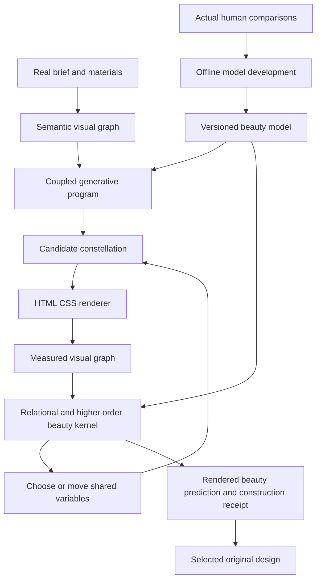

# Aphrodite HLD and LLD

## 1. Architecture and ownership

The primary executable is a beauty kernel plus a constructive generator. Observation supplies
the kernel's inputs. The compiler realizes its decisions. Tracking, schemas, accessibility and
delivery protect the work but do not substitute for its aesthetic intelligence.



The human-learning loop updates a new model version. It does not change the active scoring
model halfway through selecting a candidate. The runtime does not require a human verdict
for every output once a model's intended domain has been established.

The host model interprets the brief into proposed content/role relationships and can propose
topologies. The saved beauty kernel performs aesthetic selection. A host's natural-language
critique cannot silently change the score, threshold, targets or chosen output.

## 2. Reuse and replacement

| Earlier component | New role |
| --- | --- |
| Composition AST and native layout | Adopt the useful subset to express beauty constructors; extend only when a kernel requires it |
| Bounded partition and source mapping | Keep as lowering machinery, not a beauty definition |
| Actual-render observation | Keep and expand to the descriptors required by the first beauty laws |
| Dependency-aware revision | Drive it with a beauty prediction and shared-variable transformation |
| DPT reports | Optional mechanical annotation; never the beauty objective or its proxy label |
| J-class AI review | Hypothesis and explanation channel; no selection authority |
| Full 71-rule scaffold build | Superseded as the initial delivery sequence |
| Fresh-session packet | Carry the executable beauty model, constructor family and active graph, not only advice |
| Old all-gates admission policy | Preserve historically; replace for this program with staged model development and prospective tests |

The original files remain historical records. Their statement that no beauty score exists
does not govern Aphrodite. B_theta is an explicit beauty prediction used by the generator.

## 3. Proposed package and implementation choices

Recommended future home: `tools/agent-aphrodite/`. This is a proposed package/name, not installed
by this planning commission. Keep the first executable small enough to inspect directly.

```text
tools/agent-aphrodite/
  src/
    graph/           visual parts, roles, typed edges, void regions, hyperedges
    descriptors/     normalized geometry, type, paint, material and scale features
    beauty/          APH kernels, feature construction, model validation and scoring
    construct/       coupled variables, topology rules, admissible parameterization
    search/          joint proposals, local moves, continuation and selection
    render/          semantic HTML/CSS lowering and existing browse adapter
    evidence/        model/input/score/candidate lineage and exported proof scope
  models/            versioned parameter files and support records
  fit/               offline fitting and development analysis
  test/              analytic, adversarial and actual-render examples
```

Use Node ES modules for graph/kernel/construction/render integration so the loaded model is
portable to the existing JavaScript toolchain. Store fitted models as JSON. The offline fitter
may use the already evidenced Python scientific environment from the wild-hunt work; it is
not a dependency of a deployed fresh-session generator. Pin and verify actual versions at
implementation start. No new model service, database or graph-neural-network stack is required.

Use native browser layout and the existing `agent-do browse` control surface. Add measurement
capabilities through that owner when needed. Do not build another browser/auth harness.
The first prototype and later product must use the same kernel and constructor modules.

The public CLI and installation come after the first beauty demonstration. A module entry
can exercise the real engine before product packaging. No temporary scalar score is installed
into DPT to create the appearance of progress.

## 4. Wire contracts

UTF-8 JSON; finite numeric values; versioned schemas; exact IDs; relative artifact paths and
SHA-256 digests. Proposed schema validation follows the earlier plan's local validation
approach, but only the interfaces actually needed by the beauty kernel are built first.

```text
BeautyContext = {
  id, brief_ref, content_ref, asset_ref, role_graph_ref,
  intent: { task_priorities, expression_intentions, locked_choices },
  environments, required_function, model_support_request,
  author_sources, assumptions, copy_contract, variation_request?
}

VisualPart = {
  id, kind: text|image|control|shape|group|void,
  semantic_roles, content_ref?, asset_refs,
  observations: [{ condition_id, sample_id, descriptors, method_refs }],
  expansion_lineage, required
}

TypedRelation = {
  id, kind, subject_ids, semantic_source,
  applicable_channels, descriptor_refs, cue_contract_ref,
  scope, strength_origin
}

Constellation = {
  id, family_id, part_ids, relation_ids, arity_signature,
  joint_feature_ids, scope, eligible_weight
}

BeautyModel = {
  schema_version, id, content_digest,
  descriptor_spec_ref, law_catalog_ref,
  kernels: [{ id, descriptor_ids, target_modes, scale_or_covariance,
             mode_selection: maximum_affinity, provenance }],
  features: [{ id, law_id, operator, input_ids,
              normalization, eligible_domain, missing_policy }],
  coefficients: [{ feature_id, value, origin, fit_ref? }],
  constructor_catalog_ref, context_binding_ref,
  support_ref, emission_profile_ref,
  development_refs, evaluation_refs, known_failure_refs
}

GenerativeProgram = {
  id, model_digest, context_digest, topology,
  independent_variables: [{ id, value, domain, provenance }],
  derived_variables: [{ id, expression, dependencies }],
  parameter_blocks: [{ id, relation_system, x0?, nullspace_basis?, domain }],
  part_bindings, relation_bindings, constellation_bindings,
  state_and_reflow_variants, protected_content_ids,
  sampler_version, seed
}

BeautyEvaluation = {
  model_digest, context_digest, graph_digest, render_refs,
  status: measured|predicted_only|incomplete,
  total?, part_baseline?, pair_contribution?, configuration_contribution?,
  cross_scale_contribution?, conflict_contribution?,
  feature_rows: [{ id, value?, source_refs, known, reason? }],
  sensitivity_rows, missing_inputs,
  support_state, eligible_for_emission, decision_reasons
}

ConstructionReceipt = {
  program_digest, model_digest, context_digest,
  generated_from: { constructor_ids, independent_variables, seed },
  exact_relations, numerical_residuals, rendered_relations,
  beauty_evaluation_ref, emission_profile_ref,
  functional_check_refs, supported_conditions,
  claim: constructed_and_evaluated|exploration_only
}
```

`total` is absent when required feature input is unavailable. Incomplete candidates cannot
get a high score by dropping the inconvenient feature and renormalizing the remaining ones.
`predicted_only` means an analytic/pre-render estimate, never a verified actual-render value.

Hyperedge arity, eligible domains and normalization are fixed by the model/context binding.
They cannot be changed by a candidate to dilute a bad relation or inflate its score by adding
many copies of a good one. Regions and visual parts are determined before scoring by a
versioned semantic/visual extraction contract, not arbitrary raw DOM node counts.

Every target mode stores its source: derived construction, proposed hypothesis or fitted
development result. A candidate cannot submit new model coefficients as ordinary design variables.

## 5. Descriptor and cue registry

The initial registry has closed evaluator names and typed units. New evaluators require
implementation and independent falsifying examples. Project role names can remain open.

| Channel | Initial descriptors | Important distinction |
| --- | --- | --- |
| Geometry | Log ratios, relative edge residuals, normalized gaps, axis/order, enclosure, aspect, region centroids | CSS boxes differ from painted or perceived mass |
| Typography | Actual font identity/axes, line-fragment extents, size/measure/leading ratios, available face metrics | Font category alone is not a taste score; actual shaping affects fit |
| Paint | Resolved color channels, relative lightness/chroma/hue, composited contrast, border/surface relations | Unsupported complex paint is missing input, not guessed RGB |
| Material | Bound asset palette/crop, motif stroke/curvature, measured texture descriptors, depicted-subject annotations | Inferred content/material descriptors identify their adapter/source |
| Negative shape | Foreground union complement, connected clearance regions, adjacency, inner/outer spacing ratios | Background fill is not foreground occupancy |
| Semantic | Belongs-to, same-role, contrast, sequence, support, task priority, exception and cross-page correspondence | DOM parenthood supplies structure, not the whole semantic graph |
| Scale/state | Nested-region summaries, scale-space trajectory, role continuity across conditions | Different scale or viewport need not preserve identical pixels |

Cue contracts map each semantic relation kind to compatible channel patterns. A heading and
its paragraph are a standard diagnostic: same group, intentionally different role treatment.
A model that demands identical type because the two belong together fails the contract.
The same button role across distant groups is the complementary diagnostic.

Character descriptors enter the kernel through a bound context representation. The host may
propose “ceremonial”, “precise”, “playful” or other interpretations, but those words do not
magically define a numerical kernel. The context binder resolves them into declared expressive
relations, their descriptor targets or model modes, and provenance before generation begins.

Binding has a concrete order: resolve locked author choices; resolve supported relational
intentions against the model's mode catalog; select the eligible mode set; save its digest;
then construct candidates. Unknown intentions remain a proposed extension or an unresolved
input. The binder cannot create a new numerical target from each candidate's current values.
An expression such as “playful” has no numerical effect until this binding supplies one.

Content and interpretation have different types. The renderer accepts `ContentToken` values
from the real brief or its explicitly proposed copy, never `DesignRationale` or internal
symbolic readings. A brief's word budget applies to the counted proposed content, including
headings and controls. There is no universal word limit for every website, but an explicit
limit is enforceable and cannot be relaxed by the aesthetic search. This prevents the engine
from printing its design philosophy as product copy.

## 6. Kernel evaluation algorithm

```text
evaluate_beauty(model, context, rendered_graph):
    verify digests, schema, supported descriptor methods and domain
    preserve semantic visual-part identity and required content coverage
    resolve the fixed eligible relations/configurations
    compute dimensionless descriptors using their declared references
    evaluate typed cue affinities and compatible-mode maxima
    compute pair and higher-order features with fixed normalization
    compute region/scale continuity and declared conflict features
    if any required feature is unmeasured: return incomplete with exact inputs
    apply the frozen coefficient vector to the feature vector
    report total, non-additive contributions and sensitivities
    apply emission profile and functional prerequisites separately
```

The evaluator returns intermediate numeric values, not only a final score. Counterexample
debugging can therefore isolate a feature, an observation or its combination weight. Natural-
language explanations must refer to those quantities; they cannot replace a low computed
value with a confident adjective.

Use log-domain products/geometric means where needed, exact declared units, stable softplus
and deterministic arithmetic ordering. For diagonal kernels, each scale must be positive.
A full covariance must pass positive-definiteness validation. Missing arity/normalization,
illegal role references or nonfinite data fail before scoring.

## 7. Constructive generator and search

The generator explores topologies and low-dimensional joint variables, not independent CSS
properties. The context selects admissible role/relationship families; the host can propose
additional typed topologies inside those contracts.

### 7.1 Productions, rather than only an AST

The starting symbol is `Page(required_roles, conditions)`. Nonterminals carry role sets,
region boundaries, inherited joint variables and unfulfilled relationship obligations.
The initial production catalog is deliberately small and general:

| ID | Production | Choice and obligation |
| --- | --- | --- |
| GR-01 | `Page(S) -> Region(S)` | Establish the page field, coarse hierarchy and inherited material variables |
| GR-02 | `Region(S) -> Partition(Region(A), Region(B), axis, chord)` | Choose a nonempty role partition compatible with semantics; derive both regions and their separating void together |
| GR-03 | `Region(S) -> Sequence(Region(S1), ..., Region(Sn), trajectory)` | Expand a real ordered/repeated role set; derive intervals and developmental events from one trajectory |
| GR-04 | `Region(S) -> Cluster(Lead(L), Support(S-L), relation)` | Express a lead/support relation through coupled size, position and treatment; no assumption that the lead is always a headline |
| GR-05 | `Region(S) -> Field(surface, Anchor(A), Satellites(S-A))` | Arrange related parts around an anchor with explicit counterweight and clearance relations |
| GR-06 | `Region(S) -> Overlay(Base(A), Foreground(S-A), coupling)` | Bind visual overlap, separation, contrast and task access; allowed only when the content/state supports it |
| GR-07 | `Role(r) -> Terminal(r)` | Resolve text, image, control or shape from actual content and behavior; no invented replacement of required information |
| GR-08 | `Treatment(identity, roles) -> SharedFrame(identity, role_variants)` | Derive type, paint, spacing and material differences from joint variables instead of picking independent tokens |
| GR-09 | `ConditionVariant(G) -> Reflow(G, role_correspondence, chord')` | Construct the alternate state/viewport without losing semantic parts; preserve or coherently transition their relations |

Production applicability follows semantic obligations and capability bounds, not site names.
Every spatial expansion strictly reduces the unexpanded role set or consumes a declared
finite structural-depth allowance. GR-08 applies once per frame scope; GR-09 applies once
per declared condition. Together these rules bound recursion and prevent empty-region or
decoration loops. Decoration is an explicitly bound optional asset/role, not a source of
unlimited new scoring nodes.

For each applicable production, enumerate admissible role partitions/orderings using stable
role IDs and the derivation budget. A connected semantic group can remain intact or be split
only by a production that carries its cross-region relationship. Use a bounded beam, retaining
several non-isomorphic graph structures and compatible material modes. Score incomplete
derivations only with a labeled heuristic; they cannot receive an emission beauty score.
Complete candidates are rendered and selected by B. A host proposal is an optional additional
derivation, not the only way a graph comes into existence.

An example derivation is `Page -> Region -> Partition(Cluster, Sequence) -> terminals`.
The same role graph can also derive `Field(Anchor, Satellites)` when its obligations permit.
These are generated structures. They are not twelve saved page templates with new nouns.

### 7.2 Search and selection

```text
generate(context, frozen_model, budgets):
    bind real content/assets, semantic relationships and model modes
    expand Page through applicable GR productions using a bounded diverse beam
    optionally admit additional well-typed host-proposed derivations
    for each proposal:
        instantiate shared-variable constructors
        solve exact relation blocks and restrict independent-variable domains
        generate deterministic seed proposals in those domains
        lower and render through the existing browser interface
        score the observed graph with evaluate_beauty
        propose coupled moves from feature sensitivity and constructor coordinates
        render/re-evaluate each accepted successor without changing the model
    retain eligible outputs and the best unresolved explorations separately
    select by the fixed beauty objective and declared task constraints
    export only with the appropriate construction/evaluation claim
```

The seed stream is keyed by `(model_digest, context_digest, seed, production_path, choice_id)`.
It controls production alternatives, partition choices, mode choices and joint parameters.
Choice IDs are semantic and stable across unrelated source edits. Seed replay reproduces
the derivation/program; a browser/font/environment change is a new render measurement.

Variation has a mechanism beyond recording sameness. Keep a local archive of accepted
derivation signatures: role adjacency, nesting, emphasis order, rhythm and material-mode
relationships, excluding site identity and copy. For a requested distinct variant, first
retain candidates above the beauty threshold and within a declared beauty tolerance of the
best eligible candidate. Then choose a candidate satisfying the requested structural distance
from that archive, using B to break ties. Structural distance is a diversity constraint,
not a positive term that makes bizarre output count as beautiful.

Distance features, tolerance and minimum distance are frozen in the variation request before
search. If no distinct candidate exists within the budget/beauty region, report that result.
Changing a random seed never guarantees a new topology. Repeated-task briefs can explicitly
request family continuity instead. The archive uses the run artifacts, not another service.

Use analytic derivatives for supported kernel/construction expressions. Browser layout can
be discontinuous, so gradient information proposes a move; actual rendering decides its
effect. A deterministic bounded pattern search over joint coordinates supplies a simple
first solver. Step sizes and work budgets are explicit engineering parameters; halving a
search step is an algorithm choice, not a preferred visual proportion.

Evaluate every required condition, rather than averaging away an unsuccessful mobile view.
When a calibrated emission profile supplies per-condition thresholds and positive comparison
scales, search can maximize the minimum normalized margin `(B_q-tau_q)/scale_q`, then use
mean margin to break ties. These scales and thresholds are bound before search. An exploratory
uncalibrated run uses its declared comparison objective and remains an exploration; it cannot
claim a release-calibrated result. Cross-condition continuity is an additional APH-09 feature.

Topology changes are graph rewrites that preserve required content/action membership and
establish a new relation block. They can change the number and arrangement of regions without
copying a pinned page. A local optimum is labeled as such, not a proof that no more beautiful
design exists. Keep several compatible modes when they produce materially different original
designs; a novelty bonus is not required to preserve those choices.

Seeds reproduce the same independent choices under the same versions. Different seeds permit
different designs; they do not guarantee unique outputs in a finite candidate domain. Do not
add random decoration merely to ensure a different hash.

## 8. Beauty-preserving transformations

There are three levels of transformation evidence:

1. **Exact construction:** algebra proves the named relation remains true, such as `C*x=d`.
2. **Bounded numerical construction:** the solver verifies the relation residual over the
   declared parameter domain with its numeric tolerance and explicit limitations.
3. **Observed preservation:** the actual renderer and beauty kernel verify the successor
   under required conditions. This is required whenever content, typography or paint changes.

A transformation receipt says which level applies to each obligation. An algebraic proof
about ratios cannot certify the optical appearance of a new font. Conversely, uncertainty
about optical appearance does not erase an exact proven relationship. The beauty model
consumes both channels with their correct support status.

The state dependency graph includes the joint factors, not only layout measurements. Changing
a palette can invalidate material resonance and a heading/image constellation even when no
DOM box moved. Changing a region's scale can affect its neighbors' beauty contribution as
well as its own. This is the whole acting back on the part in executable form.

## 9. Model development interface

```text
fit_model(feature_differences, preference_groups, prior_model, fit_spec)
  -> proposed_model, fit_diagnostics, identifiable_parameters, development_results

compare_models(models, fixed_generation_inputs, evaluation_protocol)
  -> additive_vs_pair_vs_joint_results, human_verdicts, coverage_and_cost

adopt_model(proposed_model, acceptance_record)
  -> immutable runtime_model_version
```

Fitting never rewrites historic measurements/labels. Model adoption is distinct from a fit
finishing. A supported model can be replaced when better evidence warrants it, with prior
versions and known failures retained. A future host can load the exact old model to reproduce
a generation even after learning has advanced.

The implementation should expose `describe`, `compose`, `vary`, `evaluate` and `export` in
its internal module API before designing a public CLI. Packaging later adds the normal
agent-do discovery/contracts surface; those new public verbs are not created in this plan.

## 10. Fresh-session experience

A fresh capable session gets a brief, the executable model version, constructor vocabulary,
asset/content bindings and a small entry protocol. It asks the core to compose, inspects the
actual rendered candidates and the computed relational values, and requests joint variations.
It does not invent a new aesthetic rulebook from its training every time it starts.

Human feedback, when given, is recorded for model development. The generation can proceed
autonomously within the established model/support domain. A host cannot substitute its own
favorite because it dislikes the kernel's chosen candidate. It can preserve that disagreement
as a future test case rather than becoming the hidden judge.

The first product supports ordinary semantic HTML/CSS pages with declared state and responsive
conditions. Existing application actions stay bound to their real owners. Rich imagery and
illustration are substantive model inputs; they are not deferred to an optional polish pass.
Unobserved canvas/opaque content needs an adapter before its aesthetic relationships are claimed.

## 11. Storage and failure behavior

Use immutable local artifacts under the author project's `.dev/aphrodite/` and approved model/
program files under `.aphrodite/`. Existing Manna/coord own task and writer state; no second
tracker or model-service daemon is introduced.

Record context/model/program hashes, measurement method versions, chosen z, generated source,
render references, score decomposition and selection outcome. A failed run retains its best
exploration and the missing input or unsatisfied relationship. Refusing everything is measured
as lack of generation coverage, not advertised as a perfect beauty success rate.

Required errors include missing real content/asset, unsupported descriptor, unresolved semantics,
invalid covariance, unbound model target, changed model during search, impossible construction,
search budget exhaustion, incomplete render, stale score and no eligible output. They identify
the next repair in the intended path. No unrelated DPT number is used as a fallback beauty score.

No publishing, account action or remote transaction is implied by design generation. The
compiler escapes content and admits only supported markup/style/state constructors. This
operational boundary is necessary machinery, not the heart of the beauty theory.
