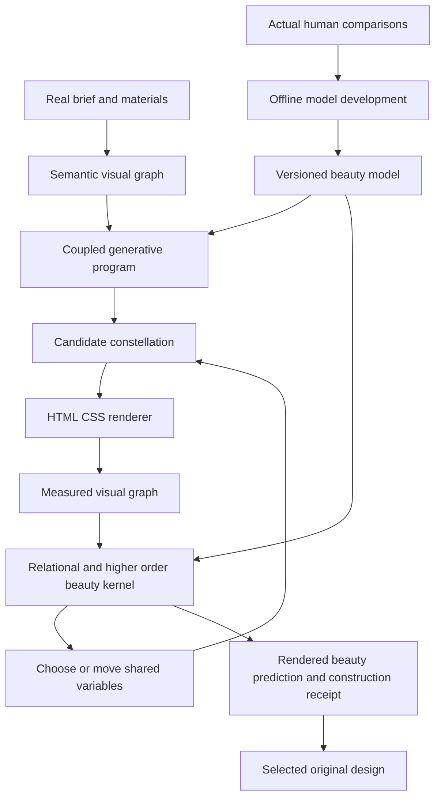

# Aphrodite: the complete design for a generative beauty engine

Corrected planning commission `mn-eafd32`, 2026-09-14. This replaces the earlier plan's
product objective and implementation order. It specifies future implementation and stops
before building the engine.

Aphrodite makes relational beauty a mathematical objective: meaningful nodes, typed
relationships, higher-order configurations, and shared variables that generate their
geometry, typography, color and material together. Its saved model chooses among actual
renders. Human preferences develop that model; an AI critic does not replace it.

1. [The mathematics](#chapter-01)
2. [Evidence and learning](#chapter-02)
3. [HLD and LLD](#chapter-03)
4. [Build and evaluation](#chapter-04)
5. [Worked synergy](#chapter-05)

Source and delivery receipts accompany this book in the package. The mathematical examples
are proposed-model fixtures, not claimed human-validation results.

---

<a id="chapter-01"></a>

## The mathematics of Aphrodite

Status: executable mathematical design for a proposed beauty model. The equations define what
to implement and test. Their connection to human appreciation is a development objective,
not a result already obtained by writing the equations.

### 1. The first principles

1. **Beauty belongs to configurations.** A typeface, color or rectangle has no context-free
   beauty value sufficient to determine the value of its placement in a page.
2. **Unity needs distinction.** Parts can belong to the same whole while doing different jobs.
   Perfect sameness and arbitrary variety are different ways to lose that relationship.
3. **Relationships have kinds.** Belonging, contrast, repetition, support, sequence and exception
   do not demand the same geometry or styling. Agreement sometimes requires difference.
4. **The whole acts back on the part.** A local choice changes its neighbors, the region and
   the page. A beautiful transformation must preserve or deliberately recompute those bonds.
5. **Beauty can be operationalized as a predictive generative model.** Its variables and
   interactions must produce testable rankings and constructive changes, not only prose.

These are chosen foundations for the instrument. They direct mathematical work toward beauty
instead of pretending that validity checks have already solved it.

### 2. The object being composed

Let `G = (V, E, H, R)` be an attributed visual hypergraph.

- `V`: semantic visual parts, including explicit empty regions. Text fragments belong to a
  meaningful text object; arbitrary DOM wrappers are not additional aesthetic parts.
- `E`: typed pair relationships, each with a scope and measurable descriptors.
- `H`: configurations involving three or more parts, or jointly binding several relationship
  channels. Examples include a heading/body/image constellation and a repeated sequence
  whose interruption announces a different task.
- `R`: nested perceptual/semantic regions and the page, with cross-region correspondences.

An element has geometry, type/paint/material descriptors, content role and observed visual
features. A relation can carry dimensionless separation, log size ratio, shared-edge residual,
relative hue/lightness, stroke relationships, direction, recurrence phase and semantic role
correspondence. Unsupported observations are marked unknown rather than numerically zero.

The context `c` contains the real content, tasks, brand constraints, intended character and
supported conditions. Character is a continuous/structured set of choices, not one of six
site classes. The reference names are not features available to the beauty evaluator.

The graph includes the **negative shape**: the space between groups, its connected passages,
and its relation to the foreground. Background color filling the screen does not erase that
space. The foreground and its surrounding field are composed together.

### 3. A concrete beauty functional

For a fixed context and model version, define a feature vector from the actual composition:

```text
F(G,c) = [local relational qualities,
          pair compatibility qualities,
          higher-order configuration qualities,
          continuity across regions and scales,
          unresolved relational conflicts]

B_theta(G | c) = theta^T F(G,c)
```

The final dot product is an interpretable combiner. **Its features are nonlinear relational
functions**, including products and configuration residuals. This is not a sum of independent
font, color and spacing grades. A linear combiner of nonlinear joint features is a nonlinear
model of the original page variables.

For clarity, its decomposition is:

```text
B_theta = B_parts + B_pairs + B_configurations + B_cross_scale - B_conflicts
```

`B_parts` is an explicit additive baseline retained for comparison. It contains contextual
material/role suitability, never a universal ranking of typefaces or colors. The product must
demonstrate useful gain from the other terms over this baseline. A model that learns all
configuration weights as zero has not fulfilled this design's central objective.

Every feature is aggregated over a declared eligible set with normalized weights. Region
weights sum to one within their level; relationship weights sum to one within their family.
An empty eligible set is inapplicable, not a perfect score. Required content missing from the
graph makes the composition ineligible. Cloning wrappers or redundant nodes cannot increase B.

Different briefs need not share an absolute beauty-number scale. B ranks alternatives under
the same bound context/model. Cross-context calibration is a separate learned capability.
The UI may show relational contributions and predictions without inventing a universal 0–100.

### 4. The compatibility kernel

For a relation descriptor vector `r`, use a contextual target `mu` and positive-definite
covariance `Sigma`:

```text
K(r; mu, Sigma) = exp(-0.5 * (r-mu)^T inverse(Sigma) * (r-mu))
```

K is a smooth affinity in `(0,1]`. It rewards the intended relationship, not maximal magnitude.
A contrast relationship has a nonzero target; an equality relationship has zero residual.
Circular angles use a wrapped circular distance, not linear subtraction across 0/360.
Invalid or unknown input does not evaluate to zero affinity; it remains unmeasured.

For more than one compatible arrangement, use a finite set of compatibility modes:

```text
K_family(r | c) = max_m K(r; mu_m(c), Sigma_m(c))
```

The family can represent several harmonic arrangements. It must not average two distinct
good arrangements into one mediocre midpoint. These are **relationship modes**, not stored
site layouts. Mode count is fixed before evaluation and penalized/selected during development
to prevent a separate perfect mode for every specimen. A generation prior over modes is
separate from beauty affinity: popularity or corpus frequency is not a beauty reward.
Their parameters omit site identity and are supported by explicit measurements,
authored mathematical proposals or learned preferences. No covariance or mode family is estimated
from too few examples and then called measured fact.

An initial diagonal covariance uses declared per-descriptor scales. A full covariance is an
optional learned successor only when the data support its additional parameters. The model
record identifies which values were proposed, derived or fitted.

### 5. The beauty-law catalog

Each law below defines a feature family and a generative action. These are the core of
Aphrodite. Mechanical accessibility, transport and schema checks remain supporting constraints.

#### APH-01: relational consonance

**Claim to develop:** a coherent page makes its different visual channels tell compatible
stories about the same relationships.

For each semantic relation e, a **typed cue contract** predicts appropriate geometric, type,
paint and material cues. Compute channel affinities `k_e,g`, `k_e,t`, `k_e,p`, `k_e,m` against
that contract. Applicable channels form a joint affinity using their product or weighted
geometric mean, with its definition fixed in the model.

`belongs_to` may use proximity or enclosure while allowing different heading/body typography.
`same_role` may call for repeated typography across distant sections without spatial proximity.
`contrasts_with` may call for deliberate differences. Therefore the three original trees are
repaired into **typed relational correspondence**, not three partitions forced to be identical.

Generator action: choose a relationship, then derive its coordinated cues. Repair a broken
cue by moving the related choices together. Never score semantic truth from DOM nesting alone.

#### APH-02: differentiated unity

**Claim to develop:** distinct roles become stronger when their differences belong to a common
system. Unity without differentiation becomes cloning; difference without unity becomes noise.

Let U be affinity to shared identity relations. Let D be affinity to **role-appropriate
distinctions**, not the raw amount of variation. Define the feature `Q_UD = U*D`.
Its mixed derivative with respect to U and D is 1: their joint payoff cannot be represented
as independent functions of U and D. The model weight sets its learned influence on B.

Generator action: bind a shared material/type/spacing identity, then derive distinct treatments
for roles inside that identity. A dense illustrated page and a spare textual page can both
have high U and D. There is no requirement for a particular amount of decoration.

#### APH-03: proportion as a shared chord

**Claim to develop:** related proportions across several channels create a stronger order
than independently reasonable dimensions.

A chord is a small latent vector z and a declared map into dimensions:

```text
log(s_i / u) = a_i^T z + b_i + epsilon_i
```

`u` is a positive scale reference. The rows `a_i`, offsets and tolerances belong to a bound
relation program, not a free parameter per element fitted after rendering. The mapped values
can include display/body measures, group spacing, image proportions and internal boundaries.
The affinity is the residual of the selected correspondence after removing permitted overall
scale. Absolute task/legibility constraints are checked separately.

This need not use integer harmonic ratios or the golden ratio. If integer-note progressions
are used, note assignments and their finite range are fixed before the fit. Otherwise any
dimensions could obtain a perfect score by inventing a bespoke chord.

Generator action: change z once and recompute all bound dimensions. Feasible responsive
constructions preserve the chord or make an explicit coherent transition to another one.

#### APH-04: figure and ground as reciprocal shapes

**Claim to develop:** a composition's occupied and empty regions strengthen each other.

Construct the foreground graph and its clearance-region adjacency graph. Measure ordered
ratios of inner/outer gaps, connected clearances, enclosure, alignment of passages and
foreground boundaries. Evaluate contextual kernels over these descriptors. There is no
global reward for more empty area or fewer nodes.

The joint feature couples a foreground grouping affinity with its supporting clearance
affinity: `Q_FG = K_foreground * K_ground`. A pleasing outline with clogged internal space,
or attractive emptiness around meaningless content, loses the joint benefit.

Generator action: a new cluster consumes and reshapes specific empty regions; spacing changes
recompute both graphs. Background surface, geometric void and perceptual negative shape
remain distinct observation channels.

#### APH-05: counterpoint and hierarchy

**Claim to develop:** attention is organized by purposeful differences and counterweights,
not by maximizing one focal point or making every region equally strong.

The context specifies priority relations, including equal-priority comparisons. The observer
supplies declared salience descriptors or a pinned perceptual adapter. Affinities compare
relative emphasis, spatial counterweight and task order with the chosen hierarchy. Optical
mass estimates carry the adapter version; rectangle area is only a geometric baseline.

Tension uses a smooth target affinity for the intended difference. Too little and too much
can both lose affinity. A nonzero target can reward asymmetric balance and strong contrast.
No monotonic “more contrast”, “more symmetry” or “more uniqueness” reward is present.

Generator action: change the lead/support relationship jointly through position, measure,
type, field or material. Multiple foci remain possible when the task requires them.

#### APH-06: recurrence, development and resolution

**Claim to develop:** recognizable relationships can develop across a page without either
mechanical repetition or unrelated changes from section to section.

Represent each recurring role's descriptor trajectory as `y_0,...,y_n`. The composition program
binds intended changes `d_k` to semantic transitions. A continuity residual is
`sum_k ||(y_(k+1)-y_k)-d_k||^2`, evaluated with typed scales and normalized eligible weights.
An interruption is a declared developmental event, not an automatically penalized deviation.

A sequence that repeats perfectly can still serve a comparison task. A narrative may require
different d values. Generator action: vary the shared trajectory, then derive local states.
The target trajectory cannot be rewritten to match every observed accident after the fact.

#### APH-07: material and meaning resonance

**Claim to develop:** geometry, type, color, texture and depicted material become more beautiful
when their expressive relationships reinforce the subject and one another.

Use measurable descriptor channels where possible: type width/x-height/stroke contrast,
surface lightness/chroma, motif curvature/stroke, image palette/crop, texture frequency and
geometric density. Symbolic/semantic descriptors may be supplied by an attributed host or
pinned model adapter, but the beauty weights and evaluation kernels are saved mathematical
objects. A free-form critic does not turn its opinion into the score.

Evaluate joint affinities over these descriptors conditioned on the chosen intention and
real material. Literal similarity is one possible relation; a deliberate complementary
contrast is another. A strong graphic frame around soft photography may be a compatible mode.

Generator action: move a shared character variable through several channels at once. Color
is not an independent finishing pass after geometry. A richer palette or expressive type
can require a different spacing, surface and hierarchy solution.

#### APH-08: higher-order constellation

**Claim to develop:** some aesthetic value exists only when several relationships hold together.

For a declared configuration h with applicable affinity values k, define a feature:

```text
Psi_h = product_e_in_h k_e
```

An optional configuration descriptor can also have its own multivariate kernel. Its scope,
normalization and relation count are fixed in the model. Do not compare raw products of
arbitrarily different numbers of factors as though their scales were equal. Configuration
families have separate normalization or a fixed-arity signature.

Use products for explicit conjunction benefit; use geometric means for scale-comparable
affinity summaries. They are different features and must not be silently substituted.
Compute in log space when necessary, preserving exact zero and underflow policy.

For three independently manipulated relational qualities g,t,c, the term `gamma*g*t*c`
has a nonzero mixed finite difference. It provides the mathematical place where the whole
can gain something no isolated node receives. Chapter 5 calculates an example.

Generator action: optimize or construct a whole constellation. A step that improves one
relationship while destroying the others can reduce the joint value even if that local
relationship becomes individually stronger.

#### APH-09: coherence across scale and viewpoint

**Claim to develop:** a strong composition retains useful organization at page, section,
component and text-detail scales, while allowing different information at each scale.

Use a region hierarchy plus rendered scale-space descriptors. Correspondences preserve
which groups and priorities should remain visible at each scale; local detail may disappear.
Use contextual trajectory kernels, not a universal blur slope or a flat acceptable interval.

Generator action: adjust the coarse composition and its fine relations together. Squint
measurements become an input to this family, not a standalone verdict about beauty.
Viewport transformations also rebind the appropriate hierarchy; pixel identity is unnecessary.

### 6. Constructing beauty rather than appending a score

A generator `Gamma_c` maps a small set of independent variables z into a full composition:

```text
G = Gamma_c(z; theta)
M_c = { Gamma_c(z;theta) : z in Z_c and construction constraints hold }
```

The controls in z describe joint decisions: a proportional chord, hierarchy, density strategy,
material inflection or rhythm development. They do not expose every CSS property as an
independent aesthetic dial. Constructors expand these decisions through the relation graph.

For a linear log-dimension relation `C*x=d`, parameterize `x=x0+N*z`, where columns of N
span C's null space. Then `C*x=d` holds for every z in the admitted domain. Exponentiation
recovers positive dimensions; bounds restrict z. This is an exact example of a constructive
guarantee. Nonlinear/color/state relationships use their declared coupled constructors and
post-render checks rather than an unsupported claim of a global analytic solution.

The emitted set is:

```text
E_c = { G in M_c : required content/function holds,
                  actual-render B_theta(G|c) >= tau_c,
                  required model/observation support is present }
```

For several required conditions q, apply the beauty/support requirement to each
`B_theta(G_q|c_q) >= tau_q`. A high desktop value cannot compensate for a missing or poor
required narrow layout. Cross-condition relationships also contribute to APH-09.

`tau_c` is calibrated or explicitly selected for a declared context/support domain. It is not
the historical all-corpus kill threshold. Exploration can inspect lower-scoring and unsupported
proposals with their status; it cannot stamp them as belonging to E_c. The model, thresholds,
cue contracts and parameter domains are fixed before the candidate is optimized. Otherwise
the generator could make every candidate pass by moving its own target.

This is the engineering meaning of “cannot build anything but beauty”: the ordinary generation
path emits only compositions constructed within, and verified against, its beauty model.
Calling that model an adequate account of human beauty requires evidence. A mathematical
membership proof cannot by itself guarantee everyone's response to every possible future
brief. The research and build must earn a broad reliable domain instead of abandoning the
ambition or presenting a circular definition as a discovery.

### 7. Required invariances and anti-degeneracy

The beauty representation must be invariant to DOM wrapper insertion, source-code minification,
stable ID renaming and unpainted metadata. Appropriate dimensionless relationships survive
uniform geometric scaling while absolute usability obligations remain separate. Empty content,
duplicated boxes, invisible text and independently reset per-node targets cannot manufacture
high scores. More relationships do not mean more beauty unless the declared eligible structure
actually changes meaningfully.

Repeated components share parameters but retain their genuine content differences. A new
image, font or language changes the measured graph and can require a different z or constructor.
The engine predicts the resulting beauty gain or loss, constructs a repair, and recomputes
it on the render. It does not merely ask a reviewer to invent a replacement verdict.

### 8. Mathematical provenance

The architectural analogy to Aldebaran is specific: preserve measured relationships in a
record and apply named, versioned interpretive rules without rewriting those observations.
The live `../aldebaran-group/ORCHESTRATOR-MAP.md`, especially sections 0 and 3, is the entry
source for that split. Aphrodite adds a numerical beauty model and a generative inverse:
instead of only reading a given configuration, it constructs a configuration that satisfies
and strengthens the desired relationships. No astronomical doctrine or estate acceptance
gate is imported as a law of visual beauty.

Shape grammars supply a precedent for generating families from structural and material
relationships; they do not already solve this website beauty model.
[Stiny and Gips, author-posted paper](https://www.researchgate.net/publication/221329330_%27Shape_Grammars_and_the_Generative_Specification_of_Painting_and_Sculpture%27).

The distinction between redundant and synergistic information has a formal information-theory
literature. Aphrodite's mixed differences are explicit model interaction tests; they are not
claimed to be a partial-information decomposition or a measured neural-complexity quantity.
[Williams and Beer](https://arxiv.org/abs/1004.2515).

The proposed kernels, feature decomposition, typed correspondence repair and constructive
parameterization above are the implementation design here. Their empirical authority comes
from the development/evaluation program specified next, not from borrowing a theorem's name.

---

<a id="chapter-02"></a>

## Development evidence and learning the beauty model

### 1. Read the measurements independently of the admission labels

The original screen asked whether each particular scalar implementation could clear every
registered gate on a very small, heterogeneous corpus. Aphrodite asks which measured
relationships help predict and construct beauty, and how their interactions can improve.
The historic files remain unchanged. This is a new interpretation and development program.

The exact extracted values and comparison identities are in
[HISTORICAL-EVIDENCE.json](HISTORICAL-EVIDENCE.json). The source is
`corpus/design-research/wildhunt-verify/scores.json`, with its hash recorded there.

| Measurement | Observed result | Development use |
| --- | --- | --- |
| Three Trees | 8/10 preference pairs; 5/5 predeclared nonconditional comparisons; both Null traps pass | Strongest measured starting clue for APH-01. Repair the semantic representation and typed cross-channel correspondence. Preserve its two Library 3 misses as development cases. |
| Three Trees fixture order | Both canons above both negative fixtures; smallest gap 0.0017967146, below the registered 0.05 margin | Positive ordering and weak separation coexist. Learn where the relation is informative; do not describe this as reversed ordering. |
| Three Trees pin coverage | Historic pin DOMs unavailable, hence the pin gate incomplete | Missing measurement is not evidence of aesthetic incompatibility. Obtain matched evidence in future work; do not substitute modern DOMs into old images. |
| Size chord | 6/10 pairs, 1/5 nonconditional; one Null trap fails | Shared proportions are an ingredient to test in APH-03, not a proven sufficient ordering. Condition on semantic roles and couple channels. |
| Raster self-teaching | 6/10 pairs, 2/5 nonconditional; broken fixture outranks both canons | Reuse/compression alone does not identify coherent beauty. Measure purposeful recurrence and distinct roles, not just compressibility. |
| HTML self-teaching | 5/10 pairs, 1/5 nonconditional; both Null traps fail | Code representation can disagree with appearance. It is not an aesthetic source of truth. |
| Raw squint | 2/10 pairs; all four fixture orderings positive but below the 0.01 margin | Useful coarse-structure observations need a better contextual objective. A single slope loses configuration detail. |
| Banded squint | Fixtures, Null traps and four available pins pass; only 1/10 strict pair wins, many ties | A flat admissible band erases useful ordering. Prefer smooth contextual affinities and keep actual joint comparisons. |
| TSE feature covariance | 2/10 pairs; white image 2.406769, above both canons | Replace the image-to-random-variable mapping. Do not call descriptor covariance the functional integration of a design. APH-02 uses explicit role unity and distinction. |
| Emphasis transport | 1/10 pairs; task importance proxied by area/headings | Better semantics and perceptual inputs are needed before transport can express desired hierarchy. Transport math alone does not supply the correct target. |
| Loom rank | 3/10 pairs; both Null traps fail | Low dimensionality of a coarse layout descriptor is insufficient. Shared parameters must correspond to actual roles and visual relationships. |
| Other bands | Banded TSE 2/10; banded raster self-teaching 4/10 | Wrapping a weak feature in a pins-fitted interval does not resolve its mapping or missing interactions. |

The pairs span four feedback groups and reuse preferred specimens. They are not ten independent
randomized trials, and the nonconditional subset is a smaller disclosed subset, not a substitute
denominator chosen to claim victory. These facts limit inference; they do not erase the signal
worth developing.

For the first step of the original eleven-test Holm family, 8/10 gives raw p=0.0546875 and
adjusted p=0.6015625; 9/10 gives 0.0107421875 and 0.1181640625; 10/10 gives 0.0009765625 and
0.0107421875. Thus even 9/10 would not clear that first family threshold. The screen was
not logically impossible for every measure, but it demanded near-perfect ranking for this
sample and asked DOM measures to clear unavailable evidence. It was unsuitable as a blanket
decision to stop developing mathematical beauty.

### 2. What changes now

Historical failures become localized counterexamples: a mapping to repair, a relation that
needs conditioning, a deceptive control, an inappropriate scalar reduction, or missing
evidence. A new model is allowed to use old outcomes for development. It cannot then call
those same outcomes independent proof of the new model.

We will not salvage every formula indiscriminately. The white-image covariance result is a
real mapping problem, not merely a harsh p-value. Three Trees' two misses are real misses.
The correction is to use all of this evidence productively, including the parts that resist
the current theory, rather than treating the old binary label as a final theorem.

The twenty untested named candidates remain possible sources of feature/construction ideas.
They are not required dependencies for the first kernel. Phase congruency, second-order
deviations, voice-leading, whitespace connectivity and dimensionless groups fit specific
new feature families. Ricci curvature, sheaf cohomology, persistent homology and assembly
indices need a precise meaningful mapping before their mathematical names earn a place in
the runtime. The raw hunt remains an idea register, not an already measured law book.

### 3. The minimum learning representation

Keep the first model small and interpretable. Do not train a large graph neural network from
twelve site approvals and a handful of reused comparisons. Use the explicit APH features and
their interaction terms, with regularized coefficients. Initial kernel targets can be
mathematical constructions or declared design hypotheses; fitted targets need actual evidence.

Each feature parameter is one of:

- **Derived:** coordinate normalization, ratio identities, an exact shared-parameter relation.
- **Proposed:** a testable affinity shape, contextual mode, tolerance or coefficient prior.
- **Estimated:** a parameter fitted on a named development partition with its procedure.

Proposed is a legitimate state for a new beauty hypothesis. It must be implemented and
tested, not used as an excuse to leave the beauty seat empty. It is also not relabeled as
human-discovered truth merely because the kernel always rewards its own definition.

Context conditioning starts with explicit semantic relation types and measured role descriptors.
The model may include shared and contextual coefficients with shrinkage toward the shared
ones. It must not use pin IDs, business names, page URLs or a six-register lookup to memorize
the training examples. Supported context distinctions describe actual design obligations,
such as comparison versus narrative or an image's role, rather than the reference identity.

### 4. Pairwise learning objective

For development comparisons a preferred to b under context c:

```text
delta = B_theta(a|c) - B_theta(b|c)
P_theta(a preferred to b | c) = sigmoid(delta)
L(theta) = weighted_mean(log(1 + exp(-delta)))
           + lambda * ||theta - theta_prior||^2
```

Use stable softplus arithmetic. Weight comparison groups so one repeatedly compared winner
does not dominate merely because it appears in more rows. The group-weighting rule and
regularization selection are written before the new fit. Conditional verdicts retain their
conditions; incompatible conditions do not create an unconditional pair.

Constrain affinity coefficients to be nonnegative and conflict penalty magnitudes to be
nonnegative. Zero is allowed and informative. Revise a failed feature definition explicitly
instead of silently inverting the meaning of a named beauty law through a negative weight.

Ties require a declared ordinal/tie likelihood or a separately reported tie analysis. Silence
is not a tie or rejection. “Neither is good” is an absolute appraisal alongside the relative
choice. Do not invent decimal preference targets from qualitative remarks.

With very little independent information, estimate fewer coefficients or freeze some at
documented priors. Report the rank and conditioning of the actual feature-difference matrix.
There is no valid rule that every proposed parameter becomes statistically identified just
because an optimizer returns a vector. Keep the support diagnostic attached to the model.

Prefer normalized feature scales whose values have meaning. Fit one normalization on the
development data and retain it. Do not normalize separately on each candidate pair, which
could manufacture a favorable difference or erase cross-comparison interpretation.

### 5. Learning ingredients and joint effects

Whole-site approvals tell us that those particular complete configurations are acceptable.
They do not tell us that every detail is optimal or that every random recombination of their
parts is good. Extract actual relational descriptors from matched observation, then propose
families that could generate those relationships without copying their concrete pages.

Use three complementary development sources:

1. **Existing preferences:** initial directional evidence and known traps.
2. **Controlled reconstructions and rewrites:** same content/assets with specific relational
   changes. These supply interventions, not automatic disliked labels.
3. **New original briefs:** the main measure of whether the instrument creates beauty outside
   its examples. Freeze a model before each judged development batch.

Interventions distinguish a poor feature from a poor mapping. For example, repair Three Trees
with a semantic relation graph; compare that repair with the old DOM-partition proxy on the
same observed material, then compare generated outputs from both objectives. A relationship
that helps generation can be valuable even if it never perfectly orders every historic pin.

For emergent beauty, compare the full model against an additive parts model and a pair-only
model with matched inputs and work budgets. The higher-order terms must contribute a useful
predictive or generative improvement. A positive coefficient or a nonzero derivative is
mathematical interaction, not by itself human-validated synergy.

### 6. Calibration for construction

Learn or explicitly choose the supported high-affinity region of each joint family. Keep
separate modes when the data show different viable relationships. Smooth kernels preserve
rank information within modes; unlike the prior flat bands, they do not assign every point
inside a broad interval the same value.

Calibrate emission threshold tau for a declared model/context domain using actual outcomes.
Track both acceptance and coverage: always refusing to emit can produce no ugly outputs
while producing no useful instrument. A narrow safe-looking support region that yields
near-identical sites also misses the product objective.

The first uncalibrated implementation is a beauty hypothesis demonstrator. It still generates
and ranks with B, rather than delegating the score to a critic. A production claim requires
the observed quality, breadth and failure behavior promised by its launch profile. No rate
or success percentage is invented in this planning document.

### 7. Evaluation that develops rather than destroys the program

Use the historical material openly for development. Reserve genuinely new briefs and outputs
for prospective checks. A reference-site retrieval holdout tests dependence on supplied
references; it does not erase a general model's prior exposure to a famous site.

Track, separately: useful absolute appraisals, relative preference, difference from additive
and pair-only models, required task access, supported expressive range, unsuccessful attempts,
refusals and generation cost. Failure diagnoses the specific kernel/constructor/context. The
whole project is not rejected because every metric does not simultaneously win every test.

Hard corruption remains hard corruption: wrong labels, inaccessible required actions, a score
derived from unobserved paint, changed targets after optimization, or a leaked reference asset
must be fixed. This protects the signal without turning a promising 8/10 into “nothing here”.

Formal statistical claims, if later requested, need a sufficiently informative prospective
design and declared analysis. Development selection can proceed from meaningful controlled
improvements while reporting its small sample honestly. No requirement for p<0.05 on every
tiny iteration is part of Aphrodite.

### 8. Human and model roles

Erik's verdicts supply the intended appreciation signal. A trained, versioned mathematical
beauty model uses those signals to select new designs without requiring him to approve every
generation. This is the transfer of taste the product is meant to achieve.

The host AI may describe content, supply hypotheses, suggest graph changes and explain
evidence. Its free-form “this is beautiful” is not a ground-truth label or a hidden selection
override. A learned perceptual adapter is allowed only as a named, versioned model component
tested against the same human signal; calling it mathematical does not exempt it from the
Round-2 trap.

### 9. The two reviews and this correction

The user-supplied review and the subsequent cold review of the old plan agree on the central
failure: it omitted the requested beauty model. The cold review arrived during this work and
was read at `.handoff/design-grammar-plan/REVIEW-2026-09-14.md`. It reviews the old package,
not the Aphrodite specification, and is not represented as validation of this replacement.

| Review finding | Correction here |
| --- | --- |
| The plan preserves source files but does not learn from their measured content | This chapter names candidate outcomes, counterexamples, pair/group denominators and the small-sample threshold behavior |
| The grammar is largely a schema awaiting an LLM's design | GR-01 through GR-09 define production expansion, bounded derivations and material/reflow construction |
| Random parameter changes do not overcome the prior's repeated layouts | Structural alternatives are generated; a beauty-constrained archive distance governs requested variation |
| The AI critic can still choose what ships | The saved kernel selects; critic observations propose future hypotheses only |
| “Human” obscures whose taste is being transferred | Erik is the ratifier for this target; other populations remain separate |
| The Null traps and established rounds workflow disappear | Both are explicit development comparisons in AP-WP-04 and AP-T14 |
| Internal symbolic language can become preaching in the page | Typed content/interpretation separation and the brief's enforceable copy contract block that route |

The review recommends preserving the old ban on beauty aggregation and requiring every new
candidate to survive the old four-gate screen. Those recommendations conflict with the user's
current direction and are not adopted. Its suggestion to remove the esoteric ambition is
also not adopted: relationships and meaning remain central; internal theory stays out of
the product's public copy. The engineering criticisms sharpen the new design without restoring
the product objective the user just rejected.

---

<a id="chapter-03"></a>

## Aphrodite HLD and LLD

### 1. Architecture and ownership

The primary executable is a beauty kernel plus a constructive generator. Observation supplies
the kernel's inputs. The compiler realizes its decisions. Tracking, schemas, accessibility and
delivery protect the work but do not substitute for its aesthetic intelligence.



The human-learning loop updates a new model version. It does not change the active scoring
model halfway through selecting a candidate. The runtime does not require a human verdict
for every output once a model's intended domain has been established.

The host model interprets the brief into proposed content/role relationships and can propose
topologies. The saved beauty kernel performs aesthetic selection. A host's natural-language
critique cannot silently change the score, threshold, targets or chosen output.

### 2. Reuse and replacement

| Earlier component | New role |
| --- | --- |
| Composition AST and native layout | Adopt the useful subset to express beauty constructors; extend only when a kernel requires it |
| Bounded partition and source mapping | Keep as lowering machinery, not a beauty definition |
| Actual-render observation | Keep and expand to the descriptors required by the first beauty laws |
| Dependency-aware revision | Drive it with a beauty prediction and shared-variable transformation |
| DPT reports | Optional mechanical annotation; never the beauty objective or its proxy label |
| J-class AI review | Hypothesis and explanation channel; no selection authority |
| Full 71-rule scaffold build | Superseded as the initial delivery sequence |
| Fresh-session packet | Carry the executable beauty model, constructor family and active graph, not only advice |
| Old all-gates admission policy | Preserve historically; replace for this program with staged model development and prospective tests |

The original files remain historical records. Their statement that no beauty score exists
does not govern Aphrodite. B_theta is an explicit beauty prediction used by the generator.

### 3. Proposed package and implementation choices

Recommended future home: `tools/agent-aphrodite/`. This is a proposed package/name, not installed
by this planning commission. Keep the first executable small enough to inspect directly.

```text
tools/agent-aphrodite/
  src/
    graph/           visual parts, roles, typed edges, void regions, hyperedges
    descriptors/     normalized geometry, type, paint, material and scale features
    beauty/          APH kernels, feature construction, model validation and scoring
    construct/       coupled variables, topology rules, admissible parameterization
    search/          joint proposals, local moves, continuation and selection
    render/          semantic HTML/CSS lowering and existing browse adapter
    evidence/        model/input/score/candidate lineage and exported proof scope
  models/            versioned parameter files and support records
  fit/               offline fitting and development analysis
  test/              analytic, adversarial and actual-render examples
```

Use Node ES modules for graph/kernel/construction/render integration so the loaded model is
portable to the existing JavaScript toolchain. Store fitted models as JSON. The offline fitter
may use the already evidenced Python scientific environment from the wild-hunt work; it is
not a dependency of a deployed fresh-session generator. Pin and verify actual versions at
implementation start. No new model service, database or graph-neural-network stack is required.

Use native browser layout and the existing `agent-do browse` control surface. Add measurement
capabilities through that owner when needed. Do not build another browser/auth harness.
The first prototype and later product must use the same kernel and constructor modules.

The public CLI and installation come after the first beauty demonstration. A module entry
can exercise the real engine before product packaging. No temporary scalar score is installed
into DPT to create the appearance of progress.

### 4. Wire contracts

UTF-8 JSON; finite numeric values; versioned schemas; exact IDs; relative artifact paths and
SHA-256 digests. Proposed schema validation follows the earlier plan's local validation
approach, but only the interfaces actually needed by the beauty kernel are built first.

```text
BeautyContext = {
  id, brief_ref, content_ref, asset_ref, role_graph_ref,
  intent: { task_priorities, expression_intentions, locked_choices },
  environments, required_function, model_support_request,
  author_sources, assumptions, copy_contract, variation_request?
}

VisualPart = {
  id, kind: text|image|control|shape|group|void,
  semantic_roles, content_ref?, asset_refs,
  observations: [{ condition_id, sample_id, descriptors, method_refs }],
  expansion_lineage, required
}

TypedRelation = {
  id, kind, subject_ids, semantic_source,
  applicable_channels, descriptor_refs, cue_contract_ref,
  scope, strength_origin
}

Constellation = {
  id, family_id, part_ids, relation_ids, arity_signature,
  joint_feature_ids, scope, eligible_weight
}

BeautyModel = {
  schema_version, id, content_digest,
  descriptor_spec_ref, law_catalog_ref,
  kernels: [{ id, descriptor_ids, target_modes, scale_or_covariance,
             mode_selection: maximum_affinity, provenance }],
  features: [{ id, law_id, operator, input_ids,
              normalization, eligible_domain, missing_policy }],
  coefficients: [{ feature_id, value, origin, fit_ref? }],
  constructor_catalog_ref, context_binding_ref,
  support_ref, emission_profile_ref,
  development_refs, evaluation_refs, known_failure_refs
}

GenerativeProgram = {
  id, model_digest, context_digest, topology,
  independent_variables: [{ id, value, domain, provenance }],
  derived_variables: [{ id, expression, dependencies }],
  parameter_blocks: [{ id, relation_system, x0?, nullspace_basis?, domain }],
  part_bindings, relation_bindings, constellation_bindings,
  state_and_reflow_variants, protected_content_ids,
  sampler_version, seed
}

BeautyEvaluation = {
  model_digest, context_digest, graph_digest, render_refs,
  status: measured|predicted_only|incomplete,
  total?, part_baseline?, pair_contribution?, configuration_contribution?,
  cross_scale_contribution?, conflict_contribution?,
  feature_rows: [{ id, value?, source_refs, known, reason? }],
  sensitivity_rows, missing_inputs,
  support_state, eligible_for_emission, decision_reasons
}

ConstructionReceipt = {
  program_digest, model_digest, context_digest,
  generated_from: { constructor_ids, independent_variables, seed },
  exact_relations, numerical_residuals, rendered_relations,
  beauty_evaluation_ref, emission_profile_ref,
  functional_check_refs, supported_conditions,
  claim: constructed_and_evaluated|exploration_only
}
```

`total` is absent when required feature input is unavailable. Incomplete candidates cannot
get a high score by dropping the inconvenient feature and renormalizing the remaining ones.
`predicted_only` means an analytic/pre-render estimate, never a verified actual-render value.

Hyperedge arity, eligible domains and normalization are fixed by the model/context binding.
They cannot be changed by a candidate to dilute a bad relation or inflate its score by adding
many copies of a good one. Regions and visual parts are determined before scoring by a
versioned semantic/visual extraction contract, not arbitrary raw DOM node counts.

Every target mode stores its source: derived construction, proposed hypothesis or fitted
development result. A candidate cannot submit new model coefficients as ordinary design variables.

### 5. Descriptor and cue registry

The initial registry has closed evaluator names and typed units. New evaluators require
implementation and independent falsifying examples. Project role names can remain open.

| Channel | Initial descriptors | Important distinction |
| --- | --- | --- |
| Geometry | Log ratios, relative edge residuals, normalized gaps, axis/order, enclosure, aspect, region centroids | CSS boxes differ from painted or perceived mass |
| Typography | Actual font identity/axes, line-fragment extents, size/measure/leading ratios, available face metrics | Font category alone is not a taste score; actual shaping affects fit |
| Paint | Resolved color channels, relative lightness/chroma/hue, composited contrast, border/surface relations | Unsupported complex paint is missing input, not guessed RGB |
| Material | Bound asset palette/crop, motif stroke/curvature, measured texture descriptors, depicted-subject annotations | Inferred content/material descriptors identify their adapter/source |
| Negative shape | Foreground union complement, connected clearance regions, adjacency, inner/outer spacing ratios | Background fill is not foreground occupancy |
| Semantic | Belongs-to, same-role, contrast, sequence, support, task priority, exception and cross-page correspondence | DOM parenthood supplies structure, not the whole semantic graph |
| Scale/state | Nested-region summaries, scale-space trajectory, role continuity across conditions | Different scale or viewport need not preserve identical pixels |

Cue contracts map each semantic relation kind to compatible channel patterns. A heading and
its paragraph are a standard diagnostic: same group, intentionally different role treatment.
A model that demands identical type because the two belong together fails the contract.
The same button role across distant groups is the complementary diagnostic.

Character descriptors enter the kernel through a bound context representation. The host may
propose “ceremonial”, “precise”, “playful” or other interpretations, but those words do not
magically define a numerical kernel. The context binder resolves them into declared expressive
relations, their descriptor targets or model modes, and provenance before generation begins.

Binding has a concrete order: resolve locked author choices; resolve supported relational
intentions against the model's mode catalog; select the eligible mode set; save its digest;
then construct candidates. Unknown intentions remain a proposed extension or an unresolved
input. The binder cannot create a new numerical target from each candidate's current values.
An expression such as “playful” has no numerical effect until this binding supplies one.

Content and interpretation have different types. The renderer accepts `ContentToken` values
from the real brief or its explicitly proposed copy, never `DesignRationale` or internal
symbolic readings. A brief's word budget applies to the counted proposed content, including
headings and controls. There is no universal word limit for every website, but an explicit
limit is enforceable and cannot be relaxed by the aesthetic search. This prevents the engine
from printing its design philosophy as product copy.

### 6. Kernel evaluation algorithm

```text
evaluate_beauty(model, context, rendered_graph):
    verify digests, schema, supported descriptor methods and domain
    preserve semantic visual-part identity and required content coverage
    resolve the fixed eligible relations/configurations
    compute dimensionless descriptors using their declared references
    evaluate typed cue affinities and compatible-mode maxima
    compute pair and higher-order features with fixed normalization
    compute region/scale continuity and declared conflict features
    if any required feature is unmeasured: return incomplete with exact inputs
    apply the frozen coefficient vector to the feature vector
    report total, non-additive contributions and sensitivities
    apply emission profile and functional prerequisites separately
```

The evaluator returns intermediate numeric values, not only a final score. Counterexample
debugging can therefore isolate a feature, an observation or its combination weight. Natural-
language explanations must refer to those quantities; they cannot replace a low computed
value with a confident adjective.

Use log-domain products/geometric means where needed, exact declared units, stable softplus
and deterministic arithmetic ordering. For diagonal kernels, each scale must be positive.
A full covariance must pass positive-definiteness validation. Missing arity/normalization,
illegal role references or nonfinite data fail before scoring.

### 7. Constructive generator and search

The generator explores topologies and low-dimensional joint variables, not independent CSS
properties. The context selects admissible role/relationship families; the host can propose
additional typed topologies inside those contracts.

#### 7.1 Productions, rather than only an AST

The starting symbol is `Page(required_roles, conditions)`. Nonterminals carry role sets,
region boundaries, inherited joint variables and unfulfilled relationship obligations.
The initial production catalog is deliberately small and general:

| ID | Production | Choice and obligation |
| --- | --- | --- |
| GR-01 | `Page(S) -> Region(S)` | Establish the page field, coarse hierarchy and inherited material variables |
| GR-02 | `Region(S) -> Partition(Region(A), Region(B), axis, chord)` | Choose a nonempty role partition compatible with semantics; derive both regions and their separating void together |
| GR-03 | `Region(S) -> Sequence(Region(S1), ..., Region(Sn), trajectory)` | Expand a real ordered/repeated role set; derive intervals and developmental events from one trajectory |
| GR-04 | `Region(S) -> Cluster(Lead(L), Support(S-L), relation)` | Express a lead/support relation through coupled size, position and treatment; no assumption that the lead is always a headline |
| GR-05 | `Region(S) -> Field(surface, Anchor(A), Satellites(S-A))` | Arrange related parts around an anchor with explicit counterweight and clearance relations |
| GR-06 | `Region(S) -> Overlay(Base(A), Foreground(S-A), coupling)` | Bind visual overlap, separation, contrast and task access; allowed only when the content/state supports it |
| GR-07 | `Role(r) -> Terminal(r)` | Resolve text, image, control or shape from actual content and behavior; no invented replacement of required information |
| GR-08 | `Treatment(identity, roles) -> SharedFrame(identity, role_variants)` | Derive type, paint, spacing and material differences from joint variables instead of picking independent tokens |
| GR-09 | `ConditionVariant(G) -> Reflow(G, role_correspondence, chord')` | Construct the alternate state/viewport without losing semantic parts; preserve or coherently transition their relations |

Production applicability follows semantic obligations and capability bounds, not site names.
Every spatial expansion strictly reduces the unexpanded role set or consumes a declared
finite structural-depth allowance. GR-08 applies once per frame scope; GR-09 applies once
per declared condition. Together these rules bound recursion and prevent empty-region or
decoration loops. Decoration is an explicitly bound optional asset/role, not a source of
unlimited new scoring nodes.

For each applicable production, enumerate admissible role partitions/orderings using stable
role IDs and the derivation budget. A connected semantic group can remain intact or be split
only by a production that carries its cross-region relationship. Use a bounded beam, retaining
several non-isomorphic graph structures and compatible material modes. Score incomplete
derivations only with a labeled heuristic; they cannot receive an emission beauty score.
Complete candidates are rendered and selected by B. A host proposal is an optional additional
derivation, not the only way a graph comes into existence.

An example derivation is `Page -> Region -> Partition(Cluster, Sequence) -> terminals`.
The same role graph can also derive `Field(Anchor, Satellites)` when its obligations permit.
These are generated structures. They are not twelve saved page templates with new nouns.

#### 7.2 Search and selection

```text
generate(context, frozen_model, budgets):
    bind real content/assets, semantic relationships and model modes
    expand Page through applicable GR productions using a bounded diverse beam
    optionally admit additional well-typed host-proposed derivations
    for each proposal:
        instantiate shared-variable constructors
        solve exact relation blocks and restrict independent-variable domains
        generate deterministic seed proposals in those domains
        lower and render through the existing browser interface
        score the observed graph with evaluate_beauty
        propose coupled moves from feature sensitivity and constructor coordinates
        render/re-evaluate each accepted successor without changing the model
    retain eligible outputs and the best unresolved explorations separately
    select by the fixed beauty objective and declared task constraints
    export only with the appropriate construction/evaluation claim
```

The seed stream is keyed by `(model_digest, context_digest, seed, production_path, choice_id)`.
It controls production alternatives, partition choices, mode choices and joint parameters.
Choice IDs are semantic and stable across unrelated source edits. Seed replay reproduces
the derivation/program; a browser/font/environment change is a new render measurement.

Variation has a mechanism beyond recording sameness. Keep a local archive of accepted
derivation signatures: role adjacency, nesting, emphasis order, rhythm and material-mode
relationships, excluding site identity and copy. For a requested distinct variant, first
retain candidates above the beauty threshold and within a declared beauty tolerance of the
best eligible candidate. Then choose a candidate satisfying the requested structural distance
from that archive, using B to break ties. Structural distance is a diversity constraint,
not a positive term that makes bizarre output count as beautiful.

Distance features, tolerance and minimum distance are frozen in the variation request before
search. If no distinct candidate exists within the budget/beauty region, report that result.
Changing a random seed never guarantees a new topology. Repeated-task briefs can explicitly
request family continuity instead. The archive uses the run artifacts, not another service.

Use analytic derivatives for supported kernel/construction expressions. Browser layout can
be discontinuous, so gradient information proposes a move; actual rendering decides its
effect. A deterministic bounded pattern search over joint coordinates supplies a simple
first solver. Step sizes and work budgets are explicit engineering parameters; halving a
search step is an algorithm choice, not a preferred visual proportion.

Evaluate every required condition, rather than averaging away an unsuccessful mobile view.
When a calibrated emission profile supplies per-condition thresholds and positive comparison
scales, search can maximize the minimum normalized margin `(B_q-tau_q)/scale_q`, then use
mean margin to break ties. These scales and thresholds are bound before search. An exploratory
uncalibrated run uses its declared comparison objective and remains an exploration; it cannot
claim a release-calibrated result. Cross-condition continuity is an additional APH-09 feature.

Topology changes are graph rewrites that preserve required content/action membership and
establish a new relation block. They can change the number and arrangement of regions without
copying a pinned page. A local optimum is labeled as such, not a proof that no more beautiful
design exists. Keep several compatible modes when they produce materially different original
designs; a novelty bonus is not required to preserve those choices.

Seeds reproduce the same independent choices under the same versions. Different seeds permit
different designs; they do not guarantee unique outputs in a finite candidate domain. Do not
add random decoration merely to ensure a different hash.

### 8. Beauty-preserving transformations

There are three levels of transformation evidence:

1. **Exact construction:** algebra proves the named relation remains true, such as `C*x=d`.
2. **Bounded numerical construction:** the solver verifies the relation residual over the
   declared parameter domain with its numeric tolerance and explicit limitations.
3. **Observed preservation:** the actual renderer and beauty kernel verify the successor
   under required conditions. This is required whenever content, typography or paint changes.

A transformation receipt says which level applies to each obligation. An algebraic proof
about ratios cannot certify the optical appearance of a new font. Conversely, uncertainty
about optical appearance does not erase an exact proven relationship. The beauty model
consumes both channels with their correct support status.

The state dependency graph includes the joint factors, not only layout measurements. Changing
a palette can invalidate material resonance and a heading/image constellation even when no
DOM box moved. Changing a region's scale can affect its neighbors' beauty contribution as
well as its own. This is the whole acting back on the part in executable form.

### 9. Model development interface

```text
fit_model(feature_differences, preference_groups, prior_model, fit_spec)
  -> proposed_model, fit_diagnostics, identifiable_parameters, development_results

compare_models(models, fixed_generation_inputs, evaluation_protocol)
  -> additive_vs_pair_vs_joint_results, human_verdicts, coverage_and_cost

adopt_model(proposed_model, acceptance_record)
  -> immutable runtime_model_version
```

Fitting never rewrites historic measurements/labels. Model adoption is distinct from a fit
finishing. A supported model can be replaced when better evidence warrants it, with prior
versions and known failures retained. A future host can load the exact old model to reproduce
a generation even after learning has advanced.

The implementation should expose `describe`, `compose`, `vary`, `evaluate` and `export` in
its internal module API before designing a public CLI. Packaging later adds the normal
agent-do discovery/contracts surface; those new public verbs are not created in this plan.

### 10. Fresh-session experience

A fresh capable session gets a brief, the executable model version, constructor vocabulary,
asset/content bindings and a small entry protocol. It asks the core to compose, inspects the
actual rendered candidates and the computed relational values, and requests joint variations.
It does not invent a new aesthetic rulebook from its training every time it starts.

Human feedback, when given, is recorded for model development. The generation can proceed
autonomously within the established model/support domain. A host cannot substitute its own
favorite because it dislikes the kernel's chosen candidate. It can preserve that disagreement
as a future test case rather than becoming the hidden judge.

The first product supports ordinary semantic HTML/CSS pages with declared state and responsive
conditions. Existing application actions stay bound to their real owners. Rich imagery and
illustration are substantive model inputs; they are not deferred to an optional polish pass.
Unobserved canvas/opaque content needs an adapter before its aesthetic relationships are claimed.

### 11. Storage and failure behavior

Use immutable local artifacts under the author project's `.dev/aphrodite/` and approved model/
program files under `.aphrodite/`. Existing Manna/coord own task and writer state; no second
tracker or model-service daemon is introduced.

Record context/model/program hashes, measurement method versions, chosen z, generated source,
render references, score decomposition and selection outcome. A failed run retains its best
exploration and the missing input or unsatisfied relationship. Refusing everything is measured
as lack of generation coverage, not advertised as a perfect beauty success rate.

Required errors include missing real content/asset, unsupported descriptor, unresolved semantics,
invalid covariance, unbound model target, changed model during search, impossible construction,
search budget exhaustion, incomplete render, stale score and no eligible output. They identify
the next repair in the intended path. No unrelated DPT number is used as a fallback beauty score.

No publishing, account action or remote transaction is implied by design generation. The
compiler escapes content and admits only supported markup/style/state constructors. This
operational boundary is necessary machinery, not the heart of the beauty theory.

---

<a id="chapter-04"></a>

## Build the beauty engine first

The first deliverable must compute relational beauty, use that computation to generate and
select an original composition, and expose a controlled comparison in which relationships
make a difference. A parser repair, schema library or AI review packet alone does not satisfy
that milestone. This document specifies future implementation; no package below starts as
part of the present planning commission.

### 1. The first model and the first experiment

Start with four active families: APH-01 typed consonance, APH-02 differentiated unity,
APH-03 shared proportion and APH-08 configuration interaction. The other five remain named
implementation work, not features falsely reported as measured. Material/paint and type
already enter the applicable cues in APH-01 and their joint configurations in APH-08.

Use a transparent proposed initial combiner:

```text
B_seed = (F_01 + F_02 + F_03 + F_08) / 4
```

Each F is normalized within its fixed eligible family. Equal weights are a starting
hypothesis, not an estimate from Erik's preferences. Save this seed alongside a fitted
successor so the fit has an honest comparator. Coefficients on affinities are nonnegative;
separate conflict features have nonnegative penalty magnitudes. This makes a feature's
direction explicit and prevents a failed fit from silently rewarding what its name condemns.
An unsupported family is not silently dropped and the denominator changed to three.

Before running candidates, materialize a seed model file with every target, scale, applicable
cue, eligible set and construction map filled in. Derive exact equality targets from relation
definitions. For expressive contrast and material modes, record proposed targets or estimates
from the development material. A parameter-free claim about all possible beauty is not the
starting deliverable. Neither is an unfinished file that asks an AI critic to invent its score.

The first experiment has one decisive question: **with the same ingredients and purpose,
does the joint model predict and construct arrangements Erik finds better than the additive
parts model?** It produces real comparable renders, numeric decompositions, and attributed
responses. It does not start by requiring an omnibus significance win across the whole corpus.

### 2. Work packages and dependencies

These IDs are planning references, not new Manna items. The critical path is
`AP-WP-00 -> AP-WP-01 -> AP-WP-02 -> AP-WP-03 -> AP-WP-04 -> AP-WP-05`.
Model development runs through every package after AP-WP-01. Later packaging cannot be used
to postpone testing the beauty hypothesis.

#### AP-WP-00: bind the model specification

Deliver the concrete seed model, the first role/cue contracts, a small actual-render input
contract, and the development manifest. Bind the semantics of a heading/body/support-image
group and a repeated-comparison group first. They are relationship problems, not website
registers. Add both restrained and emphatic material choices for those same structures.

Use the wild-hunt rows and their counterexamples directly. Preserve its original metrics
module as a comparator. Specify the repaired Three Trees feature independently so the old
values can still be reproduced. Bind actual content/assets and keep design rationale out of
renderable copy. The source manifest identifies capture/state gaps rather than filling them
with imagined evidence.

Exit: all active kernel parameters and descriptor methods are explicit, all fixture labels
are attributed, and the first experiment is runnable once AP-WP-01 supplies the evaluator.
Do not spend this package implementing the entire old 71-rule catalog.

#### AP-WP-01: implement the kernel and the relationship bench

Implement the active four families, graph normalization, cue binding, decomposition and
sensitivity calculations. Supply only the renderer/observation support needed to evaluate
the first real examples. Keep DOM structure separate from semantic and visual groupings.

Provide three intervention classes:

1. **Placement only:** move intact visual parts while preserving their individual typography,
   color, content and imagery. This isolates relationships between otherwise fixed nodes.
2. **Assignment only:** redistribute the same inventory of type/material treatments among
   roles. This tests whether the model sees compatibility rather than favorite ingredients.
3. **Coupled transformation:** change shared variables, then rederive dependent values. This
   tests generation and preservation, not a claim that every individual part stayed identical.

The numerical interaction fixture in chapter 5 is a math test. The actual renders and Erik's
responses are the aesthetic test. Keep those receipts distinct.

Exit: actual-render B is reproducible; the pair/configuration terms change under relevant
interventions; wrappers/metadata do not change it; and the first comparison is available.
No claim of learned human taste follows from algebraic test success alone.

#### AP-WP-02: construct original compositions with that kernel

Implement GR-01 through GR-08 with a bounded derivation beam, shared-variable maps and the
existing browser renderer. Support declared desktop and narrow conditions; implement the
necessary GR-09 reflow subset for those examples. The core must produce different applicable
structures without asking a language model to author every AST.

Use new briefs whose nouns, assets and task structures are not copies of the pins. Generate
with the seed model and, when fitting is identifiable, a fitted successor. The same production
engine runs the additive, pair-only and full objectives under matched proposal/render budgets.
Record search effort and selected outputs, including failures and repeated families.

Implement both exact parameterized transformations and observed joint moves. Font or image
changes invalidate the relevant beauty inputs, not only box measurements. A newly selected
candidate must obtain a new actual-render evaluation before it can be exported as selected.

Exit: an original working page is generated and selected by the mathematical kernel; changing
joint variables yields coherent measured alternatives; the first human comparison informs
the next model change. A result can warrant another model iteration even when it is mixed.
If the difference is only in floor correctness, improve the beauty model before packaging.

#### AP-WP-03: complete the nine families and broaden expression

Implement APH-04 through APH-07 and APH-09 with explicit descriptor methods, targets and
counterexamples. Expand the constructor maps needed for reciprocal empty space, hierarchy,
developmental rhythm, material/meaning and scale continuity. Add expressive modes as
relationships, never a classifier routing to a saved “Attio” or “Pete's” layout.

Complete required states, responsive behavior and content variation for the declared domain.
Test long and short content, different image proportions, supported scripts and real font
changes. Motion is optional domain expansion unless a brief requires it; if claimed, evaluate
its state/temporal relationships and reduced-motion behavior, rather than inferring motion
quality from one screenshot.

Maintain an archive of accepted graph signatures and the explicit variant-distance mechanism.
Do not reward rarity inside B. A model that covers one narrow compositional family is useful
development progress but does not fulfill the intended breadth.

Exit: all nine laws have implemented evaluators, constructor actions, mathematical examples
and observed examples. Each reported capability says which conditions it supports. The model
has direct evidence across restrained, organic, illustrated and emphatic material use without
treating those descriptions as an exhaustive menu.

#### AP-WP-04: prospective beauty and generalization study

Freeze candidate models before each batch of new outputs. Compare full, pair-only and additive
models. Also compare the instrument inside the existing design-rounds workflow against that
workflow alone, and compare a fresh host using the instrument against the same host with its
ordinary brief/material inputs. Keep content, allowed assets, task access and work budgets
matched; count human effort as well as render cost.

Erik is the ratifier for the present taste target. If other raters are later collected, report
them as a separate target rather than averaging away his preferences. Record preferences,
ties, neither, conditions and absolute responses without generating verdicts from commentary.

The Round-2 Null/conceit comparisons stay explicit diagnostics. The full twelve-pin range is
an evidence and support audit, with incomplete captures still incomplete. Neither an old
scalar failure nor one new loss mandates abandoning the program. Each loss needs a specific
descriptor, mapping, constructor, context or generalization diagnosis.

Exit: the full model's contribution, known failures, coverage and cost are understood well
enough to define its actual first release claim. If higher-order features contribute no useful
gain over the simpler models, revise or replace those features. Calling them “synergy” is
not a substitute for that gain.

#### AP-WP-05: package autonomous generation

Package the same tested core for fresh sessions: model loading, composition, variation,
evaluation and export. Add the normal agent-do registry, discovery, command contracts and
installation checks only when the engine has justified a usable domain. Reuse existing browse
and workflow surfaces. A published skill explains how to operate the model; it does not
substitute a long prose instruction for an executable one.

Version model adoption separately from software installation. A generation uses one frozen
model; later feedback proposes a successor. Ordinary use inside the supported domain selects
without waiting for a new human ruling every time. Historical acceptance remains attributed,
and the host critic does not gain override authority through packaging.

Exit: a fresh session completes the promised workflow from a real brief, the model and assets,
with the observed quality and coverage of the declared release profile. The implementation
can then stop. Extra adapters, broader domains and a larger learned model are optional work
unless required by that profile.

### 3. Verification matrix

| ID | Falsifiable check | What success establishes |
| --- | --- | --- |
| AP-T01 | Kernel equals declared analytic examples; covariance/scales are valid | Numerical implementation, not aesthetic truth |
| AP-T02 | Mixed finite differences agree with the product feature; additive baseline has zero interaction | The implemented objective really contains non-additive terms |
| AP-T03 | Typed heading/body and distant same-role examples satisfy different cue contracts | Three Trees repair does not confuse affiliation with identity |
| AP-T04 | Node-wrapper, stable-ID and source-format changes leave B unchanged | Representation does not manufacture beauty |
| AP-T05 | Required content removal, missing paint or unsupported descriptors cannot yield an eligible score | Incompleteness does not masquerade as harmony |
| AP-T06 | Fixed-arity normalization resists cloned optional nodes and relation duplication | Node counts do not inflate the objective |
| AP-T07 | Shared-variable transformations preserve Cx=d within the declared numerical tolerance | The specified family has constructive closure |
| AP-T08 | Candidate cannot edit model targets, coefficients, eligible sets or threshold | Search optimizes one objective instead of moving its goalposts |
| AP-T09 | Smooth alternative modes retain maxima without a frequency reward or average-mode collapse | Multiple compatible relationships remain possible |
| AP-T10 | An actual-render font/material change invalidates affected values; stale B cannot select | The beauty decision follows the resulting design |
| AP-T11 | Grammar expands alternative structures, terminates and preserves real content/actions | A generator exists beyond an LLM-written schema |
| AP-T12 | Seed replay and structural-distance variation follow their declared contracts | Reproducible choice and a real mechanism for variation |
| AP-T13 | Same ingredients, changed relationships: full versus additive and pair-only predictions | The model's empirical relational claim can be tested |
| AP-T14 | Null/conceits, canons/barf/broken and all available pins remain visible by group/support | Known failure patterns and expressive breadth stay in view |
| AP-T15 | New briefs, held-out outputs and matched generation budgets include refusals and all attempts | Generalization and practical usefulness, without survivor bias |
| AP-T16 | A fresh host chooses via B and cannot inject a critic verdict or philosophy into product copy | The mathematical instrument survives its integration |

Use targeted numerical/module tests for the kernel and transformations, then actual-browser
checks for measured design behavior. Run the owning package checks and agent-do contracts
checks when public commands are introduced. There is no reason to run DPT runtime tests for
this documentation-only commission.

### 4. Evidence design and inference

Do not count the ten historical pair rows as ten fully independent human decisions. Preserve
their four feedback groups, reused winners and conditional wording. They are development
evidence with known structure. The initial four coefficients and diagonal scales avoid a
high-capacity fit on twelve positive sites and a handful of comparisons.

Split on complete source/brief groups when estimating predictive transfer. Fit normalizers,
target modes and coefficients only on the development side of that split. A whole-site
holdout is not a claim of foundation-model non-exposure. Once a batch informs a model change,
it becomes development data for that successor, not a reusable untouched test set.

When testing whether several edits interact in human appreciation, show the complete declared
factorial set, not only the winning endpoints. Randomize presentation and preserve responses.
The numerical mixed difference in B and a response interaction are separate quantities. Human
ordinal comparisons do not automatically provide a cardinal score on which to subtract gains.
Use a declared comparison model or direct preference comparisons appropriate to the responses.

Report absolute judgments alongside relative wins: two weak designs can still have a winner.
Report successful generation per attempted brief, refused outputs, near-duplicate outputs and
budget exhaustion. “Nothing ugly was emitted” with no useful emissions is failure of coverage.
Development reviews select the next improvement; formal statistical claims require their own
adequate sample and analysis, rather than reusing the old eleven-way kill rule by habit.

### 5. Traceability and remaining uncertainty

| User requirement | Main mechanism | First package and check |
| --- | --- | --- |
| Encode beauty itself | B over contextual nonlinear relational features | AP-WP-01; AP-T01, AP-T13 |
| Whole greater than isolated parts | APH-02/08 interactions and coupled construction | AP-WP-01/02; AP-T02, AP-T13 |
| General formulas, not reference-site copies | Typed modes, GR productions, no site features | AP-WP-02; AP-T11, AP-T15 |
| Geometry, type, palette and material together | Shared-variable maps and cross-channel kernels | AP-WP-01/03; AP-T03, AP-T10 |
| Learn from the hunt without inheriting its death sentence | Named measurements, repairs, controlled development | AP-WP-00/04; AP-T14 |
| A fresh session can use it autonomously | Frozen executable model owns aesthetic selection | AP-WP-05; AP-T16 |
| Coherence through change and useful variation | Constructive families, derivation search and archive distance | AP-WP-02/03; AP-T07, AP-T12 |
| Fully plan, then stop | Complete specification and delivery receipts, no implementation | This planning item |

The unresolved scientific question is the predictive quality of the proposed relationships
and their combinations on new designs. The implementation work needed to answer it is fully
specified. The answer cannot be manufactured by renaming mathematical consistency “beauty”,
and it must not be evaded by building an inspector that declines the question.

Concrete decisions are made here: a hypergraph, smooth contextual kernels, an interpretable
nonlinear feature model, constructive shared variables, actual rendered evaluation, bounded
grammar search and attributed preference learning. Data-supported target modes, fitted
coefficients and release calibration are outputs of those work packages. No unmeasured value
is represented as an established law, and no waiting review is a prerequisite to this plan.

---

<a id="chapter-05"></a>

## Worked mathematics and generative examples

The numbers below are exact illustrative fixtures for the proposed model. They are not
measurements from the twelve pins, fitted coefficients or observed human preferences.

### 1. The same ingredients, a different whole

Consider a heading, supporting paragraph and image. Keep the inventory of content, imagery,
type treatments and palette fixed. Manipulate three relational qualities:

- g: how the geometry groups and distinguishes the roles;
- t: how the available type treatments are assigned to those roles;
- c: how the available material/color relationships support that grouping.

This factorial example changes arrangements or assignments, not the inventory. The stricter
placement-only experiment in chapter 4 preserves every node's complete appearance while
moving it. These are related but different tests and must not be reported interchangeably.

Give the independent-parts baseline an arbitrary constant value 10. Define a configuration
feature with coefficient 2:

```text
B(g,t,c) = 10 + 2*g*t*c
```

For each relational affinity, use 0.2 for its lower state and 0.9 for its higher state:

| Geometry | Type assignment | Material relationship | B |
| --- | --- | --- | ---: |
| 0.2 | 0.2 | 0.2 | 10.016 |
| 0.9 | 0.2 | 0.2 | 10.072 |
| 0.2 | 0.9 | 0.2 | 10.072 |
| 0.2 | 0.2 | 0.9 | 10.072 |
| 0.9 | 0.9 | 0.2 | 10.324 |
| 0.9 | 0.2 | 0.9 | 10.324 |
| 0.2 | 0.9 | 0.9 | 10.324 |
| 0.9 | 0.9 | 0.9 | 11.458 |

Improving one quality in isolation gains 0.056. Summing those three isolated gains gives
0.168. Improving all three together gains 1.442. The additional 1.274 is the improvement
beyond that sum; it contains both pair and third-order interaction contributions over these
finite changes.

The pure third-order mixed difference isolates the three-way contribution:

```text
I_gtc = B111 - B110 - B101 - B011 + B100 + B010 + B001 - B000
      = 2 * (0.9 - 0.2)^3
      = 0.686
```

Any model of the form `f(g)+h(t)+j(c)` gives zero for this difference. So does a model with
only pair interactions. The proposed three-way feature is mathematically different from
adding independent ratings, even though the final feature combiner is a dot product.

This is a place to encode emergent beauty, not evidence that this particular product is the
right human beauty law. Its coefficient and context must earn their place through the actual
comparison. If the interaction does not help, replace its mapping or structure rather than
claiming victory because 0.686 is nonzero.

### 2. A transformation that preserves a relationship by construction

Let x contain the logarithms of display size H, body size T and related gap Q, expressed
relative to the same unit. Select ratios r and k for a bound construction:

```text
log(H) - log(T) = log(r)
log(Q) - log(T) = log(k)

C = [[1,-1,0], [0,-1,1]]
d = [log(r), log(k)]
x0 = [log(r), 0, log(k)]
N = [[1], [1], [1]]
x = x0 + N*z
```

`C*N = 0` and `C*x0 = d`. Therefore every allowed z preserves the two relations. With
`u=exp(z)`, the generated dimensions are `H=r*u`, `T=u`, `Q=k*u`.

An illustrative choice `r=3`, `k=2`, `u=18` gives H=54, T=18 and Q=36. Changing u to 20
gives H=60, T=20 and Q=40. The whole moves together. These ratios are fixture values, not
mandated ratios for every website or estimates from the corpus.

The browser can introduce line wrapping, different glyph extents and layout limits. Those
are observed constraints. If a wrap changes the constellation, derive a compatible reflow
or choose another allowed construction. Do not preserve the equation by clipping a heading,
shrinking text secretly or dropping its supporting information.

The exact proof is about the two chosen relations. It is not a proof that r=3 is intrinsically
beautiful. B evaluates their contribution in the complete context, including type/material
and the other relationships. Exact construction and beauty prediction have distinct jobs.

### 3. Why perfect sameness is not the objective

APH-02's `Q_UD=U*D` joins common identity with appropriate role distinction. For illustration:

| Arrangement | U | D | Q_UD |
| --- | ---: | ---: | ---: |
| Every role given the same treatment | 1.0 | 0.0 | 0.0 |
| Every role unrelated to the others | 0.0 | 1.0 | 0.0 |
| Clear role differences inside a common system | 0.8 | 0.8 | 0.64 |

D measures the affinity of role distinctions, not a count of different styles. These are
input fixtures chosen to show behavior, not human labels attached to actual pages. A repeated
comparison row can legitimately give equivalent roles identical treatment while distinguishing
its title, values and controls. It need not invent decorative exceptions to achieve D.

This directly addresses the self-teaching/size-chord failure pattern: low variance and a
simple ladder do not by themselves win. Shared order must cooperate with meaningful variety.

### 4. Repairing the Three Trees relationship

Use four parts: heading A, body A, heading B and body B. Their semantic relations are:

```text
belongs_to(heading A, body A)
belongs_to(heading B, body B)
same_role(heading A, heading B)
same_role(body A, body B)
contrasts_with(heading role, body role)
```

A good configuration may use close within-group spacing and repeated typography across
groups. Its spatial groups and style groups therefore cross. Forcing their partitions to
be identical destroys the intended design.

The repaired kernel evaluates each typed edge against its own cue contract: affiliation
through proximity/enclosure, role identity through repeated treatment, and hierarchy through
appropriate contrast. A configuration feature binds those successes. An intervention swapping
body A's visual affiliation toward heading B should reduce the relevant affinities without
pretending that all repeated headings must sit next to one another.

The old Three Trees score remains an observable comparator. It is not overwritten with this
new quantity, and the historical 8/10 is not claimed as the repaired model's result.

### 5. Three original briefs, one mathematical vocabulary

These are proposed demonstrations of the generator, not rendered designs or approved recipes.
Their content and asset requirements must be supplied before implementation can run them.

#### A community night market

The task graph connects stalls, opening times, locations, food photographs and directions.
Equivalent stall roles need comparison; a featured event can have a different priority.

One possible derivation is `Page -> Sequence(event anchor, Partition(stalls, visit support))`.
Another is a field organized around the venue, if wayfinding is the central task. GR productions
generate both. APH-01 binds each item to its location/time, APH-02 keeps distinct vendors inside
one market identity, and APH-07/08 can coordinate emphatic lettering, photographic warmth,
colored fields and generous internal spacing. Density is purposeful, not a penalty.

The material mode determines multiple variables together. Making the identity louder can
change type width, color relationships, border/stroke rhythm and the spaces carrying them.
The result must earn a high B in its context, not obtain points simply for being colorful.

#### A ceramics archive

The task graph connects objects, makers, material, dimensions, acquisition details and essays.
The image is evidence; text supports inspection rather than competing with every object.

Possible derivations include a repeated comparison sequence or an object-led field with
supporting annotations. A shared proportional map relates the image window, caption measure,
column interval and display treatment. Negative shape and object silhouette become a coupled
APH-04 problem. Material modes may connect restrained interface strokes with clay texture,
or use an intentional graphic contrast. Neither choice is prescribed by the brief's noun.

Adding a wide shallow object can change crop, neighboring clearance and caption measure
together. Copying a pin's hero layout would not solve that relationship problem.

#### A neighborhood repair service

The task graph contains urgent contact, repair categories, availability, evidence of work
and a booking path. Priority differs from an archive because access to the action matters.

Possible derivations include a lead/support cluster followed by a comparison sequence, or
a compact field with services and availability as counterweights. APH-05 governs prominence
and counterpoint. APH-06 carries a visual identity from the first decision through evidence
and booking without giving every section the same arrangement.

The service can use a warm illustrated identity or a precise functional one. Those are
alternative relational/material modes, not fixed “SaaS” and “maximalist” categories. B and
the actual task contract decide among admissible candidates. The page displays real repair
information, not the phrase “counterpoint of care” because an internal rationale used it.

### 6. What the first demonstration must show

Show a generated original design, its graph, its computed relational contributions, and a
coupled edit with the resulting render. Include the additive and pair-only comparisons.
Show a counterexample when the objective gets something wrong. Record Erik's response without
using it to retroactively alter the already recorded model run.

The intended demonstration is simple: the instrument sees a relationship that isolated
ingredient ratings miss, creates a stronger configuration through that relationship, and
preserves its coherence when the design changes. That is the beauty claim this plan commissions
the future implementation to pursue.
