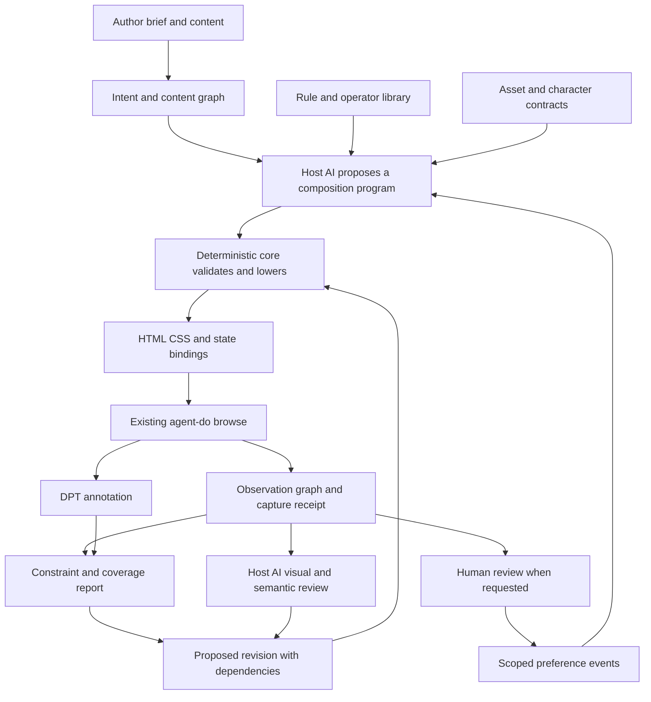

# High-level design

Status: proposed implementation architecture for `mn-27e068`.

## 1. Architecture



The core is deterministic for a saved proposal and pinned inputs. The host model is an
explicit creative participant. Its output is validated data, not executable code accepted
on trust. The browser resolves native layout and font behavior. Observations determine
whether the emitted page preserves the declared relationships.

## 2. Component ownership

| Component | Owns | Does not own |
| --- | --- | --- |
| Brief compiler | Content/action graph, requirements, assumptions, condition manifest | Inventing human approval or hidden business requirements |
| Frame library | Versioned intent and expression schemas, contextual techniques | Fixed reference-site themes or universal meanings of colors |
| Composition core | Operator AST, parameter domains, checks, lowering, deterministic sampling | Browser layout reimplementation or aesthetic verdicts |
| Browser observer | Actual boxes, text fragments, computed values, visibility, state, capture coverage | Unobserved states or psychological salience as exact measurement |
| Browser adapter | Session/project binding and supported browse command invocation | A new daemon, raw socket protocol fork, or browser authentication logic |
| DPT adapter | Raw versioned report and mapped annotation provenance | Aggregate-score optimization or silent promotion of style heuristics to hard gates |
| Revision planner | Candidate patches, affected dependencies, expected effects and counterchecks | Mutating reference evidence or silently relaxing locked requirements |
| Session packet builder | Complete mandatory brief/grammar context plus indexed optional evidence | Implying that unseen context was delivered |
| Evidence store | Immutable artifact versions, hashes, coverage, decisions, exports | A second issue tracker or secret store |
| Host AI | Proposals, interpretation, visual critique, author interaction | Deterministic measurement authority or human verdict creation |

All generation and repair uses the same representation and compiler. An emergency CSS patch
outside that representation is not a second successful production path: import it as a typed
change with source mapping or leave the run unresolved.

## 3. Repository topology and runtime

Recommended future layout, not created by this commission:

```text
tools/agent-design/
  agent-design                 thin executable entry
  package.json                 Node ES modules, explicit exports and test scripts
  src/
    cli/                       argument parsing, structured envelopes
    contracts/                 JSON Schema 2020-12 and semantic validation
    core/                      AST, operators, parameters, constraints, dependencies
    compiler/                  HTML/CSS lowering, native state bindings, source map
    observe/                   injected reader and observation normalization
    adapters/                  browse, DPT, project framework interfaces
    packet/                    fresh-session context assembly and digest
    evidence/                  local artifact/version store and export
  data/
    rules/                     versioned catalog and rule metadata
    frames/                    contextual technique descriptions
    standards/                 pinned criteria and authority records
  skill/                       portable session instructions and examples
  test/                        core, contracts, integration, browser and adversarial cases
```

Node is selected because generation, JSON validation and browser observation share one data
model with the existing JavaScript browser stack. Use Node built-ins for files, hashes and
unit tests. Recommended new runtime dependency: Ajv's draft-2020-12 validator, declared and
locked in the new package after approval. It validates external shapes; domain checks remain
owned by the core. No TypeScript build step or database is needed initially.

The browser adapter invokes the supported `agent-do browse` CLI with an explicit session.
It never imports another tool's node_modules or depends on the daemon socket's private path.
Native browser layout provides Grid, Flexbox, intrinsic sizing and text shaping. The core
supplies constraints, chooses constructions and verifies their rendered consequences.

The composition program is framework independent. The initial emitter produces semantic
HTML, scoped CSS and a small state-binding module. An owning application adapter can map the
same roles and source IDs to its components later. Backend actions remain named external
contracts; a demonstration cannot report a purchase or save as complete without its owner.

## 4. Observation and interpretation planes

An observation is bound to a page, state, viewport, browser, font/asset readiness, and capture
instant. Geometry uses declared coordinate spaces and CSS pixels. Device-pixel images have
their own dimensions and mapping. Bounding boxes are geometry; visual ink and perceived
weight are separate channels with their own methods and uncertainty.

The observer stores all admitted nodes in the declared finite scope. Relationships have
queryable predicates over that complete node set. It materializes useful subsets such as
containment, explicit program edges, neighboring regions and shared axes. It does not dump
every possible pair into the model's context. Queries carry exact considered and returned
counts, and truncation is explicit. This permits broad relation coverage without quadratic
prompt growth.

External pages may be partially observable. Cross-origin frame interiors, closed shadow
roots, dynamic infinite feeds, protected media, and unvisited states create named gaps.
Generated pages carry stable source IDs and a state manifest, which gives substantially
stronger coverage. The system never generalizes a screenshot into a claim about an entire
website's behavior.

## 5. The generative loop

1. Validate the brief and capability declaration. Bind all content, assets, standards and budgets.
2. Request a composition proposal from the host. Receive an AST, frames and rationales.
3. Validate structure, semantics, parameter authority, action bindings and missing assets.
4. Evaluate closed-form operators, then lower to native layout. Archive the candidate before render.
5. Render every required condition using the existing browser session interface.
6. Collect observation, mechanical findings, DPT annotation, and requested visual review.
7. If repair is needed, emit a structured request carrying exact affected source IDs and protected relations.
8. Validate and compile the proposed patch as a new candidate; re-observe affected conditions.
9. Stop at declared completion, author selection, exhausted budget, missing input, or a named conflict.

Candidate selection is lexicographic over required feasibility and the author's declared
priorities, with a separately recorded model/human design judgment. There is no hidden sum
of typography, color, novelty and coherence into a beauty number. Search may retain several
feasible candidates because aesthetic preferences can remain incomparable.

## 6. Data and state ownership

Author-project artifacts live under `<project>/.design/`: briefs, proposals, accepted programs,
lock metadata and user verdicts. Large run artifacts live under `<project>/.dev/design/runs/`.
An export copies the complete selected run into a portable bundle with a manifest and relative
paths. Installation metadata and executable package discovery belong to agent-do's existing
surfaces. No new daemon state is required.

Every run has its own directory and lock. Writes occur to a temporary sibling and are renamed
atomically after validation. Existing content-addressed objects are never overwritten with
different bytes. Run summaries point to immutable evidence. Resuming verifies the artifact
hashes, schema versions, capabilities and project binding before taking the next step.

The corpus and historical research are read-only inputs. New preference events are separate
records. The reference source graph cannot become a hidden lookup table in shipped defaults.

## 7. Reliability and failure behavior

| Failure | Required response |
| --- | --- |
| Missing real content or required asset | Name the missing input; do not silently substitute a reference site's material |
| Font fails to load | Record the actual fallback and fail the intended-font obligation |
| Browser transport failure | Preserve the failed attempt and repair the supported browse path |
| Capture changes while being read | Mark observations inconsistent and retry within the supplied budget |
| Unsupported measurement | Return unknown with scope and remedy; retain unrelated measurements |
| Hard constraints conflict | Report the conflict set; request a changed requirement or different permitted construction |
| Model proposal malformed | Return shape/domain errors without executing it |
| Revision oscillates | Detect repeated program state and stop with competing constraints |
| Evaluation lacks human verdict | Report unjudged; never label the candidate rejected |
| Packet exceeds available context | Preserve mandatory context; require an adequate capability/budget instead of dropping requirements |

Feasibility failure is local to a stated program and domain. General unsatisfiability may be
claimed only when the explored finite space is complete or an analytical contradiction is
proved. A search budget ending is `budget_exhausted`, not `unsatisfiable`.

## 8. Quality, security and operations

Content and imported evidence are data. The emitter escapes text and uses an allowlisted
AST for markup, styles and state bindings. Raw script injection is outside the model proposal
contract. A font or image path is resolved within the project's approved asset roots or an
explicitly authorized origin. Review pages never turn reference text into agent instructions.

Authenticated capture is delegated to existing browse/auth workflows. Capture manifests
exclude credentials and record the chosen scope; private content requires the project's
existing handling rules. No source capture authorizes sending messages, placing orders or
publishing pages. Export is a local artifact operation.

Resource budgets are explicit input values with authority. Progress events expose measured
node counts, condition counts, bytes, elapsed time and remaining obligations. Optimization
begins from measurements, not invented global page-size or token caps. Scaling plans and
budget behavior are specified in the LLD.

## 9. Existing work relationships

`mn-c2d546` remains the frozen scalar-candidate study. This architecture does not reopen,
retune, reinterpret, or admit its failed implementations. `mn-7ec6dc` describes a proposed
human design-round workflow; its gallery or feedback protocol can be an optional consumer
of these immutable runs. It is not assumed built. Dream `mn-133b76` concerns DPT floor/style
separation and remains a distinct, unratified proposal.

The Aldebaran map contributes the architectural distinction between exact substrate and
explicit interpretation. Its astrology doctrine and cross-repo release rules are not imported
as design laws. See [Sources and corpus](11-SOURCES-AND-CORPUS.md).
