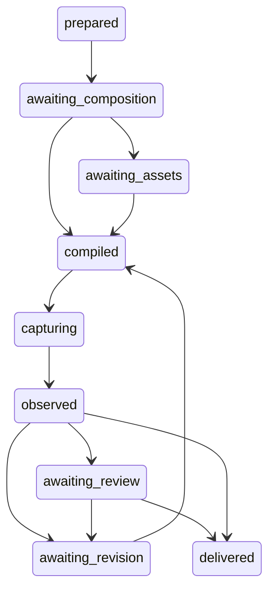

# Low-level design: contracts, state and storage

Status: proposed normative interface design for the future implementation. Type notation and
JSON examples in this document are specifications, not installed code.

## 1. Contract conventions

Wire documents are UTF-8 JSON, validated against locally bundled JSON Schema 2020-12.
Schemas forbid additional properties except an explicit namespaced `extensions` object.
No remote schema reference is fetched during validation. Unknown major schema versions fail.
Additive optional fields require a minor version; changed meanings require a major version.
Every reader declares the versions it admits.

All IDs are strings scoped by project/run or artifact. Generated source IDs derive from
semantic content keys and operator paths, not array positions that can silently rebind after
insertion. Observed external DOM IDs are capture-scoped unless a verified mapping exists.

All numeric values are finite. JSON null is not a substitute for an unknown measurement.
Optional means legitimately absent; an attempted unavailable measurement uses `Observed`.
CSS pixels, device pixels, ratios, degrees, milliseconds, bytes and counts are different units.
The value `unbounded` is a tagged maximum, never JSON Infinity.

Canonical artifact serialization sorts object keys recursively, preserves array order,
normalizes negative zero to zero, rejects nonfinite numbers, and uses the pinned Node runtime's
JSON number serialization. Digests are SHA-256 of the resulting UTF-8 bytes. This is a
project serialization contract; it is not claimed to implement a different canonical-JSON
standard. Exact source files also retain their independent raw-byte hashes.

## 2. Shared types

```text
SchemaVersion = { name: string, major: integer, minor: integer }
ArtifactRef = { path: relative_path, sha256: hex_sha256, schema?: SchemaVersion }
Scope = { project_id, run_id?, page_id?, condition_id?, state_id?, sample_id?, subject_ids: Id[] }
Quantity = { value: finite_number, unit: css_px|device_px|ratio|deg|ms|bytes|count }
Observed<T> =
  { status: known, value: T, method, source_refs: ArtifactRef[], scope: Scope,
    precision: exact_in_representation|browser_reported|quantized|estimated,
    error_bound?: Quantity, estimator?: { author, method, limitations } }
  | { status: unknown, reason_code, detail, remedy, scope: Scope, attempted_method? }
  | { status: not_applicable, reason, scope: Scope }

Authority =
  { kind: mathematical, derivation_id, expression, input_refs: Id[] }
  | { kind: standard, document_ref, criterion_or_section, version, verified_date }
  | { kind: measured, observation_ref, field_path }
  | { kind: author, instruction_ref, exact_words, scope: Scope }
  | { kind: proposed, proposer, rationale, scope: Scope, evidence_refs: ArtifactRef[] }
  | { kind: experiment, manifest_ref, field_path }

Parameter = { id, quantity_or_choice, authority: Authority, domain: Domain,
              mutability: locked|tunable, dependencies: Id[] }
Domain = finite_enum | integer_interval | real_interval | union_of_domains
```

Parameter intervals declare inclusive/exclusive endpoints and units. A real interval is an
exploration domain, not a finite exhaustive search space. Sampling and any discretization
are recorded separately. A proposed domain has no authority as a universal taste threshold.
Code/resource ceilings use the existing quantity-authority path or an explicit run manifest.

`Observed.known` means the named method supplied the value, not that the value expresses
human perception. A browser bounding box and a model-estimated subject centroid have
different methods and precision. They cannot be pooled without an explicit derived record.

## 3. Brief and content contracts

```text
DesignBrief = {
  schema, id, revision, project_id, purpose, audience,
  tasks: [{ id, description, priority: ordered_label, completion_condition }],
  requirements: [{ id, text, source: Authority, locked: boolean,
                  scope, verification_kind: machine|human|both }],
  content_graph_ref: ArtifactRef,
  action_contract_refs: ArtifactRef[], asset_manifest_ref: ArtifactRef,
  existing_brand?: { token_refs: ArtifactRef[], requirements: Id[] },
  intent_frame_ref: ArtifactRef, condition_manifest_ref: ArtifactRef,
  standards_profile_ref: ArtifactRef, budget_ref: ArtifactRef,
  assumptions: [{ id, text, proposer, consequence, status: open|accepted|rejected }],
  selection_authority: author|delegated_host,
  prohibited_effects: string[], extensions
}

ContentGraph = {
  schema, id, nodes: ContentNode[], edges: ContentEdge[], root_ids: Id[]
}
ContentNode = {
  id, kind: text|media|collection|record|control|navigation|table,
  semantic_role, task_refs: Id[], requirement_refs: Id[],
  value: text_or_asset_or_structured_data, language, direction,
  required: boolean, provenance: Authority,
  children: Id[], action_ref?: Id, annotation_refs: ArtifactRef[]
}
ContentEdge = { id, from, to, kind: reading_order|belongs_to|supports|acts_on|navigates_to,
                authority: Authority }
```

Collections have stable item keys and an exact declared membership or an explicitly bounded
data-window contract. Tables carry column/header associations, not just arrays rendered as
boxes. Reading-order edges must be acyclic. Relationship edges can be cyclic when their
semantics allow it. Every required node must be reachable from a delivered page or an
explicitly reachable disclosure state. Deleted or unreachable required content fails INT-01.

An ActionContract names its owner, inputs, validation, trigger, pending/success/error states,
side-effect class, implementation binding and verification source. An unbound real action
is incomplete. Test fixtures can exercise interaction logic with labeled fixture handlers;
that evidence cannot certify the real owner's external operation.

## 4. Intent, character and assets

```text
IntentFrame = {
  schema, id, experience_goals: [{ id, wording, task_refs, author, evidence_refs }],
  role_priorities: [{ scope, ordered_roles, rationale }],
  symbolic_readings: [{ name, interpretation, author, assumptions, scope }],
  protected_relations: RelationSpec[], prohibited_effects: string[]
}
CharacterFrame = {
  schema, id, parent_ref?: ArtifactRef,
  role_styles: [{ role, condition?, token_bindings, rationale, authority }],
  parameters: Parameter[], selected_rule_ids: Id[],
  expression_axes: [{ name, value_or_description, scope, authority }],
  exceptions: [{ id, scope, overrides, reason, invariant_refs }],
  dependencies: DependencyEdge[]
}
AssetManifest = { schema, id, assets: AssetRecord[] }
AssetRecord = {
  id, kind: image|font|video|svg|icon|opaque_component,
  status: ready|requested|unavailable,
  source: { kind: supplied|owned|licensed|generated|reference_only, provenance },
  file_ref?: ArtifactRef, allowed_use, intrinsic?: { width, height, duration },
  font?: { family, style, weight_domain, axes, language_coverage, file_refs },
  focal_regions: [{ geometry, coordinate_space, authority }],
  intended_role, alternative_text?: { value, authority },
  request?: { required_properties, acquisition_owner, unresolved_questions }
}
```

A `reference_only` asset cannot be compiled into a deliverable. For generation, requested
media requires an asset brief containing subject, composition function, crop flexibility,
content obligations and output conditions. Existing asset-generation or acquisition tools
fulfil that request outside the deterministic core. The final asset is re-measured before use.

Frame inheritance has one parent and must be acyclic. Resolution order is parent, local
role rule, then matching scoped exception. Two equally specific incompatible assignments
are a conflict. Declaration order is not a hidden tie-breaker. Exceptions identify their
permitted fields so they cannot alter unrelated locked requirements.

## 5. Composition program and expression language

```text
CompositionProgram = {
  schema, id, revision, brief_ref: ArtifactRef, content_ref: ArtifactRef,
  asset_ref: ArtifactRef, frame_refs: ArtifactRef[],
  seed: string, sampler_version: string,
  parameters: Parameter[], roots: OperatorNode[],
  relations: RelationSpec[], dependencies: DependencyEdge[],
  condition_manifest_ref: ArtifactRef, action_bindings: ActionBinding[],
  rationale: [{ decision_id, choice, reason, authority, alternatives_considered }]
}
OperatorNode = { id, kind: OperatorKind, content_refs: Id[], role,
                 args: TypedOperatorArgs, children: OperatorNode[],
                 condition?: Predicate, source: Authority }
RelationSpec = { id, kind, subjects: Id[], channel, condition?: Predicate,
                 targets: ParameterRef[], authority, strength: locked|selected|advisory }
DependencyEdge = { from: Id, to: Id, kind: value|layout|paint|state|interpretation,
                   condition?: Predicate, reason }
```

`OperatorKind` is the following closed first-release set. Unknown kinds produce
`unsupported_operator`; future extensions require a registered contract and tests.

| Kind | Required args | Output and invariants |
| --- | --- | --- |
| page | page_id, title, language, direction | Semantic page root and declared landmarks; exactly one content root per page variant |
| region | role, inset_refs, surface_ref | Container with owned surface and logical insets |
| flow | axis, gap_ref, wrap_policy, align_policy | Ordered intrinsic flow; preserves content membership and semantic order |
| partition | axis, shares, minimums, maximums, gap_refs, reflow_ref | Bounded weighted children; conservation or a named infeasibility |
| grid | minimum_item_ref, gap_refs, placement_policy, reflow_ref | Content-keyed repeated grid; feasible count and explicit exceptional spans |
| align | axis_or_edge, reference_id, offset_ref, alignment_kind | Equality/offset relation lowered to native layout where possible |
| layer | ordering, overlap_permissions, protected_regions, clipping | Base/foreground composition with explicit occlusion obligations |
| repeat | collection_id, item_key_field, body | One keyed expansion per admitted content item |
| sequence | recurrence_ref, item_bindings, interruption_refs | Scoped rhythmic assignment without changing required membership |
| clearance | boundary, permitted_roles, extent_refs | Reserved space constraint, lowered as insets/gaps or an inert structural region |
| text | content_id, typography_role, wrap_policy, measure_refs | Semantic text element with actual font/content measurement |
| media | asset_id, fit, anchor, focal_policy, alternative_text_ref | Media element with intrinsic and accessible-content contract |
| control | content_id, native_kind, action_id, state_machine_id | Native control or registered component with verified semantics |
| state | machine_id, variants, transition_refs | Finite state-dependent views and their behavior bindings |
| transform | target_ids, typed_patch, invariant_refs, purpose | Validated scoped change, not arbitrary JavaScript or raw CSS |
| component | registered_contract_id, props, content_slots | Bounded reusable component with lowering and observation adapters |

Wrapper operators do not necessarily add DOM elements. Lowering may express them through a
parent's layout properties. Every such decision appears in the source map. The AST is a
finite tree after keyed expansion; references and constraints are separate edges. A root
cannot reference its own descendant as a size source if that creates an unresolved value cycle.

Expressions use a closed tree: `literal`, `ref`, `add`, `subtract`, `multiply`, `divide`,
`min`, `max`, `clamp`, `abs`, `floor`, `ceil`, `power`, `modulo`, and `choose` over an admitted
predicate. Each operator checks arity, units and domain. Division by zero and invalid powers
fail before emission. Powers used for progressions operate on dimensionless ratios. CSS
lengths retain their unit and are never added directly to counts or angles.

Predicates use `all`, `any`, `not`, `equal`, `less`, `less_or_equal`, `greater`,
`greater_or_equal`, and `member_of` over declared environment/state/parameter fields.
Arbitrary property access, executable expressions, script strings and external lookup calls
are outside this expression language.

## 6. Conditions, states and capture

```text
ConditionManifest = {
  schema, id, pages: [{ page_id, required_state_ids }],
  environments: [{ id, viewport: { width: Quantity, height: Quantity },
                    device_scale: Quantity, browser_profile_ref,
                    locale, direction, input_modes, reduced_motion,
                    zoom_or_reflow_profile, color_scheme }],
  derived_boundaries: [{ relation_id, derivation, neighbor_conditions }],
  combinations: [{ id, page_id, state_id, environment_id, required, reason }],
  uncovered_combinations: [{ description, reason, consequence }]
}
StateMachine = {
  id, initial_state, states: [{ id, invariants, content_ids, focus_policy }],
  transitions: [{ id, from, event, guard, to, action_ref?, effect_contract }],
  terminal_states: Id[], recovery_transitions: Id[]
}
CaptureManifest = {
  schema, id, program_ref?, source_kind: generated|external,
  page_url, project_binding, browser_session, browser_version, platform,
  condition_ref, state_ref, started_at, completed_at,
  viewport_css, visual_viewport, document_extent, device_scale,
  samples: [{ id, timestamp, scroll_offsets, visual_viewport, document_extent,
              observation_ids, screenshot_refs, readiness, consistency }],
  scroll_history, font_readiness, asset_readiness, motion_policy,
  node_scope: { definition, observed_count, known_opaque_roots, exclusions },
  band_coverage, state_coverage, consistency,
  screenshots: [{ file_ref, device_extent, css_mapping, capture_kind }],
  observation_ref, limitations: [{ code, scope, detail, remedy }]
}
```

Condition completeness refers to the declared finite matrix. A continuous responsive domain
also carries its construction inequalities, boundary tests and sampled interior conditions;
testing finite viewports does not prove every possible width or every unknown browser.
Pairwise condition sampling is allowed for supplemental exploration. Required interaction
paths and known high-risk combinations remain explicit, not discarded by pairwise coverage.

For an external page, the observer cannot know that it has visited every interactive state.
It reports the requested observed state set. Lazy sections require recorded traversal and
readiness. Infinite/virtualized content is a declared finite data window with uncovered scope.
An uploaded image without matched measurements has image evidence and no fabricated DOM.

## 7. Observation graph

```text
ObservationGraph = {
  schema, id, capture_ref, nodes: ObservedNode[],
  explicit_edges: ObservedRelation[], indexes: ArtifactRef[],
  query_domain: { node_ids, supported_predicates, predicate_limits },
  coverage: CoverageRecord
}
ObservedNode = {
  id, sample_id: Id, parent_id?, generated_source_id?: Id,
  locator: { capture_scoped_selector?, frame_path, shadow_path, stability },
  semantic: { tag, role, name, language, direction, state_properties },
  boxes: { border: Observed<Box>, content: Observed<Box>,
           fragments: Observed<Box[]>, transform: Observed<Transform> },
  computed: { typography, colors, surfaces, spacing, positioning, overflow },
  paint: { visibility, clip_chain, stacking_context, opaque_regions },
  content_ref?, asset_refs, source_refs, limitations
}
ObservedRelation = { id, subjects, kind, channel, value: Observed<Value>, derivation }
QueryResult = { domain_digest, predicate, considered_count, matched_count,
                returned_count, rows, continuation?, complete, limitations }
```

Boxes use viewport or document coordinates explicitly. Text fragments are actual browser
range rectangles where supported. CSS baseline declarations are not exact observed baselines;
exact baseline comparison requires emitted anchors or an admitted measurement adapter.
Cross-frame coordinates require the frame offset/transform chain. If that chain is missing,
the inner value cannot be compared in the outer coordinate space.

An ObservedNode ID identifies one subject in one sample. `generated_source_id` or a verified
external identity mapping links repeated observations of the same subject. Parent IDs point
inside that sample. Cross-sample relationship queries require explicit comparison semantics;
the default domain is one sample. Capture samples retain their own document extent because
loading and virtualized views can change it.

A relation query operates over the declared node domain. Symmetric pair cardinality is
`n*(n-1)/2`; directed distinct-pair cardinality is `n*(n-1)`. Counts are derived at call time.
Lazy computation can keep an index instead of materializing every edge. An index omission
cannot change the mathematical answer: unsupported or budget-exhausted queries disclose
that they are incomplete. Full-domain scan fallback is an intended query algorithm, not a
substitute browser acquisition path.

## 8. Rules, obligations and reports

```text
RuleDefinition = {
  schema, id, version, class: H|G|J|P, title,
  input_types, applicability_predicate, parameter_slots,
  algorithm_id, authority_refs, dependency_kinds,
  postconditions, repair_operations, test_ids, implementation_version
}
RuleApplication = { id, rule_ref, scope, subject_ids, parameter_refs,
                    authority_refs, dependencies, selected_by }
RuleResult = { application_id, status: pass|fail|unknown|not_applicable,
               measured_values, expected_relations, evidence_refs,
               reason, repair_candidates, evaluator_kind: core|model|human }
StandardsProfile = { id, source_ref, version, target_level,
                      criteria: [{ id, applicability, evaluator,
                                   test_refs, manual_review_contract? }] }
InspectionReport = {
  schema, program_ref, capture_refs, rule_results,
  coverage: { expected_applications, classified_applications, missing_applications },
  conflicts, dpt_annotations: ArtifactRef[], interpretations: Interpretation[],
  next_request?: HostRequest
}
Interpretation = { id, author, kind: visual|semantic|symbolic, claim,
                   scope, evidence_refs, assumptions, proposed_change? }
```

Rule coverage requires every expected application to be classified. `unknown` counts as
classified coverage but not as a passed obligation. The completion policy separately checks
which unknowns block the requested claim. A known inapplicable criterion needs its reason.
Required manual checks are not silently counted as passed by an automated scanner.

A DPTAnnotation stores the entire raw report as an immutable artifact, the DPT source/build
version, capture/project binding and status. A small adapter extracts the fields it knows.
Unrecognized fields remain in the raw report. Missing or incomplete synthesis does not make
the independent observer's unrelated geometry disappear. DPT's numeric score is never a
constraint objective. Promoting a specific DPT finding to a hard requirement needs its own
authority and independent test mapping.

## 9. Proposals, patches and host requests

```text
HostRequest = {
  schema, id, kind: composition|revision|asset|visual_review|clarification,
  run_id, base_digest, required_inputs: ArtifactRef[],
  instruction, output_schema_ref, protected_requirements: Id[],
  requested_capabilities, budget_ref, unresolved_items
}
HostResponse = { schema, request_id, base_digest, author, model_metadata?,
                 proposal_ref?, interpretation_refs?, supplied_input_refs?, explanation }
Patch = {
  schema, id, base_program_digest, operations: PatchOperation[],
  expected_effects: [{ relation_id, prediction, evidence_basis }],
  protected_requirement_ids, rationale, author
}
PatchOperation = set_parameter | bind_asset | replace_operator |
                 move_subtree | add_exception | change_condition | bind_action
```

Every patch operation has a typed target ID, prior-value digest and new typed value. Removing
required content, altering a locked requirement, modifying a standards threshold or changing
the base brief is not an ordinary repair. It requires a new author-approved brief revision.
`replace_operator` must preserve declared content/action coverage. `move_subtree` cannot
create cycles. `change_condition` may add coverage; dropping required conditions requires a
new brief. Arbitrary file or CSS patches are outside the host response contract.

The host model is provider-neutral. Model name/version, prompt artifacts, requested budget
and returned response are retained where the host exposes them. Unsupported metadata is
marked unavailable. The core does not reconstruct hidden prompts or claim visibility into
model training. A session without vision can fulfill structural tasks but cannot silently
fulfill a required visual-review request.

## 10. Preferences and experiments

```text
PreferenceEvent = {
  schema, id, author, source_ref, exact_words, recorded_at,
  candidate_refs: ArtifactRef[], scope,
  verdict: advance|reject|conditional|comment,
  conditions: string[], interpretation_refs: ArtifactRef[]
}
EvaluationManifest = {
  schema, id, frozen_at, ruleset_ref, core_ref, corpus_snapshot_ref,
  calibration_groups, holdout_groups, novel_briefs,
  trial_units, conditions, baselines, ablations, presentation_randomization,
  judging_protocol, metrics, acceptance_policy, analysis_plan,
  budgets, model_versions, known_exposure, amendment_policy
}
```

Only an actual human source can create a human-authored preference event. The ingestion tool
records a provided verdict; it does not infer one from a click being absent, a score, or a
model's explanation. A comment with an ambiguous winner stays a comment/conditional event.
Source quotations remain intact; interpretations are separate linked records.

## 11. Run state machine and operation envelopes

Run states are `prepared`, `awaiting_composition`, `awaiting_assets`, `compiled`, `capturing`,
`observed`, `awaiting_revision`, `awaiting_review`, `delivered`, `blocked`,
`budget_exhausted`, and `cancelled`. Every transition writes an event with its input and
output digests. A run can resume from waiting, blocked or budget-exhausted states after a
new valid input/budget/capability event. A delivered version is immutable; further work
creates a successor run or revision.



Every nonterminal transition can instead record blocked, budget_exhausted or cancelled.
`observed → delivered` is permitted only when the brief delegates selection and all required
reviews and obligations are already fulfilled. Delivery does not manufacture a human verdict.

Every CLI operation returns:

```text
OperationResult = {
  schema, success: boolean, operation, run_id?, run_state?,
  outcome: completed|needs_input|invalid|runtime_failed|budget_exhausted,
  artifact_refs: ArtifactRef[], coverage?, next_request?,
  errors: [{ code, path?, scope?, message, remedy, evidence_refs }],
  totals: { items_considered, items_emitted, bytes_written },
  complete: boolean
}
```

Proposed CLI exit codes: 0 operation completed; 1 invalid input or failed requested gate;
2 required input/capability missing; 3 runtime/transport failure; 4 budget exhausted. These
are interface constants defined here, not measured quantities. An inspection can complete
while the design has unresolved findings; `run_state` and the explicit verification mode
prevent conflating those outcomes. `verify --require mechanical` and `verify --require release`
have different predicates, defined in the integration document.

Required error codes include `schema_version_unsupported`, `shape_invalid`, `unit_mismatch`,
`reference_missing`, `parameter_authority_missing`, `locked_requirement_changed`,
`unsupported_operator`, `constraint_infeasible`, `search_incomplete`, `asset_unavailable`,
`font_unresolved`, `paint_unmeasurable`, `capture_inconsistent`, `coverage_incomplete`,
`browser_binding_mismatch`, `browser_transport_failed`, `source_changed`,
`patch_base_mismatch`, `dependency_cycle`, `revision_cycle`, `capability_missing`,
`manual_review_required`, `budget_exhausted`, and `artifact_digest_mismatch`.

## 12. Storage and module interfaces

```text
<project>/.design/
  project.json                  project identity and approved asset roots
  briefs/<digest>.json
  programs/<digest>.json
  preferences/<event-id>.json
  selected.json                 pointer plus author/delegation source
<project>/.dev/design/runs/<run-id>/
  run.json                      current pointer and run configuration
  events/<sequence>.json        immutable event chain
  inputs/                       bound snapshots or artifact references
  candidates/<digest>/          program, compiled bundle, source-map
  captures/<capture-id>/        manifest, graph, screenshots, readiness, DPT
  reports/                      inspections and verification results
  requests/                     host requests and responses
  export/                       reproducible selected delivery manifest
```

The run ID is a generated identifier, not an ownership credential. A per-run lock prevents
two writers. Immutable object writes compare existing digests; pointer updates use compare-
and-swap on the prior digest and atomic rename. An interrupted capture keeps its partial
event/manifest with a failure state. Restarting cannot mislabel it complete.

Core interfaces, all returning validated values or typed errors:

| Function | Input | Output |
| --- | --- | --- |
| validateBrief | DesignBrief and bound refs | ValidatedBrief plus unresolved required inputs |
| resolveFrame | parent chain, local frame, condition | ResolvedFrame and conflict/provenance map |
| validateProgram | program, brief, ruleset, assets | ValidatedProgram or domain errors |
| expandProgram | validated AST and keyed content | ExpandedProgram and source-ID lineage |
| solveConstruction | operator, resolved parameters, measurements | PlacementIntent or scoped infeasibility |
| compileProgram | validated expanded program, emitter version | Bundle and SourceMap |
| captureProgram | bundle, condition, explicit browser binding, budget | CaptureManifest and ObservationGraph |
| queryRelations | graph, typed predicate, scope, budget | QueryResult with exact coverage counts |
| inspectProgram | expected relations and capture set | InspectionReport and optional HostRequest |
| applyPatch | base program, typed patch, brief | NewProgram and invalidation set |
| verifyRun | run, requested claim, standards/review records | GateReport with unresolved obligations |
| buildPacket | brief, capabilities, manifest, measured context budget | PacketManifest and context artifacts |
| exportRun | verified selected version, destination | Portable manifest and digest receipt |

The schema implementation validates syntax first, then reference integrity, graph invariants,
unit correctness, authority, condition coverage and semantic constraints in that order.
Error paths identify the exact offending field and source object. No expensive render starts
after a failed prerequisite.

## 13. Supporting contracts and catalog binding

```text
Box = { x, y, width, height, unit: css_px, space: viewport|document,
        sample_id, frame_id }
ActionBinding = { action_id, handler_id, owner, interface_version,
                  implementation_ref?: ArtifactRef, status: bound|unbound|fixture_only }
ActionContract = { schema, id, owner, input_schema_ref, validation_rules,
                   event, side_effect: none|local_state|navigation|external,
                   permitted_targets, pending_state, success_state, failure_states,
                   cancellation_policy, idempotency_policy, verification_refs }
SourceMap = { schema, program_ref, bundle_refs: ArtifactRef[],
              entries: [{ source_id, operator_id, content_ids, condition_ids,
                          output_file, output_locator, lowering_kind,
                          owned_properties, dependency_ids }] }
CoverageRecord = { domain_definition, expected_ids, observed_ids,
                   unknown_extent: boolean, excluded_scopes, incomplete_scopes,
                   reason_by_scope }
BudgetProfile = { schema, id, authority, limits: [{ resource, quantity, policy }],
                  capture_profile, search_profile, context_profile }
CapabilityManifest = { schema, host, core_version, renderer_profile,
                       supported_schema_versions, operators, predicates,
                       measurement_methods, vision, interaction_methods,
                       unavailable: [{ capability, reason, remedy }] }
PacketManifest = { schema, packet_id, project_id, run_id?, brief_digest, ruleset_digest,
                   core_version, compiler_version, input_artifact_refs,
                   mandatory_blocks, optional_evidence_index, delivered_blocks,
                   required_capabilities, available_capabilities, unresolved_capabilities,
                   context_budget: { authority, measured_bytes, tokenizer_method?, token_count? },
                   unfulfilled_requirements, next_operation, expected_response_schema,
                   continuation_ref?, complete }
FrameRecipe = { schema, id, purpose, applicability, role_inputs,
                operator_expansion, parameter_slots, dependency_edges,
                selected_rule_ids, protected_relations, counterexamples,
                interpretation_prompts, authority }
```

Source map locators use emitted stable IDs, not file line numbers alone. A lowering that adds
no element points to the owning element and the specific properties it controls. Source maps
retain the expansion lineage for keyed collections. Hand edits to emitted owned properties
make the bundle diverge from its program and require an explicit import or regeneration.

`RelationSpec.kind`, typed operator args, recurrence definitions, token values and predicates
resolve through versioned bundled catalogs. Their initial domains are exactly the relation
constructors in Rulebook section 2, the sixteen operators in section 5 above, and the closed
expression language. Strings cannot introduce an unregistered evaluator. Numeric slots declare
units, permitted domains and zero/empty behavior. Role names may be project-defined; an unknown
role requires a binding, not an invented default style. Recipes in the worked examples are
compositions of existing operators and do not extend this closed executable vocabulary.

Budget resources include host requests, candidates, revisions, capture actions, elapsed time,
query work, artifact bytes and context size. A policy states stop/resume behavior; a larger
budget is a new attributed event. Actual context accounting uses the host's tokenizer when
available and labels any estimate. Capability and packet behavior are defined in the
[integration protocol](06-FRESH-SESSION-AND-INTEGRATION.md).

### Relation signatures

The following initial relation kinds are closed evaluator names. Each result carries the
common scope, authority, status and evidence contract. Inputs are source/observation IDs,
typed field selectors and Parameter references. Symbolic meanings use Interpretation records
and cannot add arbitrary executable relation kinds.

| Kind | Subjects and typed configuration | Result semantics |
| --- | --- | --- |
| containment | inner, outer; box/clip selector | Geometric inclusion of the selected bounds, or an explicit permitted clip |
| alignment | members, reference; axis/edge, offset, tolerance | Signed reference residuals and selected equality disposition |
| adjacency | pair; axis, order, maximum gap or nearest-neighbor domain | Facing-edge gap/order, with exact searched domain if nearest is requested |
| overlap | pair; box or supported paint selector, overlap permission | Intersection or supported occlusion result; box and paint values remain distinct |
| distance | pair; anchors, metric, normalization extent | Euclidean, inline or block distance with units and selected target interval |
| proportion | numerator and denominator field refs; target/domain | Dimensionless ratio after a positive-denominator check |
| balance | members and reference; area or attributed weights | Weighted geometric center and residual; estimated optical weights produce an interpretation |
| precedence | ordered members; semantic, visual-inline or visual-block channel | Acyclic semantic order or measured positional order in the named channel |
| similarity | members; exact token/property selector or explicit tolerance | Equality/difference on the selected property; no implicit universal style distance |
| repetition | collection and expanded members; stable key mapping | Exact membership, multiplicity and selected shared-property assignment |
| progression | ordered members; recurrence ref and selected fields | Difference from the selected arithmetic/geometric/explicit sequence |
| clearance | region and admitted foreground domain; permitted intrusions | Union occupancy, complement geometry and forbidden incursions |
| fit | content/media and containing region; fit/focal/wrap policy | Selected intrinsic, focal, wrapping and reachability obligations |
| affiliation | semantic members; selected grouping channel | Content-edge membership and the independently checked geometric/token cue |
| contrast | foreground/background or role pair; metric and profile | Supported contrast result and applicability, or a typed unknown |
| emphasis | leader/support roles; selected channels and targets | Separate channel results plus attributed visual review, never a hidden salience sum |
| continuity | before/after scopes; protected content, role and action relations | State/condition invariant correspondence with explicit intended changes |
| exception | affected application and replacement fields; invariant refs | Scoped override validity and remaining protected postconditions |
| dependency | source and dependent; edge kind and condition | Invalidation/recomputation requirement, not an aesthetic verdict |

Exact selectors are registered field paths, not JavaScript accessors. Comparison across
unrelated units or samples is rejected. Relation kinds can be observed, expected or both;
an unavailable observation never becomes a successful expected-value substitution. A higher-
order relationship names a set and its ordering or membership explicitly. Its evaluator does
not silently reduce the set to convenient pairs.
