# Sequenced implementation plan

Status: planned decomposition under `mn-27e068`. These work-package IDs are document IDs,
not live Manna claims. No implementation package has been launched. Mint canonical Manna
items and their handoffs when implementation is commissioned; the board owns live status.

## 1. Delivery sequence

The first implementation milestone is a complete narrow loop. It must take an original brief
through a real render and a verified revision before the library expands. Later milestones
fill the complete first-release catalog and condition domain. No separate temporary rendering
or scoring path may be used to create an apparent early success.

```mermaid
flowchart LR
    A[WP-00 Adopt implementation scope] --> B[WP-01 Contracts and artifacts]
    B --> C[WP-02 Core operators and compiler]
    C --> D[WP-03 Browser observation]
    D --> E[WP-04 Inspection and revision]
    E --> F[WP-05 Complete expression library]
    F --> G[WP-06 States and responsive coverage]
    G --> H[WP-07 Fresh-session product]
    H --> I[WP-08 Generalization evaluation]
    I --> J[WP-09 Release and handoff]
```



Some evidence preparation and schema fixtures can proceed independently after WP-00. Shared
schema/operator changes remain coordinated. A worktree is the preferred isolation for live
concurrent implementation; Manna lifecycle operations remain in the primary checkout.

## 2. Work packages

### WP-00: adopt the implementation contract

Inputs: this package, current repo/board state, the selected real first brief, allowed project
scope, asset policy, budget and acceptance claim. Review the proposed `design` tool name and
Ajv dependency. An explicit implementation commission can adopt the recommended decisions
as a set; this planning delivery itself does not do so.

Deliverables: sealed implementation work orders, approved scope/version, known capability
matrix, pinned runtime/dependency policy and initial evaluation manifest structure. Preserve
all existing corpus and research hashes. Identify a responsible human reviewer and an
independent engineering review role; no agent is spawned by this plan.

Acceptance: no implementation work order points to a missing contract; new dependency/tool
authority is explicit; the first brief has real content and named action/asset owners.

### WP-01: contracts, storage and a truthful empty run

Inputs: WP-00. Implement JSON schemas, authority/quantity types, IDs, digest serialization,
semantic validation, run storage, event/pointer updates, per-run locks, source preservation,
host request/response envelopes and error codes.

Deliverables: modules in `contracts/` and `evidence/`; read-only status; prepared run with a
valid composition request; migration/version tests; fixture schemas and independent malformed
inputs. No aesthetics are required to prove this stage.

Acceptance: T-CONTRACT and relevant EVD/INT/REP/GEN cases pass; invalid or missing authority
blocks downstream work; interrupted/concurrent writes preserve valid prior state; sources and
human verdicts remain byte-bound. A fresh process can resume the prepared run.

### WP-02: compositional core and first compiler path

Inputs: WP-01. Implement page, region, flow, partition, grid, align, text, media and keyed repeat
alongside frame/token resolution, actual content membership and source mapping. Implement the
deterministic sampler, expression/unit checker, bounded partition solver and compile artifacts.

Deliverables: a new original composition program, compiled bundle, asset/action manifest and
source map using the initial emitters. A loopback preview server belongs to this same package.

Acceptance: independent numeric fixtures, conservation/bounds tests, stable keys, deterministic
build bytes, semantic HTML and meaningful source mappings. Missing fonts/media remain named
gaps. Style parameters are not hardcoded from the reference sites. This stage is **partial
catalog coverage** and cannot claim first-release completion.

### WP-03: actual browser observation and coverage

Inputs: WP-02. Implement the supported browse adapter, explicit session/project binding,
capture/readiness profiles, scroll traversal, node/fragment collection, typed unknowns,
relation queries, clearance descriptors and screenshot/source mapping. Archive DPT reports
as an annotation adapter without changing its score or source.

Deliverables: a capture/observation pair for the new composition; sample-level geometry;
readiness and coverage receipts; an independent query oracle for tests; incomplete-reference
capture fixtures reproducing lazy-load and opaque-root cases.

Acceptance: T-CAPTURE, T-RELATION and relevant T-TEXT/T-PAINT pass. Wrong session, incomplete
scroll, fallback fonts and inconsistent layouts cannot produce complete receipts. Raw images
and CSS coordinate measurements remain correctly distinguished.

### WP-04: inspection and dependency-aware revision

Inputs: WP-03. Implement expected RuleApplications, result dispositions, hard/selected/judgment
separation, host review/revision requests, typed patches, dependency closure, protected
requirements, stale-observation checks, cycle detection and resumable budget exhaustion.

Deliverables: the first complete narrow loop from brief to original program to render to
inspection to a successful meaningful revision. Include a controlled text or asset change
that forces more than one dependent layout change. No direct CSS bypass is permitted.

Acceptance: T-REPAIR and relevant REP/COH/HIE tests pass; a fresh process can resume after an
interrupted attempt. The revised render satisfies its actual invariants. This is the first
useful prototype, labeled partial until the remaining operator/state catalog is implemented.

### WP-05: complete expression and material coverage

Inputs: WP-04. Implement layer, sequence, clearance, transform and registered component
contracts; complete geometric, rhythmic, typographic, palette, imagery, detail, exception and
cross-page frame handling. Add the complete rule catalog bindings and implementation records.

Deliverables: all first-release geometric and expressive operators have implementations;
state and control are completed in WP-06. Content-first,
media-first, dense, sparse, richly illustrated and restrained constructions work through the
same path on new material. Asset requests have proper readiness and permitted-use handling.

Acceptance: all relevant GEO/RHY/TYP/COL/MAT/VAR/COH rule tests pass; unsupported paint and
shaping stay explicit; each construction includes a falsifying case and a context where it
does not apply. No reference-site template or universal palette/type ban has appeared.

### WP-06: complete behavior and responsive obligations

Inputs: WP-05. Implement state/control contracts and bindings, required condition derivation,
LTR/RTL, input/focus behavior, overlays, text expansion, supported motion/reduced-motion,
standards-profile obligations and manual-review accounting.

Deliverables: multi-page and multi-state flows with real content and correctly bounded action
owners, condition manifests, tests at derived changes, and complete mechanical/standards
coverage reports. Register the explicit unsupported vertical-writing/opaque-component limits.

Acceptance: T-STATE/T-RESPONSIVE and STA/RSP/MOT/COL standard checks pass. Required content
and task access survive transformation. A screenshot alone cannot discharge an interaction
obligation. The full catalog is implemented; missing manual release review remains visible.

### WP-07: portable fresh-session product and discovery

Inputs: WP-06. Implement the proposed CLI, context packet builder, compact skill, export and
resume, capability/budget checks, registry metadata and install/discovery integration.
Use the actual repo contract-generation and validation path.

Deliverables: a portable project bundle and installed entry protocol after authorization;
documented public help; existing-tool adapter tests; no model-provider service dependency.

Acceptance: T-PACKET/T-INTEGRATION/T-EXPORT pass. A new session completes and another resumes
the workflow with only the packet and repository tools. Too-small context, missing vision,
wrong browser and changed input versions fail honestly. DPT audit users retain their workflow.

### WP-08: prospective generalization and human evaluation

Inputs: WP-07 and a frozen EvaluationManifest with prospective briefs, budgets, judging policy
and accepted comparison criteria. Complete needed source recaptures separately as evidence
work, without altering the historical study or inventing new labels.

Deliverables: matched baseline/instrument trials, retrieval holdouts, ablations, controlled
transformations, blind presentation, exact human verdicts and descriptive/inferential results
within the predeclared protocol. Record failures and missing judgments alongside successes.

Acceptance: the evaluation is reproducible and honestly accounted for. A positive aesthetic
claim requires the actual predeclared benefit criterion to pass. Failure to establish benefit
triggers a scoped revision proposal, not a rewritten score or denominator. Engineering
completion and unestablished taste benefit are reported separately if that is the outcome.

### WP-09: release, continuation and stop

Inputs: WP-08 and required application/human acceptance. Run the complete declared checks,
verify catalog and condition closure, inspect source/asset use, and export the selected version.
Record versions, known limits, actual evidence and how a fresh session resumes.

Deliverables: local release artifacts, source, contracts, tests, skill and evaluation report.
Commit owned files with the canonical Manna trailer when authorized. Publishing, deployment
or external messaging require their own explicit commission. Close only the completed work
items under the repo's normal verified lifecycle.

Acceptance: release claims match evidence. Stop when the commissioned product is usable;
optional new adapters, models or theory work do not become implicit unfinished requirements.

## 3. Work ownership and implementation review

Core/contracts owns representation and algorithms. Browser/observation owns actual-page
evidence. Compiler/interaction owns emitted behavior. Integration owns installation and fresh-
session discovery. Evaluation owns frozen manifests and judgment accounting. These are
ownership roles, not instructions to launch parallel agents now.

Review changes at the component boundary they affect. A new operator includes its contract,
lowering, observation support and adversarial tests in the same work package. A browser
capability change includes protocol, adapter and real-browser receipts. A schema change
includes migration or explicit version refusal. A preference-rule change includes its scope
and source; it never edits the original human wording.

## 4. Validation commands

Current applicable repo gates, verified from local instructions:

```bash
./test.sh
agent-do harness contracts validate
agent-do harness contracts drift
```

When browser source/protocol is touched, also use the existing package scripts:

```bash
npm --prefix tools/agent-browse test
npm --prefix tools/agent-browse run test:protocol
```

The new package should define `npm test` for core/contracts, `test:integration` for adapters,
`test:browser` for owned live-render fixtures, and `check` for its complete non-browser gate.
These are **proposed scripts**, not currently runnable commands. Browser tests require the
declared coordinated environment. Failures are preserved and fixed through the real path.

At each work package, run the smallest relevant suites plus required repository gates for
touched shared surfaces. Run the complete new-package and required repo checks at release.
Do not broaden or repeat suites after green results without a changed input or unresolved concern.

## 5. Estimation and remaining decisions

Work estimates should be based on measured effort from WP-01 through WP-04 and the remaining
catalog/test census. This plan supplies dependency order and concrete completion conditions,
not an invented calendar or staffing promise. Runtime and evaluation budgets are explicit
launch inputs; missing them produces an actionable request before costly work.

Needed before implementation: a launch instruction adopting or amending the recommended
architecture, the initial real brief, and the declared dependency/tool authority. Needed before
effectiveness claims: the frozen prospective study and actual human judgments. These are
distinct from gaps in this written architecture.

Optional after first-release completion: framework emitters beyond the initial bundle,
vertical writing generation, deeper canvas/paint adapters, additional symbolic frames,
additional host integrations and formal research on preference models. They are not hidden
requirements for the scoped first release.

## 6. Current commission's stop condition

For `mn-27e068`, complete the rulebook, HLD, LLD, contracts, integration, evaluation, examples,
decisions, source inventory and traceability; validate their consistency; deliver to the repo,
iCloud Transfer and Obsidian; record the receipt; then stop. Do not execute WP-00 through
WP-09, install dependencies, register a tool, or start new design-generation trials in this turn.
