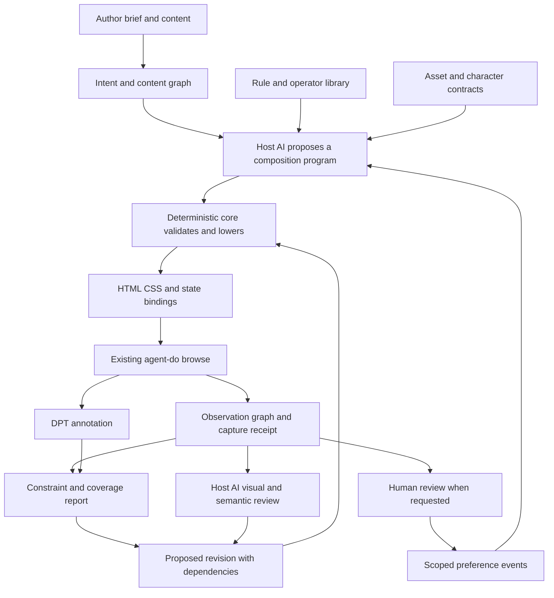
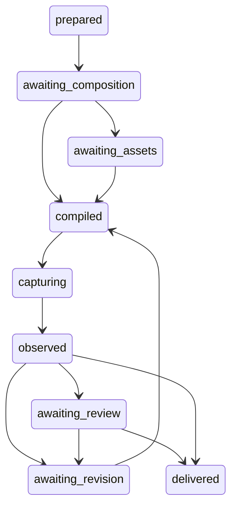

# Generative Design Grammar: full design document

Planning commission: `mn-27e068`. September 14, 2026.

Status: proposed first-release architecture and rulebook. Planning complete; implementation not started.

This book combines the chapter files without dropping their content.


<a id="overview"></a>

## Generative Design Grammar: complete planning package

Planning commission: `mn-27e068`. Date: 2026-09-14. Status: **PROPOSED FOR IMPLEMENTATION**.
The planning package is the deliverable. Product implementation, installation, new tool
registration, deployment, and changes to the frozen taste study are outside this commission.

### The outcome

A fresh AI session receives a brief and a portable instrument. It can construct an original
website, inspect its actual rendered relationships, and revise the composition coherently.
The instrument supplies a general language of roles, space, typography, color, materials,
state, and transformation. The model supplies contextual interpretation and proposals.
Human preference remains an independently recorded verdict.

The twelve approved sites are evidence of expressive range. They are not templates,
training labels for universal aesthetic laws, or a closed list of styles. A generative rule
cannot branch on a reference site's identity. A rule may cite a reference in its evidence.

### Read this package

Start with [the complete design document](#overview) for one continuous book, or use the
chapters below. [Completion and validation](#completion) records the delivery boundary.

| Document | What a builder gets |
| --- | --- |
| [Vision and scope](#chapter-01) | Product behavior, requirements, completeness boundary, meaning model |
| [Rulebook](#chapter-02) | Complete first-release rule catalog, formulas, applicability, exceptions |
| [HLD](#chapter-03) | Components, ownership, architecture, data flow, deployment and trust boundaries |
| [LLD: contracts](#chapter-04) | Wire types, states, schemas, identifiers, errors, storage and function contracts |
| [LLD: algorithms](#chapter-05) | Operators, observation, generation, dependency propagation, revision and determinism |
| [Fresh-session integration](#chapter-06) | Portable packet, skill entry, proposed CLI, discovery and existing-tool integration |
| [Evaluation](#chapter-07) | Mechanical tests, preference trials, holdouts, ablations and anti-copy safeguards |
| [Build plan](#chapter-08) | Ordered work packages, dependencies, deliverables, acceptance and stopping conditions |
| [Worked examples](#chapter-09) | New briefs, parameter derivations, composition traces and repair cases |
| [Decisions and risks](#chapter-10) | Chosen architecture, alternatives, recommendations, unresolved empirical questions |
| [Sources and corpus](#chapter-11) | Live repo evidence, official specifications, exact corpus coverage and source limits |
| [Traceability](#chapter-12) | Requirements to rules, contracts, algorithms, tests and build packages |

[SOURCE-INVENTORY.json](SOURCE-INVENTORY.json) binds local inputs and protected evidence for this plan.
The package's machine-readable verification and delivery receipts accompany the final bundle.

### The architectural decision

Use a deterministic composition core with a declarative relational representation, native
browser layout, and a host-model proposal loop. Retain `agent-do browse` as the browser
control surface and DPT as versioned annotation. The core creates no network model calls.
It produces structured requests that the current capable session can answer.

The recommended implementation home is a new `tools/agent-design/` package in this repo,
with Node ES modules and a thin CLI. `agent-do design` is a **proposed** tool name, not a
command installed by this plan. The only proposed new runtime dependency is Ajv for
JSON Schema validation. No general optimization solver, database, vector service, model
fine-tuning pipeline, or new browser harness is required for the initial product.

The first useful build runs the entire brief → composition → render → observation → revision
loop with a bounded subset of operators. The remainder of the catalog then expands that
same working path. The final first-release gate covers every catalog obligation within the
declared scope; an early vertical slice is explicitly partial.

### Meaning of complete

This is a complete implementation plan for the first release described here. It does not
claim an exhaustive theory of beauty or guarantee approval for every future brief.
Its scope is finite, its rule and state coverage is countable, and its learning claims have
separate tests. The rule grammar is extensible without changing the distinction between
facts, hypotheses, preferences, and standards.

Implementation starts only after Erik commissions it. Planning delivery does not ratify
the proposed aesthetic hypotheses or authorize installing dependencies or registering tools.

**TL;DR (12th grade):** Build a reusable language for composing and revising websites.
Use the examples to test its range. Keep the layout machinery precise and the claims about
beauty honest. This package specifies the machinery, its interfaces, and how to test it.


<a id="chapter-01"></a>

## Vision, scope, and requirements

Status: proposed design for `mn-27e068`. Implementation is not started.

### 1. Product thesis

The instrument makes design decisions explicit and related. It can describe which element
leads, how supporting elements gather, where space creates separation, how a material or
type treatment carries meaning, and which relationships must survive a change.

The creative thesis is that coherent differences can form a meaningful whole. This is a
working design position, not a discovered equation of aesthetic value. Exact geometry can
support several valid visual readings. A character frame declares one reading and its
conditions; it never changes the underlying observations to make the reading appear true.

The AI's native working medium is a graph of content, roles, constraints, and transformations.
It can inspect that graph, construct a candidate, render it, and compare intention with
observed consequences. The human sees the resulting website and, when useful, an explanation
of consequential choices. Internal rule IDs and instrumentation do not leak into product UI.

### 2. User experience

The author supplies the site's purpose, audience, real content or an explicit content-writing
scope, target environment, existing brand obligations, and assets. The session resolves
missing information that changes the task; ordinary tunable decisions stay with the session.

The instrument then:

1. Produces an inspectable brief with locked requirements and clearly labeled assumptions.
2. Forms a content and action graph, including required pages and states.
3. Proposes distinct composition programs and character hypotheses within that brief.
4. Compiles a selected program into runnable HTML/CSS and supported interaction bindings.
5. Observes the actual output at the required conditions, including text, media, and controls.
6. Identifies precise mismatches, proposes bounded changes, and checks their consequences.
7. Delivers the website, its source, coverage receipt, unresolved limits, and decision record.

User selection of a visual direction is supported. An author may also delegate candidate
selection to the session. Such selection is recorded as model selection, never human approval.
A fresh session must be able to continue from saved artifacts without this conversation.

### 3. First-release expression domain

Included: responsive browser websites and interfaces built from semantic HTML, CSS layouts,
text, image/video assets, static or externally rendered SVG, and common native controls.
Compositions include landing pages, editorial pages, catalogs, product/detail pages, forms,
navigation, documentation, and information-dense application screens. Lists and data tables
are first-class content structures. Marketing pages alone cannot satisfy this scope.

Included state families: default, hover where meaningful, focus, active, selected, expanded,
disabled, loading, empty, success, and error. Applicability is declared per control and page;
the system does not instantiate every state on every element. Input modalities, language,
writing direction, reduced motion, zoom/reflow, and container size are conditions.

Generated layouts support horizontal LTR and RTL writing modes in the first-release gate.
Vertical writing is represented in observations and explicitly marked unsupported for
generation until its adapter and tests exist. It is an extension obligation, not silently
treated as horizontal. Custom canvas/WebGL scenes and closed third-party widgets are opaque
assets or components with declared contracts; their internal geometry is not inferred from
their host element. Their accessibility and behavior remain separate review obligations.

Excluded from the first-release implementation: native mobile layout compilers, print layout,
logo/typeface invention, 3D scene generation, a general image-generation model, autonomous
production transactions, and backend business logic. Asset briefs and action contracts are
included so these capabilities can be supplied by their existing owners.

The default compiler emits a runnable web bundle. A React or other framework adapter is an
optional subsequent adapter, selected by the owning project. The design representation and
rule engine do not depend on a frontend framework.

### 4. Explicit requirements

| ID | Requirement | Observable completion evidence |
| --- | --- | --- |
| REQ-01 | General rules independent of site identity | No site-name branches, reference assets, or reference-specific token defaults in core; new-brief trials |
| REQ-02 | Geometry and empty space represented | Box/fragment observations, relational queries, clearance regions, applicability and coverage receipts |
| REQ-03 | Meaning and visual character explicit | IntentFrame and CharacterFrame bind choices to content, audience, tasks, and assumptions |
| REQ-04 | Coupled design decisions | Typed dependency graph invalidates affected text, geometry, assets and states after changes |
| REQ-05 | Original generation | New content and permitted assets; multiple structural and material choices; copy audit |
| REQ-06 | Functional browser delivery | Compiled pages, action contracts, supported state transitions, real browser receipts |
| REQ-07 | Responsive and input-state coverage | Condition matrix includes feasible breakpoints, LTR/RTL, keyboard and applicable interaction states |
| REQ-08 | Accessibility obligations explicit | Versioned standards profile, per-criterion disposition, mechanical checks and named manual review |
| REQ-09 | Facts and judgment remain distinct | Observation, interpretation, generated proposal and human-verdict records have different types |
| REQ-10 | Partial evidence stays partial | Missing DOM, unloaded media, unsupported paint and unvisited states cannot yield a complete claim |
| REQ-11 | Fresh-session usability | Entry discovery, packet integrity and end-to-end continuation tested without thread history |
| REQ-12 | Repeatability | Saved proposals, seeds, content, assets, core and renderer versions reproduce the same compilation |
| REQ-13 | Bounded revision | Explicit budgets, conflict reports, cycle detection and durable resumable state |
| REQ-14 | Existing-tool integration | Browser runs through agent-do browse; DPT remains an annotation adapter |
| REQ-15 | Generalization tested honestly | Whole-reference holdouts, new briefs, model/version disclosure, non-pooled failure breakdowns |
| REQ-16 | Human verdicts preserved exactly | Immutable scoped events, no negative labels inferred from silence, no model self-ratification |
| REQ-17 | Portable local ownership | Versioned files and export bundle work across sessions and machines; no service dependency |
| REQ-18 | Complete first-release rule coverage | Every rule has applicability, implementation owner, tests, and an explicit result disposition |
| REQ-19 | Content and assets are substantive inputs | Real text lengths, missing assets and subject matter affect composition; no hidden placeholder pass |
| REQ-20 | Current commission ends at planning | Documents and receipts only; no installed engine, new verbs, browser runs or research changes |

### 5. The meaning layer

An IntentFrame records the work a design must do. Fields describe audience, primary and
secondary tasks, content priorities, desired experience, context, and prohibited effects.
An archetypal description such as sanctuary, workshop, observatory, or marketplace is allowed
as author language. It expands into explicit proposals about reading pace, gathering,
emphasis, material treatment and interaction. It has no universal color or geometry mapping.

A CharacterFrame records proposed expression across typography, surface, palette, imagery,
mark-making, density, cadence, and motion. These axes can overlap, vary by region, and acquire
new named values. The corpus register map is descriptive metadata outside the runtime grammar.
An expressive frame is not selected by a six-class classifier.

Every consequential aesthetic choice has a reason, a source category, a scope and a possible
counterexample. Reasons are concise and testable against the brief: a photograph carries
necessary product information; a narrow measure supports sustained reading; contrasting
surface bands distinguish task phases. A generated reason is still an interpretation.

The system does not infer personality, spirituality, or brand values from geometry as facts.
The esoteric ambition is supported through explicit symbolic readings and transformations,
with the same factual substrate available to other readings.

### 6. What is already present and what is missing

Present: twelve human-approved site pins, twenty-nine image files across the current shots
directory, older rendered design rounds and human verdicts, a browser tool, a DPT scanner,
coordination, task tracking, discovery and local document delivery. Counts are from the
planning snapshot and are not runtime constants.

Missing: a versioned composition representation; operator implementations; a relationship
observer with coverage; asset and intent contracts; a compiler with source mapping; a
dependency-aware revision protocol; the portable session packet; and evidence that the
combined process improves original designs across unfamiliar briefs.

The seven added pins broaden expression examples. They do not resolve mobile coverage,
interaction coverage, or independent generalization. Sources and caveats are itemized in
[Sources and corpus](#chapter-11).

### 7. Completion and extension rule

First-release completion requires all REQ-01 through REQ-19 within the declared domain.
An early implementation may be useful but must report its missing catalog and condition
coverage. No scalar aesthetic score can substitute for these separate findings.

New primitives require a type signature, semantic and geometric invariants, a lowering rule,
observation support, failure cases and tests. New interpretive frames require documented
scope and evidence; they may remain hypotheses. Neither kind is added merely to reproduce
a particular reference website.


<a id="chapter-02"></a>

## Rulebook and generative formulas

Status: proposed first-release catalog. These are construction, observation and evaluation
rules. They are not seventy-one discovered laws of beauty. The catalog count is derived from
the uniquely identified entries below and verified in the planning receipt.

### 1. Rule authority and execution

Every rule has a stable ID and version. Its application binds subject IDs, a condition,
parameter references and evidence. A rule has one of four classes:

- **H:** a structural, functional or selected standards obligation. Its authority is explicit.
- **G:** a generative construction. Its postconditions bind when the operator/frame is selected.
- **J:** a contextual judgment. It produces an attributed interpretation or review request.
- **P:** an evidence and process invariant. It protects the meaning of the other results.

Rules return `pass`, `fail`, `unknown`, or `not_applicable`, each with a scope. An unknown
precondition produces `unknown`; it cannot produce `not_applicable`. A G rule can be omitted
by choosing another valid construction. Once selected, its own declared postconditions must
hold. An H or P failure cannot be compensated by an attractive result elsewhere.

Every catalog entry below defines its applicability and required behavior. The common test
contract assigns `T-<rule-id>` to each entry: at least an applicable success, applicable
failure, unavailable-evidence case where meaningful, and inapplicable case. Each case asserts
both the result and its evidence path. These are required future tests, not executed tests.
Algorithm references identify the implementation home in [LLD algorithms](#chapter-05).

Each implementation record also carries `inputs`, `parameter_refs`, `authority_refs`,
`dependencies`, `repair_operations`, `implementation_version`, and `test_ids`. The canonical
shape is RuleDefinition in [LLD contracts](#chapter-04). A missing implementation
record is a catalog-coverage failure, not permission to skip the rule.

### 2. Mathematical foundation

#### 2.1 Coordinates and scale

Let a region have an inline extent `W` and block extent `H` in CSS pixels. Its usable inline
extent is `U = W - padding_start - padding_end`. For a one-dimensional partition with `n`
children and inter-child gaps `g_j`, define `A = U - sum(g_j)`. All declared extents and gaps
must be finite. Insets may not consume more space than exists in a selected fitted region.

For unconstrained positive shares `r_i`, allocate `w_i = A * r_i / sum(r)`. With lower and
upper child bounds, solve `w_i = clamp(lambda * r_i, min_i, max_i)` with `sum(w_i) = A`.
The monotone bounded solve in ALG-03 finds the common scale while respecting every bound.
If the minima do not fit, the selected partition is infeasible. It does not shrink text
or discard content to make the equation true. A separately declared reflow construction
must take over. Unbounded maxima are represented by an explicit `unbounded` variant.

Each allocation preserves `sum(widths) + sum(gaps) + insets = W`, modulo measured browser
rounding tolerance. The tolerance is an authority-bearing parameter, never an aesthetic margin.

#### 2.2 Relations

For axis-aligned boxes A and B, overlap on axis x is
`ox = max(0, min(A.right, B.right) - max(A.left, B.left))`, and similarly for y.
Intersection area is `ox * oy`. Edge equality is tested as `abs(edgeA - edgeB) <= epsilon`.
Normalized distance divides by the declared containing extent, whose positivity is checked.

These describe bounding geometry. They do not establish overlap of painted glyphs, opacity,
occlusion, or psychological grouping. Those are distinct observations or interpretations.
Transforms retain both the axis-aligned bounds and the known transform/quad capability.

Containment, alignment, adjacency, precedence, similarity, repetition, exception, dependency,
semantic affiliation and contrast are typed relations. A relation states the channel it
uses: geometry, tokens, semantic role, state, or attributed visual interpretation.

#### 2.3 Rhythm and progression

Available sequence constructors are arithmetic `s_k = u + k*d`, geometric `s_k = u*q^k`,
and explicit finite sequences with a declared recurrence or semantic grouping. Parameters
have domains; invalid negative sizes or nonfinite terms fail. The compiler never chooses
the golden ratio, an eight-pixel grid, or a heading progression as a universal default.

For a linear fluid parameter between measured or specified container bounds:
`t = clamp((W - W0)/(W1 - W0), 0, 1)` and `s(W) = s0 + t*(s1 - s0)`, requiring `W1 > W0`.
Endpoint values and bounds are proposals or author inputs. Rendered content determines
whether the chosen progression remains usable at intervening conditions.

#### 2.4 Space and density

A clearance region specifies a boundary and which foreground roles may enter it. Its
geometric occupancy is the union of admitted foreground boxes clipped to that region.
`occupancy = area(union(boxes))/area(region)` and `geometric_clearance = 1 - occupancy`.
These are descriptors, not beauty scores. Background fields are recorded separately so a
full-page painted background does not falsely erase every space between foreground elements.

Two groups may deliberately distinguish their internal and external gaps. The optional
proximity construction binds `outer_gap >= inner_gap + separation`, where `separation` is a
selected parameter. Enclosure, shared surface, alignment and connectors are alternative
grouping channels. Proximity is never the sole definition of belonging.

#### 2.5 Image fitting and cropping

For source image extent `(Iw,Ih)` and box `(Bw,Bh)`, contain uses
`s = min(Bw/Iw, Bh/Ih)` and cover uses `s = max(Bw/Iw, Bh/Ih)`; all extents must be positive.
The remaining offset positions the source according to an authored anchor. A protected focal
region is transformed by the same scale/offset and must remain inside the visible clip.
If it cannot, choose another permitted fit or composition, or request a different asset.

#### 2.6 Color and character

A palette is a mapping from semantic surface/ink/action/state roles to color expressions.
A generator may use an OKLCH family such as
`L_i = L_base + deltaL_i`, `C_i = C_base * cScale_i`, and
`h_i = (h_base + deltaH_i) mod 360`. The domains and relationships are frame choices.
Achromatic colors do not receive meaningful hue-distance claims. No hue offset guarantees
harmony. The generator converts into its declared output gamut and rechecks actual contrast.

The initial emitter's canonical output colors are sRGB. OKLCH is an optional proposal space,
with standards-based conversion and explicit gamut handling. Imported pages retain their raw
CSS and color-space provenance; unsupported exact conversion remains unknown. Alpha and
overlapping surfaces must be composed before a background-dependent claim is made.

See [CSS Color 4](https://www.w3.org/TR/css-color-4/) for the color model and conversion
definitions. Those definitions supply numerical mechanics, not an aesthetic ranking.

#### 2.7 Responsive feasibility

For equal-width items, the largest feasible count satisfies
`n*minimum_item_width + (n-1)*gap <= U` for positive integer n. An empty collection has zero
items and zero inter-item gaps, with its declared empty-state behavior. Cap n by the actual
remaining item count. If no item
fits, invoke a declared fallback or report infeasibility. Unequal partitions use their actual
child minima. Breakpoints are derived from these inequalities and from actual content
transitions, then verified in the browser. Width alone is not a proxy for input modality.

#### 2.8 Coupled transformations

A transformation is `next_program = apply(program, patch)` followed by validation, dependency
invalidation, compilation and observation. It is not unrestricted addition to an arbitrary
vector of CSS values. The patch states which role, parameter, relation or primitive changes
and which properties must remain invariant. Meaningful variation is encoded through these
typed transformations. Sampling only proposes values inside declared domains.

### 3. Catalog

#### Evidence: EVD

| ID | Class | Applicability and required behavior | Algorithm |
| --- | --- | --- | --- |
| EVD-01 | P | Every fact, asset and rule parameter carries its source kind, source reference and version/hash where applicable. A screenshot estimate cannot be labeled DOM measurement. | ALG-01 |
| EVD-02 | P | Every observed or generated object has a stable scoped identity. Revisions retain lineage; transient browser selectors do not become cross-capture IDs. | ALG-01 |
| EVD-03 | P | Every capture declares page, condition, state, readiness and admitted domain. Missing bands, states and interiors remain explicit coverage obligations. | ALG-02 |
| EVD-04 | P | Missing, unsupported or inconsistent values remain typed unknowns. Numeric zero and a successful result require evidence. | ALG-01 |

#### Intent and content: INT

| ID | Class | Applicability and required behavior | Algorithm |
| --- | --- | --- | --- |
| INT-01 | H | Generated meaningful content and actions map to brief requirements and semantic roles. Required content cannot disappear during fitting or refinement. | ALG-04 |
| INT-02 | H | A declared reading/action order remains represented in semantic source order. Visual rearrangement must preserve a usable equivalent sequence. | ALG-07 |
| INT-03 | P | Proposed role and meaning assignments identify their author and assumptions. They never become recorded human verdicts by reuse. | ALG-01 |
| INT-04 | J | Each character choice explains its relevance to the actual subject, audience and task. A register label alone is insufficient rationale. | ALG-04 |

#### Geometry and space: GEO

| ID | Class | Applicability and required behavior | Algorithm |
| --- | --- | --- | --- |
| GEO-01 | H | All boxes and fragments declare coordinate space, units and condition. Invalid extents and incompatible-space comparisons fail. | ALG-02 |
| GEO-02 | H | Required generated content fits through wrapping, scrolling, disclosure or a different composition explicitly permitted by the brief. Accidental clipping is a failure. | ALG-07 |
| GEO-03 | G | A selected partition conserves available space and respects positive shares and child bounds. Infeasible bounds produce a conflict, not fabricated dimensions. | ALG-03 |
| GEO-04 | G | Selected alignment identifies the reference axis/edge and admitted offset. A baseline claim needs an actual baseline anchor or remains unmeasured. | ALG-03 |
| GEO-05 | G | A grouping construction identifies proximity, enclosure, surface, alignment or another declared channel and checks its selected relationship. | ALG-03 |
| GEO-06 | G | Reserved clearances identify permitted intrusions. Occupancy descriptors distinguish foreground boxes from full-area background surfaces. | ALG-02 |
| GEO-07 | H | Overlap affecting content or controls is either declared by a layer contract with ordering/protected regions, or reported as a collision. | ALG-07 |
| GEO-08 | G | Media fitting preserves intrinsic aspect and any required focal region. Distortion requires an explicit, asset-appropriate transform. | ALG-05 |
| GEO-09 | G | Centering or counterbalancing names its geometric reference. A visual/optical offset is an attributed proposal and is tested after rendering. | ALG-03 |
| GEO-10 | G | Regions selected to share a grid or edge use the same reference relation; a deliberate departure is represented as an exception. | ALG-03 |

#### Rhythm: RHY

| ID | Class | Applicability and required behavior | Algorithm |
| --- | --- | --- | --- |
| RHY-01 | G | A selected progression declares its constructor, domain and role assignments. Arithmetic, geometric and explicit sequences remain available. | ALG-03 |
| RHY-02 | H | Repetition cardinality and keys derive from the content collection or authored structure. Missing items and duplicate identities fail. | ALG-03 |
| RHY-03 | G | A selected section cadence binds its recurrence and named interruptions. Changed content can change the cadence through a new proposal. | ALG-04 |
| RHY-04 | J | Density reports text, controls, media and geometric occupancy separately. The brief determines whether the resulting density is useful. | ALG-06 |

#### Hierarchy: HIE

| ID | Class | Applicability and required behavior | Algorithm |
| --- | --- | --- | --- |
| HIE-01 | G | An emphasis relation names its intended leader, dependents and channels such as scale, contrast, isolation or media. Channels have explicit targets, not a universal salience sum. | ALG-04 |
| HIE-02 | J | Review the path from orientation to required information to action. A pleasing composition with an obscured or misleading task path is not approved by geometry alone. | ALG-06 |
| HIE-03 | J | Review competing emphasis in its task context. Multiple legitimate focal regions are allowed; count alone is not a defect. | ALG-06 |
| HIE-04 | G | A state or viewport change preserves the declared priority relations or explicitly changes them for a stated task reason. | ALG-07 |

#### Typography: TYP

| ID | Class | Applicability and required behavior | Algorithm |
| --- | --- | --- | --- |
| TYP-01 | H | Intended font files, faces, weights, axes and language coverage are available and resolved. Fallback is recorded and checked against the asset/brief contract. | ALG-05 |
| TYP-02 | H | Text layout uses actual content and shaping. Fit repair cannot silently shrink below the declared readable domain or erase text. | ALG-05 |
| TYP-03 | G | Typography maps semantic roles to deliberate treatments. One or several families and distinct scales are permitted when their use is coherent with the chosen frame. | ALG-04 |
| TYP-04 | G | A selected type progression and exceptions retain their declared relationship at actual rendered sizes. There is no mandatory display/body ratio. | ALG-03 |
| TYP-05 | G | Selected measure, leading and wrapping goals depend on language, font, task and content. Browser fragments and review validate them; characters-per-line is a descriptor. | ALG-05 |
| TYP-06 | H | Text-resize, content expansion and supported language/direction conditions preserve content and access. Required font variants cannot be inferred from a file name alone. | ALG-07 |

#### Color and surfaces: COL

| ID | Class | Applicability and required behavior | Algorithm |
| --- | --- | --- | --- |
| COL-01 | H | Color measurements retain raw CSS, resolved channels, color space, method and support state. Unmeasurable paint is unknown, never transparent black by default. | ALG-05 |
| COL-02 | H | Background-dependent checks use the actual composited surface or report that it is not established. Gradients, blends and image backgrounds require their own support. | ALG-05 |
| COL-03 | G | A selected palette family declares role relationships, permitted gamut transforms and domains. Hue geometry is a construction choice, not evidence of beauty. | ALG-05 |
| COL-04 | H | Applicable text contrast checks follow the selected standards profile and its exceptions. Unknown background or font classification prevents a pass. | ALG-07 |
| COL-05 | H | Information carried by a color change has the additional cues required by the selected standards and task contract. | ALG-07 |
| COL-06 | G | State color meanings stay consistent within the declared frame or have a scoped reason for changing. Meanings are contextual, not intrinsic to hue. | ALG-04 |

#### Materials, imagery and detail: MAT

| ID | Class | Applicability and required behavior | Algorithm |
| --- | --- | --- | --- |
| MAT-01 | H | Required assets have bytes, provenance, allowed use and dimensions/capabilities. An asset request remains incomplete until real material is supplied. | ALG-05 |
| MAT-02 | P | A media box is distinct from the image's depicted subject and visual weight. Subject/focal annotations state whether they are authored or inferred. | ALG-05 |
| MAT-03 | G | A chosen ornament or motif varies through shared parameters and a stated role, including expressive atmosphere where intended. | ALG-04 |
| MAT-04 | H | Texture and decorative layers preserve readable content, operation and the selected accessibility obligations. Decorative richness has no universal maximum. | ALG-07 |
| MAT-05 | G | A selected corner/border construction defines its nesting and stroke relationship. Consistent hierarchy can use different radii; a single global radius is not mandatory. | ALG-03 |
| MAT-06 | J | Icons, symbols and illustration are reviewed for legibility, task meaning and a coherent visual treatment in context. | ALG-06 |

#### Variation: VAR

| ID | Class | Applicability and required behavior | Algorithm |
| --- | --- | --- | --- |
| VAR-01 | G | A transformation preserves named invariants while varying declared parameters, topology or materials. It must survive validation and observation. | ALG-08 |
| VAR-02 | G | Exceptions identify their scope, purpose and affected relations. A local exception cannot silently redefine an entire site's rule. | ALG-08 |
| VAR-03 | P | Candidate diversity records which structural, material and task decisions differ. Randomness or rarity alone is not rewarded. | ALG-04 |

#### Responsiveness: RSP

| ID | Class | Applicability and required behavior | Algorithm |
| --- | --- | --- | --- |
| RSP-01 | H | Each delivered page has a declared condition domain and tested representatives, including boundaries where its selected layout changes. Untested ranges are disclosed. | ALG-07 |
| RSP-02 | G | Responsive composition changes follow fitted content and declared constraints. A breakpoint is derived or authored with a reason, not copied from a reference screenshot. | ALG-03 |
| RSP-03 | H | Reflow retains required content and action reachability. Disclosure or scroll alternatives have explicit state and interaction contracts. | ALG-07 |
| RSP-04 | H | Logical direction and supported writing modes preserve meaningful order and layout. Unsupported modes are named capability gaps. | ALG-07 |

#### State and behavior: STA

| ID | Class | Applicability and required behavior | Algorithm |
| --- | --- | --- | --- |
| STA-01 | H | Generated interactive components declare applicable states, events, transitions and invariants. The capture matrix derives from this declaration. | ALG-07 |
| STA-02 | H | Keyboard operation, focus and names/roles follow native semantics or a declared, verified component contract. A visual affordance is not a behavior test. | ALG-07 |
| STA-03 | H | Input labels, help, validation and status changes retain their relationship to the affected controls and task. | ALG-07 |
| STA-04 | H | Overlays declare modal/nonmodal behavior, protected controls, focus handling and dismissal where applicable. Occlusion is evaluated in that state context. | ALG-07 |
| STA-05 | H | Business actions keep their owning API/application contract. A prototype transition cannot fabricate a completed external operation. | ALG-07 |

#### Motion: MOT

| ID | Class | Applicability and required behavior | Algorithm |
| --- | --- | --- | --- |
| MOT-01 | G | Motion names its endpoints, timing source, trigger and informational or expressive purpose. State continuity is checked at the meaningful points. | ALG-07 |
| MOT-02 | H | Reduced-motion and motion-control obligations are represented and verified for the chosen standards/project profile. Meaning and access survive the alternate behavior. | ALG-07 |
| MOT-03 | P | A capture records whether motion was settled, sampled or intentionally frozen. A static image cannot verify an unobserved animation sequence. | ALG-02 |

#### Coherence: COH

| ID | Class | Applicability and required behavior | Algorithm |
| --- | --- | --- | --- |
| COH-01 | H | Each emitted style assignment has an owning token/operator and source map. Unexpected cascade overrides or stale compiled edits are reported. | ALG-09 |
| COH-02 | H | Parameter, content, font, asset and state changes invalidate dependent observations and checks before a completion claim. | ALG-08 |
| COH-03 | G | Shared role treatments and deliberate page/state variants use explicit inheritance. A section can vary without accidentally forking every shared token. | ALG-04 |
| COH-04 | H | Resource and delivery budgets are authority-bearing inputs and measured outcomes. The system does not invent global asset, word or node ceilings. | ALG-10 |

#### Revision and retention: REP

| ID | Class | Applicability and required behavior | Algorithm |
| --- | --- | --- | --- |
| REP-01 | H | Every accepted patch lies inside its permitted domain and preserves locked requirements. Out-of-domain proposals are rejected before compilation. | ALG-08 |
| REP-02 | P | Reports separate hard failures, selected-construction failures, unknowns and judgments. No compensating aggregate beauty score exists. | ALG-06 |
| REP-03 | P | Controlled changes record the changed variable and observed consequences. Generated perturbations receive no human preference label without a verdict. | ALG-08 |
| REP-04 | P | Prior candidates, decisions and receipts remain addressable. Resumption and export verify versions and bytes before use. | ALG-10 |

#### Generalization: GEN

| ID | Class | Applicability and required behavior | Algorithm |
| --- | --- | --- | --- |
| GEN-01 | P | Core selection and defaults are independent of reference-site identity. Reference names remain evidence metadata, outside executable rule conditions. | ALG-04 |
| GEN-02 | P | Evaluation partitions respect source-site groups, new-brief boundaries and declared tuning history. Disclosed references are not called blind training holdouts. | ALG-11 |
| GEN-03 | P | Human remarks retain exact words, author and scope. Approval of a whole site is not approval of each detail; unmentioned variants remain unjudged. | ALG-01 |
| GEN-04 | P | Compilation replay pins all deterministic inputs; model generation and browser pixels have separately disclosed reproducibility limits. | ALG-10 |

### 4. Standards boundary

The recommended first-release accessibility target is WCAG 2.2 AA. The StandardsProfile
must enumerate all applicable criteria from its pinned authoritative source and carry a
disposition for each: automated, manual, not applicable with reason, or unsupported. The
checks below are implementation anchors, not a claim that this short list covers AA.

Text contrast uses the applicable 4.5:1 or 3:1 threshold and the criterion's large-text,
incidental and logotype classifications. Do not round a failing ratio into a pass.
[SC 1.4.3 explanation](https://www.w3.org/WAI/WCAG22/Understanding/contrast-minimum.html).

Target-size assessment uses the 24 CSS-pixel minimum criterion with its spacing and other
exceptions; it does not turn 44 pixels into an unexplained universal law.
[SC 2.5.8 explanation](https://www.w3.org/WAI/WCAG22/Understanding/target-size-minimum.html).

Reflow assessment includes the 320 CSS-pixel width condition for horizontally read content,
with the criterion's exceptions for necessary two-dimensional layout.
[SC 1.4.10 explanation](https://www.w3.org/WAI/WCAG22/Understanding/reflow.html).

Focus visibility and occlusion are tested in actual interaction states. A menu covering its
background is not automatically a failure.
[SC 2.4.11 explanation](https://www.w3.org/WAI/WCAG22/Understanding/focus-not-obscured-minimum.html).

The normative profile binds [WCAG 2.2](https://www.w3.org/TR/2024/REC-WCAG22-20241212/).
Pattern guidance from [WAI-ARIA APG](https://www.w3.org/WAI/ARIA/apg/patterns/) informs custom
controls; it does not replace native semantics or the project's conformance review.

### 5. Rules we deliberately do not encode

No global requirement for a serif, a sans, a maximum font count, a quiet background, one
focal point, equal cards, a fixed palette length, a minimum amount of whitespace, a fixed
word budget, the golden ratio, a particular level of ornament, or a penalty for familiar
patterns. These can be scoped choices if the brief calls for them. The approved corpus
already spans several conflicting choices along these axes.

No rule proves semantic compatibility merely because two colors or dimensions have a
simple numerical relationship. No high score grants aesthetic approval. No image model,
language model or automatic critic writes a verdict in Erik's name.


<a id="chapter-03"></a>

## High-level design

Status: proposed implementation architecture for `mn-27e068`.

### 1. Architecture



The core is deterministic for a saved proposal and pinned inputs. The host model is an
explicit creative participant. Its output is validated data, not executable code accepted
on trust. The browser resolves native layout and font behavior. Observations determine
whether the emitted page preserves the declared relationships.

### 2. Component ownership

| Component | Owns | Does not own |
| --- | --- | --- |
| Brief compiler | Content/action graph, requirements, assumptions, condition manifest | Inventing human approval or hidden business requirements |
| Frame library | Versioned intent and expression schemas, contextual techniques | Fixed reference-site themes or universal meanings of colors |
| Composition core | Operator AST, parameter domains, checks, lowering, deterministic sampling | Browser layout reimplementation or aesthetic verdicts |
| Browser observer | Actual boxes, text fragments, computed values, visibility, state, capture coverage | Unobserved states or psychological salience as exact measurement |
| Browser adapter | Session/project binding and supported browse command invocation | A new daemon, raw socket protocol fork, or browser authentication logic |
| DPT adapter | Raw versioned report and mapped annotation provenance | Aggregate-score optimization or silent promotion of style heuristics to hard gates |
| Revision planner | Candidate patches, affected dependencies, expected effects and counterchecks | Mutating reference evidence or silently relaxing locked requirements |
| Session packet builder | Complete mandatory brief/grammar context plus indexed optional evidence | Implying that unseen context was delivered |
| Evidence store | Immutable artifact versions, hashes, coverage, decisions, exports | A second issue tracker or secret store |
| Host AI | Proposals, interpretation, visual critique, author interaction | Deterministic measurement authority or human verdict creation |

All generation and repair uses the same representation and compiler. An emergency CSS patch
outside that representation is not a second successful production path: import it as a typed
change with source mapping or leave the run unresolved.

### 3. Repository topology and runtime

Recommended future layout, not created by this commission:

```text
tools/agent-design/
  agent-design                 thin executable entry
  package.json                 Node ES modules, explicit exports and test scripts
  src/
    cli/                       argument parsing, structured envelopes
    contracts/                 JSON Schema 2020-12 and semantic validation
    core/                      AST, operators, parameters, constraints, dependencies
    compiler/                  HTML/CSS lowering, native state bindings, source map
    observe/                   injected reader and observation normalization
    adapters/                  browse, DPT, project framework interfaces
    packet/                    fresh-session context assembly and digest
    evidence/                  local artifact/version store and export
  data/
    rules/                     versioned catalog and rule metadata
    frames/                    contextual technique descriptions
    standards/                 pinned criteria and authority records
  skill/                       portable session instructions and examples
  test/                        core, contracts, integration, browser and adversarial cases
```

Node is selected because generation, JSON validation and browser observation share one data
model with the existing JavaScript browser stack. Use Node built-ins for files, hashes and
unit tests. Recommended new runtime dependency: Ajv's draft-2020-12 validator, declared and
locked in the new package after approval. It validates external shapes; domain checks remain
owned by the core. No TypeScript build step or database is needed initially.

The browser adapter invokes the supported `agent-do browse` CLI with an explicit session.
It never imports another tool's node_modules or depends on the daemon socket's private path.
Native browser layout provides Grid, Flexbox, intrinsic sizing and text shaping. The core
supplies constraints, chooses constructions and verifies their rendered consequences.

The composition program is framework independent. The initial emitter produces semantic
HTML, scoped CSS and a small state-binding module. An owning application adapter can map the
same roles and source IDs to its components later. Backend actions remain named external
contracts; a demonstration cannot report a purchase or save as complete without its owner.

### 4. Observation and interpretation planes

An observation is bound to a page, state, viewport, browser, font/asset readiness, and capture
instant. Geometry uses declared coordinate spaces and CSS pixels. Device-pixel images have
their own dimensions and mapping. Bounding boxes are geometry; visual ink and perceived
weight are separate channels with their own methods and uncertainty.

The observer stores all admitted nodes in the declared finite scope. Relationships have
queryable predicates over that complete node set. It materializes useful subsets such as
containment, explicit program edges, neighboring regions and shared axes. It does not dump
every possible pair into the model's context. Queries carry exact considered and returned
counts, and truncation is explicit. This permits broad relation coverage without quadratic
prompt growth.

External pages may be partially observable. Cross-origin frame interiors, closed shadow
roots, dynamic infinite feeds, protected media, and unvisited states create named gaps.
Generated pages carry stable source IDs and a state manifest, which gives substantially
stronger coverage. The system never generalizes a screenshot into a claim about an entire
website's behavior.

### 5. The generative loop

1. Validate the brief and capability declaration. Bind all content, assets, standards and budgets.
2. Request a composition proposal from the host. Receive an AST, frames and rationales.
3. Validate structure, semantics, parameter authority, action bindings and missing assets.
4. Evaluate closed-form operators, then lower to native layout. Archive the candidate before render.
5. Render every required condition using the existing browser session interface.
6. Collect observation, mechanical findings, DPT annotation, and requested visual review.
7. If repair is needed, emit a structured request carrying exact affected source IDs and protected relations.
8. Validate and compile the proposed patch as a new candidate; re-observe affected conditions.
9. Stop at declared completion, author selection, exhausted budget, missing input, or a named conflict.

Candidate selection is lexicographic over required feasibility and the author's declared
priorities, with a separately recorded model/human design judgment. There is no hidden sum
of typography, color, novelty and coherence into a beauty number. Search may retain several
feasible candidates because aesthetic preferences can remain incomparable.

### 6. Data and state ownership

Author-project artifacts live under `<project>/.design/`: briefs, proposals, accepted programs,
lock metadata and user verdicts. Large run artifacts live under `<project>/.dev/design/runs/`.
An export copies the complete selected run into a portable bundle with a manifest and relative
paths. Installation metadata and executable package discovery belong to agent-do's existing
surfaces. No new daemon state is required.

Every run has its own directory and lock. Writes occur to a temporary sibling and are renamed
atomically after validation. Existing content-addressed objects are never overwritten with
different bytes. Run summaries point to immutable evidence. Resuming verifies the artifact
hashes, schema versions, capabilities and project binding before taking the next step.

The corpus and historical research are read-only inputs. New preference events are separate
records. The reference source graph cannot become a hidden lookup table in shipped defaults.

### 7. Reliability and failure behavior

| Failure | Required response |
| --- | --- |
| Missing real content or required asset | Name the missing input; do not silently substitute a reference site's material |
| Font fails to load | Record the actual fallback and fail the intended-font obligation |
| Browser transport failure | Preserve the failed attempt and repair the supported browse path |
| Capture changes while being read | Mark observations inconsistent and retry within the supplied budget |
| Unsupported measurement | Return unknown with scope and remedy; retain unrelated measurements |
| Hard constraints conflict | Report the conflict set; request a changed requirement or different permitted construction |
| Model proposal malformed | Return shape/domain errors without executing it |
| Revision oscillates | Detect repeated program state and stop with competing constraints |
| Evaluation lacks human verdict | Report unjudged; never label the candidate rejected |
| Packet exceeds available context | Preserve mandatory context; require an adequate capability/budget instead of dropping requirements |

Feasibility failure is local to a stated program and domain. General unsatisfiability may be
claimed only when the explored finite space is complete or an analytical contradiction is
proved. A search budget ending is `budget_exhausted`, not `unsatisfiable`.

### 8. Quality, security and operations

Content and imported evidence are data. The emitter escapes text and uses an allowlisted
AST for markup, styles and state bindings. Raw script injection is outside the model proposal
contract. A font or image path is resolved within the project's approved asset roots or an
explicitly authorized origin. Review pages never turn reference text into agent instructions.

Authenticated capture is delegated to existing browse/auth workflows. Capture manifests
exclude credentials and record the chosen scope; private content requires the project's
existing handling rules. No source capture authorizes sending messages, placing orders or
publishing pages. Export is a local artifact operation.

Resource budgets are explicit input values with authority. Progress events expose measured
node counts, condition counts, bytes, elapsed time and remaining obligations. Optimization
begins from measurements, not invented global page-size or token caps. Scaling plans and
budget behavior are specified in the LLD.

### 9. Existing work relationships

`mn-c2d546` remains the frozen scalar-candidate study. This architecture does not reopen,
retune, reinterpret, or admit its failed implementations. `mn-7ec6dc` describes a proposed
human design-round workflow; its gallery or feedback protocol can be an optional consumer
of these immutable runs. It is not assumed built. Dream `mn-133b76` concerns DPT floor/style
separation and remains a distinct, unratified proposal.

The Aldebaran map contributes the architectural distinction between exact substrate and
explicit interpretation. Its astrology doctrine and cross-repo release rules are not imported
as design laws. See [Sources and corpus](#chapter-11).


<a id="chapter-04"></a>

## Low-level design: contracts, state and storage

Status: proposed normative interface design for the future implementation. Type notation and
JSON examples in this document are specifications, not installed code.

### 1. Contract conventions

Wire documents are UTF-8 JSON, validated against locally bundled JSON Schema 2020-12.
Schemas forbid additional properties except an explicit namespaced `extensions` object.
No remote schema reference is fetched during validation. Unknown major schema versions fail.
Additive optional fields require a minor version; changed meanings require a major version.
Every reader declares the versions it admits.

All IDs are strings scoped by project/run or artifact. Generated source IDs derive from
semantic content keys and operator paths, not array positions that can silently rebind after
insertion. Observed external DOM IDs are capture-scoped unless a verified mapping exists.

All numeric values are finite. JSON null is not a substitute for an unknown measurement.
Optional means legitimately absent; an attempted unavailable measurement uses `Observed`.
CSS pixels, device pixels, ratios, degrees, milliseconds, bytes and counts are different units.
The value `unbounded` is a tagged maximum, never JSON Infinity.

Canonical artifact serialization sorts object keys recursively, preserves array order,
normalizes negative zero to zero, rejects nonfinite numbers, and uses the pinned Node runtime's
JSON number serialization. Digests are SHA-256 of the resulting UTF-8 bytes. This is a
project serialization contract; it is not claimed to implement a different canonical-JSON
standard. Exact source files also retain their independent raw-byte hashes.

### 2. Shared types

```text
SchemaVersion = { name: string, major: integer, minor: integer }
ArtifactRef = { path: relative_path, sha256: hex_sha256, schema?: SchemaVersion }
Scope = { project_id, run_id?, page_id?, condition_id?, state_id?, sample_id?, subject_ids: Id[] }
Quantity = { value: finite_number, unit: css_px|device_px|ratio|deg|ms|bytes|count }
Observed<T> =
  { status: known, value: T, method, source_refs: ArtifactRef[], scope: Scope,
    precision: exact_in_representation|browser_reported|quantized|estimated,
    error_bound?: Quantity, estimator?: { author, method, limitations } }
  | { status: unknown, reason_code, detail, remedy, scope: Scope, attempted_method? }
  | { status: not_applicable, reason, scope: Scope }

Authority =
  { kind: mathematical, derivation_id, expression, input_refs: Id[] }
  | { kind: standard, document_ref, criterion_or_section, version, verified_date }
  | { kind: measured, observation_ref, field_path }
  | { kind: author, instruction_ref, exact_words, scope: Scope }
  | { kind: proposed, proposer, rationale, scope: Scope, evidence_refs: ArtifactRef[] }
  | { kind: experiment, manifest_ref, field_path }

Parameter = { id, quantity_or_choice, authority: Authority, domain: Domain,
              mutability: locked|tunable, dependencies: Id[] }
Domain = finite_enum | integer_interval | real_interval | union_of_domains
```

Parameter intervals declare inclusive/exclusive endpoints and units. A real interval is an
exploration domain, not a finite exhaustive search space. Sampling and any discretization
are recorded separately. A proposed domain has no authority as a universal taste threshold.
Code/resource ceilings use the existing quantity-authority path or an explicit run manifest.

`Observed.known` means the named method supplied the value, not that the value expresses
human perception. A browser bounding box and a model-estimated subject centroid have
different methods and precision. They cannot be pooled without an explicit derived record.

### 3. Brief and content contracts

```text
DesignBrief = {
  schema, id, revision, project_id, purpose, audience,
  tasks: [{ id, description, priority: ordered_label, completion_condition }],
  requirements: [{ id, text, source: Authority, locked: boolean,
                  scope, verification_kind: machine|human|both }],
  content_graph_ref: ArtifactRef,
  action_contract_refs: ArtifactRef[], asset_manifest_ref: ArtifactRef,
  existing_brand?: { token_refs: ArtifactRef[], requirements: Id[] },
  intent_frame_ref: ArtifactRef, condition_manifest_ref: ArtifactRef,
  standards_profile_ref: ArtifactRef, budget_ref: ArtifactRef,
  assumptions: [{ id, text, proposer, consequence, status: open|accepted|rejected }],
  selection_authority: author|delegated_host,
  prohibited_effects: string[], extensions
}

ContentGraph = {
  schema, id, nodes: ContentNode[], edges: ContentEdge[], root_ids: Id[]
}
ContentNode = {
  id, kind: text|media|collection|record|control|navigation|table,
  semantic_role, task_refs: Id[], requirement_refs: Id[],
  value: text_or_asset_or_structured_data, language, direction,
  required: boolean, provenance: Authority,
  children: Id[], action_ref?: Id, annotation_refs: ArtifactRef[]
}
ContentEdge = { id, from, to, kind: reading_order|belongs_to|supports|acts_on|navigates_to,
                authority: Authority }
```

Collections have stable item keys and an exact declared membership or an explicitly bounded
data-window contract. Tables carry column/header associations, not just arrays rendered as
boxes. Reading-order edges must be acyclic. Relationship edges can be cyclic when their
semantics allow it. Every required node must be reachable from a delivered page or an
explicitly reachable disclosure state. Deleted or unreachable required content fails INT-01.

An ActionContract names its owner, inputs, validation, trigger, pending/success/error states,
side-effect class, implementation binding and verification source. An unbound real action
is incomplete. Test fixtures can exercise interaction logic with labeled fixture handlers;
that evidence cannot certify the real owner's external operation.

### 4. Intent, character and assets

```text
IntentFrame = {
  schema, id, experience_goals: [{ id, wording, task_refs, author, evidence_refs }],
  role_priorities: [{ scope, ordered_roles, rationale }],
  symbolic_readings: [{ name, interpretation, author, assumptions, scope }],
  protected_relations: RelationSpec[], prohibited_effects: string[]
}
CharacterFrame = {
  schema, id, parent_ref?: ArtifactRef,
  role_styles: [{ role, condition?, token_bindings, rationale, authority }],
  parameters: Parameter[], selected_rule_ids: Id[],
  expression_axes: [{ name, value_or_description, scope, authority }],
  exceptions: [{ id, scope, overrides, reason, invariant_refs }],
  dependencies: DependencyEdge[]
}
AssetManifest = { schema, id, assets: AssetRecord[] }
AssetRecord = {
  id, kind: image|font|video|svg|icon|opaque_component,
  status: ready|requested|unavailable,
  source: { kind: supplied|owned|licensed|generated|reference_only, provenance },
  file_ref?: ArtifactRef, allowed_use, intrinsic?: { width, height, duration },
  font?: { family, style, weight_domain, axes, language_coverage, file_refs },
  focal_regions: [{ geometry, coordinate_space, authority }],
  intended_role, alternative_text?: { value, authority },
  request?: { required_properties, acquisition_owner, unresolved_questions }
}
```

A `reference_only` asset cannot be compiled into a deliverable. For generation, requested
media requires an asset brief containing subject, composition function, crop flexibility,
content obligations and output conditions. Existing asset-generation or acquisition tools
fulfil that request outside the deterministic core. The final asset is re-measured before use.

Frame inheritance has one parent and must be acyclic. Resolution order is parent, local
role rule, then matching scoped exception. Two equally specific incompatible assignments
are a conflict. Declaration order is not a hidden tie-breaker. Exceptions identify their
permitted fields so they cannot alter unrelated locked requirements.

### 5. Composition program and expression language

```text
CompositionProgram = {
  schema, id, revision, brief_ref: ArtifactRef, content_ref: ArtifactRef,
  asset_ref: ArtifactRef, frame_refs: ArtifactRef[],
  seed: string, sampler_version: string,
  parameters: Parameter[], roots: OperatorNode[],
  relations: RelationSpec[], dependencies: DependencyEdge[],
  condition_manifest_ref: ArtifactRef, action_bindings: ActionBinding[],
  rationale: [{ decision_id, choice, reason, authority, alternatives_considered }]
}
OperatorNode = { id, kind: OperatorKind, content_refs: Id[], role,
                 args: TypedOperatorArgs, children: OperatorNode[],
                 condition?: Predicate, source: Authority }
RelationSpec = { id, kind, subjects: Id[], channel, condition?: Predicate,
                 targets: ParameterRef[], authority, strength: locked|selected|advisory }
DependencyEdge = { from: Id, to: Id, kind: value|layout|paint|state|interpretation,
                   condition?: Predicate, reason }
```

`OperatorKind` is the following closed first-release set. Unknown kinds produce
`unsupported_operator`; future extensions require a registered contract and tests.

| Kind | Required args | Output and invariants |
| --- | --- | --- |
| page | page_id, title, language, direction | Semantic page root and declared landmarks; exactly one content root per page variant |
| region | role, inset_refs, surface_ref | Container with owned surface and logical insets |
| flow | axis, gap_ref, wrap_policy, align_policy | Ordered intrinsic flow; preserves content membership and semantic order |
| partition | axis, shares, minimums, maximums, gap_refs, reflow_ref | Bounded weighted children; conservation or a named infeasibility |
| grid | minimum_item_ref, gap_refs, placement_policy, reflow_ref | Content-keyed repeated grid; feasible count and explicit exceptional spans |
| align | axis_or_edge, reference_id, offset_ref, alignment_kind | Equality/offset relation lowered to native layout where possible |
| layer | ordering, overlap_permissions, protected_regions, clipping | Base/foreground composition with explicit occlusion obligations |
| repeat | collection_id, item_key_field, body | One keyed expansion per admitted content item |
| sequence | recurrence_ref, item_bindings, interruption_refs | Scoped rhythmic assignment without changing required membership |
| clearance | boundary, permitted_roles, extent_refs | Reserved space constraint, lowered as insets/gaps or an inert structural region |
| text | content_id, typography_role, wrap_policy, measure_refs | Semantic text element with actual font/content measurement |
| media | asset_id, fit, anchor, focal_policy, alternative_text_ref | Media element with intrinsic and accessible-content contract |
| control | content_id, native_kind, action_id, state_machine_id | Native control or registered component with verified semantics |
| state | machine_id, variants, transition_refs | Finite state-dependent views and their behavior bindings |
| transform | target_ids, typed_patch, invariant_refs, purpose | Validated scoped change, not arbitrary JavaScript or raw CSS |
| component | registered_contract_id, props, content_slots | Bounded reusable component with lowering and observation adapters |

Wrapper operators do not necessarily add DOM elements. Lowering may express them through a
parent's layout properties. Every such decision appears in the source map. The AST is a
finite tree after keyed expansion; references and constraints are separate edges. A root
cannot reference its own descendant as a size source if that creates an unresolved value cycle.

Expressions use a closed tree: `literal`, `ref`, `add`, `subtract`, `multiply`, `divide`,
`min`, `max`, `clamp`, `abs`, `floor`, `ceil`, `power`, `modulo`, and `choose` over an admitted
predicate. Each operator checks arity, units and domain. Division by zero and invalid powers
fail before emission. Powers used for progressions operate on dimensionless ratios. CSS
lengths retain their unit and are never added directly to counts or angles.

Predicates use `all`, `any`, `not`, `equal`, `less`, `less_or_equal`, `greater`,
`greater_or_equal`, and `member_of` over declared environment/state/parameter fields.
Arbitrary property access, executable expressions, script strings and external lookup calls
are outside this expression language.

### 6. Conditions, states and capture

```text
ConditionManifest = {
  schema, id, pages: [{ page_id, required_state_ids }],
  environments: [{ id, viewport: { width: Quantity, height: Quantity },
                    device_scale: Quantity, browser_profile_ref,
                    locale, direction, input_modes, reduced_motion,
                    zoom_or_reflow_profile, color_scheme }],
  derived_boundaries: [{ relation_id, derivation, neighbor_conditions }],
  combinations: [{ id, page_id, state_id, environment_id, required, reason }],
  uncovered_combinations: [{ description, reason, consequence }]
}
StateMachine = {
  id, initial_state, states: [{ id, invariants, content_ids, focus_policy }],
  transitions: [{ id, from, event, guard, to, action_ref?, effect_contract }],
  terminal_states: Id[], recovery_transitions: Id[]
}
CaptureManifest = {
  schema, id, program_ref?, source_kind: generated|external,
  page_url, project_binding, browser_session, browser_version, platform,
  condition_ref, state_ref, started_at, completed_at,
  viewport_css, visual_viewport, document_extent, device_scale,
  samples: [{ id, timestamp, scroll_offsets, visual_viewport, document_extent,
              observation_ids, screenshot_refs, readiness, consistency }],
  scroll_history, font_readiness, asset_readiness, motion_policy,
  node_scope: { definition, observed_count, known_opaque_roots, exclusions },
  band_coverage, state_coverage, consistency,
  screenshots: [{ file_ref, device_extent, css_mapping, capture_kind }],
  observation_ref, limitations: [{ code, scope, detail, remedy }]
}
```

Condition completeness refers to the declared finite matrix. A continuous responsive domain
also carries its construction inequalities, boundary tests and sampled interior conditions;
testing finite viewports does not prove every possible width or every unknown browser.
Pairwise condition sampling is allowed for supplemental exploration. Required interaction
paths and known high-risk combinations remain explicit, not discarded by pairwise coverage.

For an external page, the observer cannot know that it has visited every interactive state.
It reports the requested observed state set. Lazy sections require recorded traversal and
readiness. Infinite/virtualized content is a declared finite data window with uncovered scope.
An uploaded image without matched measurements has image evidence and no fabricated DOM.

### 7. Observation graph

```text
ObservationGraph = {
  schema, id, capture_ref, nodes: ObservedNode[],
  explicit_edges: ObservedRelation[], indexes: ArtifactRef[],
  query_domain: { node_ids, supported_predicates, predicate_limits },
  coverage: CoverageRecord
}
ObservedNode = {
  id, sample_id: Id, parent_id?, generated_source_id?: Id,
  locator: { capture_scoped_selector?, frame_path, shadow_path, stability },
  semantic: { tag, role, name, language, direction, state_properties },
  boxes: { border: Observed<Box>, content: Observed<Box>,
           fragments: Observed<Box[]>, transform: Observed<Transform> },
  computed: { typography, colors, surfaces, spacing, positioning, overflow },
  paint: { visibility, clip_chain, stacking_context, opaque_regions },
  content_ref?, asset_refs, source_refs, limitations
}
ObservedRelation = { id, subjects, kind, channel, value: Observed<Value>, derivation }
QueryResult = { domain_digest, predicate, considered_count, matched_count,
                returned_count, rows, continuation?, complete, limitations }
```

Boxes use viewport or document coordinates explicitly. Text fragments are actual browser
range rectangles where supported. CSS baseline declarations are not exact observed baselines;
exact baseline comparison requires emitted anchors or an admitted measurement adapter.
Cross-frame coordinates require the frame offset/transform chain. If that chain is missing,
the inner value cannot be compared in the outer coordinate space.

An ObservedNode ID identifies one subject in one sample. `generated_source_id` or a verified
external identity mapping links repeated observations of the same subject. Parent IDs point
inside that sample. Cross-sample relationship queries require explicit comparison semantics;
the default domain is one sample. Capture samples retain their own document extent because
loading and virtualized views can change it.

A relation query operates over the declared node domain. Symmetric pair cardinality is
`n*(n-1)/2`; directed distinct-pair cardinality is `n*(n-1)`. Counts are derived at call time.
Lazy computation can keep an index instead of materializing every edge. An index omission
cannot change the mathematical answer: unsupported or budget-exhausted queries disclose
that they are incomplete. Full-domain scan fallback is an intended query algorithm, not a
substitute browser acquisition path.

### 8. Rules, obligations and reports

```text
RuleDefinition = {
  schema, id, version, class: H|G|J|P, title,
  input_types, applicability_predicate, parameter_slots,
  algorithm_id, authority_refs, dependency_kinds,
  postconditions, repair_operations, test_ids, implementation_version
}
RuleApplication = { id, rule_ref, scope, subject_ids, parameter_refs,
                    authority_refs, dependencies, selected_by }
RuleResult = { application_id, status: pass|fail|unknown|not_applicable,
               measured_values, expected_relations, evidence_refs,
               reason, repair_candidates, evaluator_kind: core|model|human }
StandardsProfile = { id, source_ref, version, target_level,
                      criteria: [{ id, applicability, evaluator,
                                   test_refs, manual_review_contract? }] }
InspectionReport = {
  schema, program_ref, capture_refs, rule_results,
  coverage: { expected_applications, classified_applications, missing_applications },
  conflicts, dpt_annotations: ArtifactRef[], interpretations: Interpretation[],
  next_request?: HostRequest
}
Interpretation = { id, author, kind: visual|semantic|symbolic, claim,
                   scope, evidence_refs, assumptions, proposed_change? }
```

Rule coverage requires every expected application to be classified. `unknown` counts as
classified coverage but not as a passed obligation. The completion policy separately checks
which unknowns block the requested claim. A known inapplicable criterion needs its reason.
Required manual checks are not silently counted as passed by an automated scanner.

A DPTAnnotation stores the entire raw report as an immutable artifact, the DPT source/build
version, capture/project binding and status. A small adapter extracts the fields it knows.
Unrecognized fields remain in the raw report. Missing or incomplete synthesis does not make
the independent observer's unrelated geometry disappear. DPT's numeric score is never a
constraint objective. Promoting a specific DPT finding to a hard requirement needs its own
authority and independent test mapping.

### 9. Proposals, patches and host requests

```text
HostRequest = {
  schema, id, kind: composition|revision|asset|visual_review|clarification,
  run_id, base_digest, required_inputs: ArtifactRef[],
  instruction, output_schema_ref, protected_requirements: Id[],
  requested_capabilities, budget_ref, unresolved_items
}
HostResponse = { schema, request_id, base_digest, author, model_metadata?,
                 proposal_ref?, interpretation_refs?, supplied_input_refs?, explanation }
Patch = {
  schema, id, base_program_digest, operations: PatchOperation[],
  expected_effects: [{ relation_id, prediction, evidence_basis }],
  protected_requirement_ids, rationale, author
}
PatchOperation = set_parameter | bind_asset | replace_operator |
                 move_subtree | add_exception | change_condition | bind_action
```

Every patch operation has a typed target ID, prior-value digest and new typed value. Removing
required content, altering a locked requirement, modifying a standards threshold or changing
the base brief is not an ordinary repair. It requires a new author-approved brief revision.
`replace_operator` must preserve declared content/action coverage. `move_subtree` cannot
create cycles. `change_condition` may add coverage; dropping required conditions requires a
new brief. Arbitrary file or CSS patches are outside the host response contract.

The host model is provider-neutral. Model name/version, prompt artifacts, requested budget
and returned response are retained where the host exposes them. Unsupported metadata is
marked unavailable. The core does not reconstruct hidden prompts or claim visibility into
model training. A session without vision can fulfill structural tasks but cannot silently
fulfill a required visual-review request.

### 10. Preferences and experiments

```text
PreferenceEvent = {
  schema, id, author, source_ref, exact_words, recorded_at,
  candidate_refs: ArtifactRef[], scope,
  verdict: advance|reject|conditional|comment,
  conditions: string[], interpretation_refs: ArtifactRef[]
}
EvaluationManifest = {
  schema, id, frozen_at, ruleset_ref, core_ref, corpus_snapshot_ref,
  calibration_groups, holdout_groups, novel_briefs,
  trial_units, conditions, baselines, ablations, presentation_randomization,
  judging_protocol, metrics, acceptance_policy, analysis_plan,
  budgets, model_versions, known_exposure, amendment_policy
}
```

Only an actual human source can create a human-authored preference event. The ingestion tool
records a provided verdict; it does not infer one from a click being absent, a score, or a
model's explanation. A comment with an ambiguous winner stays a comment/conditional event.
Source quotations remain intact; interpretations are separate linked records.

### 11. Run state machine and operation envelopes

Run states are `prepared`, `awaiting_composition`, `awaiting_assets`, `compiled`, `capturing`,
`observed`, `awaiting_revision`, `awaiting_review`, `delivered`, `blocked`,
`budget_exhausted`, and `cancelled`. Every transition writes an event with its input and
output digests. A run can resume from waiting, blocked or budget-exhausted states after a
new valid input/budget/capability event. A delivered version is immutable; further work
creates a successor run or revision.



Every nonterminal transition can instead record blocked, budget_exhausted or cancelled.
`observed → delivered` is permitted only when the brief delegates selection and all required
reviews and obligations are already fulfilled. Delivery does not manufacture a human verdict.

Every CLI operation returns:

```text
OperationResult = {
  schema, success: boolean, operation, run_id?, run_state?,
  outcome: completed|needs_input|invalid|runtime_failed|budget_exhausted,
  artifact_refs: ArtifactRef[], coverage?, next_request?,
  errors: [{ code, path?, scope?, message, remedy, evidence_refs }],
  totals: { items_considered, items_emitted, bytes_written },
  complete: boolean
}
```

Proposed CLI exit codes: 0 operation completed; 1 invalid input or failed requested gate;
2 required input/capability missing; 3 runtime/transport failure; 4 budget exhausted. These
are interface constants defined here, not measured quantities. An inspection can complete
while the design has unresolved findings; `run_state` and the explicit verification mode
prevent conflating those outcomes. `verify --require mechanical` and `verify --require release`
have different predicates, defined in the integration document.

Required error codes include `schema_version_unsupported`, `shape_invalid`, `unit_mismatch`,
`reference_missing`, `parameter_authority_missing`, `locked_requirement_changed`,
`unsupported_operator`, `constraint_infeasible`, `search_incomplete`, `asset_unavailable`,
`font_unresolved`, `paint_unmeasurable`, `capture_inconsistent`, `coverage_incomplete`,
`browser_binding_mismatch`, `browser_transport_failed`, `source_changed`,
`patch_base_mismatch`, `dependency_cycle`, `revision_cycle`, `capability_missing`,
`manual_review_required`, `budget_exhausted`, and `artifact_digest_mismatch`.

### 12. Storage and module interfaces

```text
<project>/.design/
  project.json                  project identity and approved asset roots
  briefs/<digest>.json
  programs/<digest>.json
  preferences/<event-id>.json
  selected.json                 pointer plus author/delegation source
<project>/.dev/design/runs/<run-id>/
  run.json                      current pointer and run configuration
  events/<sequence>.json        immutable event chain
  inputs/                       bound snapshots or artifact references
  candidates/<digest>/          program, compiled bundle, source-map
  captures/<capture-id>/        manifest, graph, screenshots, readiness, DPT
  reports/                      inspections and verification results
  requests/                     host requests and responses
  export/                       reproducible selected delivery manifest
```

The run ID is a generated identifier, not an ownership credential. A per-run lock prevents
two writers. Immutable object writes compare existing digests; pointer updates use compare-
and-swap on the prior digest and atomic rename. An interrupted capture keeps its partial
event/manifest with a failure state. Restarting cannot mislabel it complete.

Core interfaces, all returning validated values or typed errors:

| Function | Input | Output |
| --- | --- | --- |
| validateBrief | DesignBrief and bound refs | ValidatedBrief plus unresolved required inputs |
| resolveFrame | parent chain, local frame, condition | ResolvedFrame and conflict/provenance map |
| validateProgram | program, brief, ruleset, assets | ValidatedProgram or domain errors |
| expandProgram | validated AST and keyed content | ExpandedProgram and source-ID lineage |
| solveConstruction | operator, resolved parameters, measurements | PlacementIntent or scoped infeasibility |
| compileProgram | validated expanded program, emitter version | Bundle and SourceMap |
| captureProgram | bundle, condition, explicit browser binding, budget | CaptureManifest and ObservationGraph |
| queryRelations | graph, typed predicate, scope, budget | QueryResult with exact coverage counts |
| inspectProgram | expected relations and capture set | InspectionReport and optional HostRequest |
| applyPatch | base program, typed patch, brief | NewProgram and invalidation set |
| verifyRun | run, requested claim, standards/review records | GateReport with unresolved obligations |
| buildPacket | brief, capabilities, manifest, measured context budget | PacketManifest and context artifacts |
| exportRun | verified selected version, destination | Portable manifest and digest receipt |

The schema implementation validates syntax first, then reference integrity, graph invariants,
unit correctness, authority, condition coverage and semantic constraints in that order.
Error paths identify the exact offending field and source object. No expensive render starts
after a failed prerequisite.

### 13. Supporting contracts and catalog binding

```text
Box = { x, y, width, height, unit: css_px, space: viewport|document,
        sample_id, frame_id }
ActionBinding = { action_id, handler_id, owner, interface_version,
                  implementation_ref?: ArtifactRef, status: bound|unbound|fixture_only }
ActionContract = { schema, id, owner, input_schema_ref, validation_rules,
                   event, side_effect: none|local_state|navigation|external,
                   permitted_targets, pending_state, success_state, failure_states,
                   cancellation_policy, idempotency_policy, verification_refs }
SourceMap = { schema, program_ref, bundle_refs: ArtifactRef[],
              entries: [{ source_id, operator_id, content_ids, condition_ids,
                          output_file, output_locator, lowering_kind,
                          owned_properties, dependency_ids }] }
CoverageRecord = { domain_definition, expected_ids, observed_ids,
                   unknown_extent: boolean, excluded_scopes, incomplete_scopes,
                   reason_by_scope }
BudgetProfile = { schema, id, authority, limits: [{ resource, quantity, policy }],
                  capture_profile, search_profile, context_profile }
CapabilityManifest = { schema, host, core_version, renderer_profile,
                       supported_schema_versions, operators, predicates,
                       measurement_methods, vision, interaction_methods,
                       unavailable: [{ capability, reason, remedy }] }
PacketManifest = { schema, packet_id, project_id, run_id?, brief_digest, ruleset_digest,
                   core_version, compiler_version, input_artifact_refs,
                   mandatory_blocks, optional_evidence_index, delivered_blocks,
                   required_capabilities, available_capabilities, unresolved_capabilities,
                   context_budget: { authority, measured_bytes, tokenizer_method?, token_count? },
                   unfulfilled_requirements, next_operation, expected_response_schema,
                   continuation_ref?, complete }
FrameRecipe = { schema, id, purpose, applicability, role_inputs,
                operator_expansion, parameter_slots, dependency_edges,
                selected_rule_ids, protected_relations, counterexamples,
                interpretation_prompts, authority }
```

Source map locators use emitted stable IDs, not file line numbers alone. A lowering that adds
no element points to the owning element and the specific properties it controls. Source maps
retain the expansion lineage for keyed collections. Hand edits to emitted owned properties
make the bundle diverge from its program and require an explicit import or regeneration.

`RelationSpec.kind`, typed operator args, recurrence definitions, token values and predicates
resolve through versioned bundled catalogs. Their initial domains are exactly the relation
constructors in Rulebook section 2, the sixteen operators in section 5 above, and the closed
expression language. Strings cannot introduce an unregistered evaluator. Numeric slots declare
units, permitted domains and zero/empty behavior. Role names may be project-defined; an unknown
role requires a binding, not an invented default style. Recipes in the worked examples are
compositions of existing operators and do not extend this closed executable vocabulary.

Budget resources include host requests, candidates, revisions, capture actions, elapsed time,
query work, artifact bytes and context size. A policy states stop/resume behavior; a larger
budget is a new attributed event. Actual context accounting uses the host's tokenizer when
available and labels any estimate. Capability and packet behavior are defined in the
[integration protocol](#chapter-06).

#### Relation signatures

The following initial relation kinds are closed evaluator names. Each result carries the
common scope, authority, status and evidence contract. Inputs are source/observation IDs,
typed field selectors and Parameter references. Symbolic meanings use Interpretation records
and cannot add arbitrary executable relation kinds.

| Kind | Subjects and typed configuration | Result semantics |
| --- | --- | --- |
| containment | inner, outer; box/clip selector | Geometric inclusion of the selected bounds, or an explicit permitted clip |
| alignment | members, reference; axis/edge, offset, tolerance | Signed reference residuals and selected equality disposition |
| adjacency | pair; axis, order, maximum gap or nearest-neighbor domain | Facing-edge gap/order, with exact searched domain if nearest is requested |
| overlap | pair; box or supported paint selector, overlap permission | Intersection or supported occlusion result; box and paint values remain distinct |
| distance | pair; anchors, metric, normalization extent | Euclidean, inline or block distance with units and selected target interval |
| proportion | numerator and denominator field refs; target/domain | Dimensionless ratio after a positive-denominator check |
| balance | members and reference; area or attributed weights | Weighted geometric center and residual; estimated optical weights produce an interpretation |
| precedence | ordered members; semantic, visual-inline or visual-block channel | Acyclic semantic order or measured positional order in the named channel |
| similarity | members; exact token/property selector or explicit tolerance | Equality/difference on the selected property; no implicit universal style distance |
| repetition | collection and expanded members; stable key mapping | Exact membership, multiplicity and selected shared-property assignment |
| progression | ordered members; recurrence ref and selected fields | Difference from the selected arithmetic/geometric/explicit sequence |
| clearance | region and admitted foreground domain; permitted intrusions | Union occupancy, complement geometry and forbidden incursions |
| fit | content/media and containing region; fit/focal/wrap policy | Selected intrinsic, focal, wrapping and reachability obligations |
| affiliation | semantic members; selected grouping channel | Content-edge membership and the independently checked geometric/token cue |
| contrast | foreground/background or role pair; metric and profile | Supported contrast result and applicability, or a typed unknown |
| emphasis | leader/support roles; selected channels and targets | Separate channel results plus attributed visual review, never a hidden salience sum |
| continuity | before/after scopes; protected content, role and action relations | State/condition invariant correspondence with explicit intended changes |
| exception | affected application and replacement fields; invariant refs | Scoped override validity and remaining protected postconditions |
| dependency | source and dependent; edge kind and condition | Invalidation/recomputation requirement, not an aesthetic verdict |

Exact selectors are registered field paths, not JavaScript accessors. Comparison across
unrelated units or samples is rejected. Relation kinds can be observed, expected or both;
an unavailable observation never becomes a successful expected-value substitution. A higher-
order relationship names a set and its ordering or membership explicitly. Its evaluator does
not silently reduce the set to convenient pairs.


<a id="chapter-05"></a>

## Low-level design: algorithms and execution

Status: proposed algorithms. Pseudocode defines future implementation behavior and has not
been installed as a runtime. Rule IDs refer to the [Rulebook](#chapter-02).

### ALG-01: ingest, bind, validate and preserve

Input: a brief, content, assets, frames, rules and source records. Output: validated immutable
artifacts and a dependency manifest, or field-level typed errors.

1. Validate schema/version and reject unknown fields outside namespaced extensions.
2. Resolve artifact references inside the admitted project/evidence roots; verify hashes.
3. Check ID uniqueness, reference existence, units, numeric domains and graph invariants.
4. Classify every source: mathematical, standard, measured, author, proposed or experiment.
5. Preserve human words exactly. Store parsing/interpretation as separate attributed records.
6. Canonicalize generated JSON, hash it, write an immutable object, then atomically update
   the referencing pointer after checking its prior digest.

The source membership is conserved. There is no implicit dropping of difficult content,
unreadable references or disputed human labels. Missing data can prevent a specific
operation while unrelated records remain available with their correct status.

A migration reads an old version and creates a new artifact with `migrated_from` lineage.
It does not overwrite the old record or reinterpret its verdicts. A missing schema version
is not guessed from field resemblance. Imported numerical measurements retain original
units, precision and capture scope before any derived normalization is stored.

### ALG-02: observe a rendered composition

#### Acquisition contract

Use the supported browser adapter, with explicit project/run/session and allowed URL binding.
For an owned generated bundle, serve through the package's loopback preview server or an
explicitly bound existing project server. The preview server exposes only the selected
artifact root, resolves paths beneath it, supports read requests, and reports its actual
origin. Its lifecycle belongs to the run. It is not an alternate browser or auth stack.

External reference capture takes an explicit target and capture plan. It does not fill or
submit live forms as a side effect of measuring a page. Navigation, scrolling and specifically
authorized menu/disclosure exploration are recorded. A capture plan cannot contain hidden
production transactions.

```text
observe(capture_plan, browser_binding, budget):
    validate binding, allowed actions, conditions, budgets
    record initial URL, viewport, browser/platform and asset manifest
    apply declared environment and state via supported browse operations
    collect readiness and consistency samples
    for each declared scroll region and band:
        move through supported browser evaluation or scroll capability
        wait according to the capture profile and remaining budget
        check fonts, media readiness, DOM and layout changes
        record sample_id, scroll, observations and viewport screenshot
        discover further extent within the declared finite scope
    take the requested full-page image as an additional artifact
    reconcile band coverage, loaded assets and state obligations
    emit capture, observations and explicit gaps
```

Scroll stride, settling interval, stable-sample count and deadline come from the capture
profile/run budget. A profile is an engineering procedure, not a proof of complete loading.
Stop only at its declared finite boundary or an explicit budget/capability failure. A page
that keeps expanding yields `coverage_incomplete` for the unobserved extent. An unchanged
document height does not prove that virtualized or scroll-triggered sections were observed.

`document.fonts.ready` and loaded face checks are readiness inputs. They are not sufficient
proof of the exact face used for every glyph. Generated font contracts carry intended files,
variants and declared language coverage; shaping/fallback uncertainties receive a named
visual or language review. Media readiness includes image completion, positive intrinsic
dimensions and decoding where supported, plus background/asset-manifest obligations.
See [CSS Font Loading](https://www.w3.org/TR/css-font-loading-3/).

Motion is either sampled at declared points, settled according to the state contract, or
frozen as an explicitly altered capture condition. Preserve that distinction. Never hide a
failed animation or unloaded section behind a clean static capture claim.

#### Nodes and coordinates

Traverse admitted document roots and open shadow roots, and same-origin frames when the
adapter supports their coordinate chain. Record opaque roots separately. Collect DOM
semantics, computed values, element boxes and actual text-fragment boxes from ranges.
Record borders, padding, overflow, transforms, clip ancestry and stacking information.

Generated source IDs map observations directly to AST nodes and content. For external pages,
derive capture-scoped locators from the admitted DOM structure and record their stability.
Do not infer cross-capture identity from a mutable sibling index alone.

Viewport and document coordinates are related by the recorded scroll offset for the given
sample; sticky and fixed positions remain sample-dependent. Each observation contains a
`sample_id`. A node observed in several scroll samples has several records, not one overwritten
box. Comparisons require a common sample or a justified transform for position-stable nodes.
Browser box geometry follows [CSSOM View](https://www.w3.org/TR/cssom-view/); it is distinct
from the pixel shape and optical weight of the painted content.

#### Relationships and empty space

Build parent/ancestry indexes and sorted interval indexes by axis. Query explicit program
relations first; then relevant neighbors, shared reference lines and semantic affiliations.
Exact predicates recheck candidates returned by the indexes. A brute-force predicate path
is retained for reference tests and small domains. Index and brute-force answers must agree.

For a requested region, clip admitted foreground rectangles to its bounds. Sweep sorted x
edges, maintain the union of y intervals per slab, and integrate union area. Complement
spans form a disjoint geometric clearance description; adjacent compatible spans may merge.
Do not call it the unique perceptually meaningful whitespace decomposition. Container
surfaces, shadows, glyph ink, and transparent media have separately recorded paint semantics.

Full pair queries can cost quadratic work. The query contract exposes the exact candidate
domain and completed count. If its work/byte budget is insufficient, return a continuation
and incomplete status. Never silently restrict the node domain to the first N elements.

### ALG-03: layout constructions and native lowering

#### Bounded weighted partition

```text
partition(available, shares, minima, maxima, tolerance, budget):
    validate finite available >= 0, nonnegative minima, maxima >= minima
    validate equal array lengths, positive finite shares, tolerance and budget
    if no children: require declared empty/remainder behavior; return that result
    if sum(minima) > available: return scoped constraint_infeasible
    if all maxima finite and sum(maxima) < available:
        require declared alignment space or return constraint_infeasible
        return maxima plus explicitly allocated alignment remainder
    if available == sum(minima): return minima
    if all maxima finite and available == sum(maxima): return maxima
    g(lambda) = sum(clamp(lambda * shares[i], minima[i], maxima[i]))
    lo = 0; hi = 1
    while g(hi) < available:
        check budget and representable arithmetic; hi = 2 * hi
    repeat within budget:
        mid = lo + (hi - lo) / 2
        widths = clamp(mid * shares, minima, maxima)
        if abs(sum(widths) - available) <= tolerance:
            return widths with actual conservation residual
        if g(mid) < available: lo = mid
        else: hi = mid
        if no representable interior midpoint remains: stop search
    return search_incomplete with final bracket and residual
```

The function g is continuous and nondecreasing, so the feasible bracket has a root. Initial
bracket seeds 0 and 1 and the doubling factor 2 are algorithm constants, not design ratios.
Normalize shares by their maximum when necessary to avoid arithmetic overflow; this changes
lambda's units, not the allocation. Budget exhaustion or inadequate numeric precision is
`search_incomplete`, not a proof of infeasibility. Termination tolerance and iteration budget
have explicit authority. Never permanently clamp both lower and upper violators from the
same unconstrained guess without a correct active-set derivation. Tests compare conservation,
bounds, free-share proportionality and independent small enumerated cases. Unused remainder
is explicit alignment space. Browser rounding is checked separately after rendering.

Native Grid/Flexbox lowers the selected construction, including intrinsic minima, wrapping
and ordering. Calculated widths are placement intentions where browser intrinsic layout
participates; the render verifies the actual result. A browser discrepancy invalidates the
expected relation rather than being patched into the observation.
[CSS Grid](https://www.w3.org/TR/css-grid-2/) and
[Flexbox](https://www.w3.org/TR/css-flexbox-1/) supply browser layout semantics.

#### Other operator procedures

- `flow`: preserve keyed order; use intrinsic sizing and the selected axis/gap/wrap behavior.
- `grid`: derive feasible count from actual minimums, gaps and item count. Apply exceptional
  spans through explicit relations. Zero items yield zero gaps and the declared empty state;
  one item yields zero inter-item gaps. Each row's content remains accounted for.
- `align`: prefer shared native grid/flex references; otherwise emit an owned offset. Baseline
  alignment lowers to native semantics and is measured only with supported baseline anchors.
- `clearance`: lower to logical insets/gaps or an inert reserved region with an observation ID.
- `repeat`: expand exactly once per admitted stable content key; preserve key-derived source IDs.
- `sequence`: evaluate the chosen recurrence in its domain and apply only to bound properties.
- `layer`: emit explicit stacking and clipping with a list of permitted overlaps and protected
  content/controls; verify the real hit-testing and visibility where relevant.
- `region` and `page`: own semantics, scope and surface; they do not impose a site theme.

Logical start/end and inline/block semantics are retained until lowering. LTR and RTL share
the same relational declarations where possible. A physical placement such as an illustration
anchored to the left is an explicit physical choice with a direction-aware alternative.

Responsive breakpoints are the roots/boundaries of selected feasibility conditions. Include
the boundary and neighboring representable CSS conditions in validation; also test the
profile's required endpoints and interior cases. Container size may be the relevant input,
as described by [CSS Containment](https://www.w3.org/TR/css-contain-3/). Unsupported container
features use a declared compiler capability choice, not a falsely equivalent silent fallback.

### ALG-04: contextual generation and expression

The host proposes an AST and frames from the brief, content graph and available operator
contracts. Its proposal must name task priorities, intended gathering/emphasis, material
roles, source assumptions and the alternatives considered. No reference-site name or pin ID
is admitted in a rule predicate, topology selector, parameter default or sampler key.

The frame library supplies techniques such as shared edges, isolated anchors, rhythmic
sequences, changes of field, dense repetition, optical counterweights and material continuity.
Each technique has a purpose, applicability, parameters, dependencies and counterexamples.
It contains no mandatory mappings from an industry, mood or archetype to a particular font
or palette. A subject-specific choice is a host interpretation recorded with its rationale.

Example frame dependency: changing a display font invalidates text measurement, wrapping,
headline extent, its containing partition, adjacent media placement and affected responsive
conditions. Changing a hero asset invalidates its intrinsic/focal constraints and any
attributed emphasis assessment. These dependencies are explicit edges, not buried prompt prose.

Candidate exploration varies declared decision dimensions: topology, lead channel, density
strategy, material treatment, typography treatment and state behavior. A budget and requested
candidate count come from the run manifest. Diversity is reported as changed decisions;
there is no novelty reward. The host can propose several incomparable feasible designs.

Deterministic sampling uses a versioned hash stream keyed by `(seed, stable_choice_id, counter)`.
For a uniform fraction, interpret the leading 53 bits of SHA-256 as an integer and divide by
`2^53`. The bit width derives from exact integer representation in the chosen number model.
Map into an explicitly declared finite choice or continuous domain. Sampling order is stable
under unrelated AST insertion because choices have stable IDs. Pin the sampling algorithm.
Repeatability of the host model's original proposal is a different, unpromised property.

### ALG-05: typography, color and asset coupling

#### Text

Bind real content before computing fit. Resolve font assets and style declarations, then
measure the browser's actual fragments and overflow in the target container. Canvas text
metrics may guide proposals but do not replace multiline shaping, ligatures, fallback or
line-breaking observations. Re-measure when content, font, width, tracking, leading, locale,
direction or relevant browser conditions change.

Fit repair has a declared menu: adjust an allowed measure, change the composition, wrap or
reorder through an approved responsive construction, adjust tunable typography, or request
edited content. It cannot delete text, choose a smaller-than-permitted treatment, or make an
action inaccessible merely to achieve a target box. Measure and leading goals are contextual
parameters. Unsupported shaping/fallback facts remain unknown with a review obligation.

#### Color and surfaces

Generated canonical colors use sRGB channels and explicit alpha. Optional OKLCH proposals
use the pinned standards-based conversion equations. The frame selects `reject_out_of_gamut`
or an explicit `clip_srgb` policy. Clipping records original and emitted values and requires
rechecking relationships; it is not claimed to preserve hue or appearance. A different gamut
mapping can be added as a versioned operator with tests.

Imported CSS preserves its original syntax and space. Browser-supported normalization or a
verified converter can produce resolved channels with a stated method. Unsupported input
produces `paint_unmeasurable`. No `lab()`/P3/gradient value becomes a guessed RGB value.
Quantized browser pixel readings are labeled quantized and never presented as exact source
colors. The generated emitter and imported observer have different assurance boundaries.

For simple stacked surfaces with established sRGB colors, compose alpha in paint order using
the chosen standards-defined space and record the result. Complex blend modes, filters,
gradients or text over media require supported paint analysis or manual review. The checker
cannot prove contrast over a changing image from a single average background sample.

Palette adjustment varies only tunable parameters, emits new colors, then recomputes the
affected foreground/background and state relationships. A text-contrast repair cannot
silently change a locked brand color; it may instead propose an allowed backing surface,
placement or typography change. Numeric contrast does not establish the aesthetic suitability
of the new palette.

#### Media and detail

Use intrinsic dimensions and the contain/cover/focal formulas in the rulebook. A requested
crop derives from a content function and a protected subject region, where provided. Focal
annotations from a model retain their attribution. A replacement asset invalidates all such
annotations and the dependent layout/interpretation.

Borders, radii, marks and textures are coupled token families. A nested-radius construction
may use `inner_radius = max(0, outer_radius - inset)` for concentric corner geometry. It is
selected only when that geometric relationship is intended; no universal corner style is
imposed. Icons and illustrations require both asset readiness and contextual visual review.

### ALG-06: inspect without a beauty score

Compute the expected RuleApplications from the chosen program, standards profile, brief
requirements and condition matrix. Evaluate H/G/P applications with their admitted methods.
Emit J applications as attributed interpretations or requests for a capable reviewer.

Maintain separate lists: hard failures, selected-construction failures, unknowns, inapplicable
obligations, and judgments. Preserve all denominators. The report may rank an actionable
repair by declared severity and dependency reach; those rankings are operational priorities,
not taste measurements. DPT's report remains a linked annotation with source/version.

The visual review request includes the brief's purpose and content, rendered images,
relevant factual relations, protected requirements, and a fixed response schema. The critic
identifies a concrete observation, its task consequence, a proposed change, and evidence that
would challenge the interpretation. It does not output a binding numerical beauty verdict.
Conflicting interpretations can coexist until the author or delegated selector chooses.

Review should ask whether the composition expresses the brief, makes its content intelligible,
uses its materials convincingly, and retains a coherent character across pages and states.
The result is still attributed judgment. A rhetorical explanation cannot erase a failing
mechanical obligation or create a missing human preference event.

### ALG-07: conditions, behavior and release checks

Derive the required state/environment matrix from the program and brief. Transition paths
cover applicable controls, including recovery from error and return from overlays. Reachable
state inventory can be enumerated for generated finite machines. Explicitly distinguish
unreachable states, unvisited reachable states and states outside the configured domain.

Use supported browse input commands to exercise owned generated controls. Check semantic
names, source order, focus location, visibility, target relation, state changes and required
content/action reachability. Native control behavior is preferred; custom components must
provide their own APG-informed contracts and verification. Real backend effects require
their owning application's tests and are never manufactured by a fixture handler.

Resource readiness and render consistency precede layout assertions. Standards checks use
the profile's applicability and exceptions. Missing manual review remains a named obligation.
Automated inspection does not itself issue a blanket accessibility-conformance claim.

When a condition changes, compare invariant relations rather than requiring identical
coordinates. A compact navigation disclosure can preserve task access while changing its
topology. A product gallery can become a vertical sequence while preserving media and action
priority. Cross-state comparison checks the specified invariant, not pixel equality.

### ALG-08: dependency-aware revision

```text
revise(base, patch, brief, evidence, budget):
    require patch.base_digest == hash(base)
    validate target IDs, prior digests, field permissions and parameter domains
    apply the typed patch to a new immutable candidate
    check required content, actions and locked invariants
    compute affected dependency closure
    mark affected observations and results stale
    expand, compile and capture affected required conditions
    evaluate relevant applications and all protected completion obligations
    compare the new failure vectors and attributed design judgments
    keep the candidate, request another patch, or return a named conflict
```

Dependency kinds are value, layout, paint, state and interpretation. Value cycles in a
calculation are rejected unless owned by a specified solving operator. Layout/paint feedback
can form strongly connected components; recompute the complete component after a change.
It is never valid to reuse an unaffected-looking screenshot whose dependency hash changed.

Hard requirements remain constraints on any deliverable. Selected construction choices can
be replaced by a new valid program. The system does not silently weaken them while retaining
the old selection record. No accepted patch writes directly into the source corpus.

Detect oscillation using program/parameter digests and a revision transition ledger. If a
prior state repeats, return the cycle and the constraints driving it. Budget exhaustion
retains all candidates and requests; it is not an aesthetic rejection. Conflict reporting
uses a locally reduced incompatible constraint set where possible. Such a set is not called
globally minimal unless the minimization procedure was exhaustive.

Before committing a selected generated result into its owning application, replay the
required integration checks through the same emitter/adapter path. A manual CSS workaround
that bypasses the representation is not a valid verified revision.

### ALG-09: compile and preserve source ownership

Validate and expand the program, resolve frame/condition assignments, then lower each node
into semantic HTML, scoped CSS and registered state bindings. Escape all text and validate
URLs/asset roots. Arbitrary script/style strings from model output are rejected. Native
HTML semantics are the default; CSS does not fabricate headings or control behavior.

Emit stable `data-design-id` attributes where DOM nodes exist. The SourceMap links each
operator, content node, token assignment and conditional rule to emitted files/selectors.
Wrapper-free operations map to the actual parent property or native layout rule. Scope
classes avoid unrelated project CSS; the owning project adapter declares its cascade boundary.

CSS assignments resolve through explicit frame specificity and variant conditions. Conflicts
are diagnosed before emission where possible. Observed unexpected computed overrides produce
a source-mapping mismatch. An adapter importing a changed component must supply its new
mapping and test the original invariant rather than hiding the drift.

The compiler outputs a content/action coverage manifest and asset-use manifest. Build bytes
are deterministic for a pinned program, content, assets, ruleset, emitter and runtime. Browser
pixels additionally depend on browser/OS/fonts/device conditions and are compared only with
that provenance. DOM semantic behavior and tolerance-bounded geometry support cross-platform
verification where pixel equality is inappropriate.

### ALG-10: budgets, progress, continuation and export

Required budgets are supplied by the run or resolved through an authority source. They cover
candidate count, revision count, deadline, model context/delivery, browser actions, query
work and artifact bytes where applicable. `none` is an explicit absence of a governing cap,
not an implicit hardcoded fallback. Model ceilings resolve from the current host capability
or agent-do quantity authority and retain that source version.

Before an operation, validate its prerequisites and budget. During work emit progress events
with completed and remaining obligations and exact counts available so far. A count of an
unbounded external domain is unknown, not estimated as an exact total. Chunked artifacts and
relation queries include a continuation tied to the domain digest and deterministic order.

On interruption, preserve the last completed immutable step and the incomplete attempt.
Resumption verifies project binding, digests, schema versions and available capabilities;
then continues from the next unmet obligation. It does not rerun completed expensive steps
unless a dependency changed.

Export collects the selected program, brief, required content/assets, source map, compiled
bundle, captures, review and verification records. Reference-only assets are excluded from
the product bundle and remain clearly identified in research evidence if included there.
Verify every copied digest and relative link. Export does not publish or deploy the site.

### ALG-11: evaluation accounting

Freeze the evaluation manifest before generating evaluation outputs. Separate calibration
from withheld retrieval groups and new briefs. Track model/version and any known exposure.
Already familiar public sites are not called training-unseen merely because their files
were omitted from a prompt.

Generate baseline and instrument runs under matched declared conditions. Preserve failures,
unjudged outputs and ties in the ledger. Randomize presentation labels and positions without
changing the artifacts. Ingest actual human feedback and keep its scope. Count wins, losses,
ties, conditional verdicts, failures and missing judgments separately.

Report task/register/condition breakdowns before any pooled summary. Use paired preference
analysis only on the explicitly defined eligible pairs, with denominators and exclusion
reasons. Study size and any effectiveness threshold derive from a stated decision/precision
target and available evaluation budget in the manifest. No significance threshold is tuned
after seeing the outcome. Mechanical build acceptance and evidence of aesthetic benefit
remain different claims. Full protocol: [Evaluation](#chapter-07).

### Complexity and performance acceptance

Expansion and basic validation scale with the generated AST, content and edge counts.
Sorting-based indexes add logarithmic factors; full pair output has quadratic cardinality
by definition. Clearance sweeps and browser sampling expose their actual work and byte totals.
Budgets bound expensive operations with continuations or explicit partial status.

Benchmark a content-derived small/medium/large corpus profile at implementation time, record
hardware/browser conditions and freeze release budgets from those measured requirements.
Do not add arbitrary node caps to make the benchmark pass. The release must identify the
largest admitted tested domain and its behavior when budget is insufficient.


<a id="chapter-06"></a>

## Fresh-session delivery and integration

Status: proposed integration. No skill, hook, registry entry or command is installed by this plan.

### 1. The fresh-session contract

The session must receive the design brief, capability requirements, rule semantics and current
run state before it generates or changes product code. It must not need this conversation,
a remembered site, or an undocumented project convention to use the instrument correctly.

A PacketManifest binds the following fields, identically defined in LLD contracts section 13:

```text
schema, packet_id, project_id, run_id?, brief_digest, ruleset_digest,
core_version, compiler_version, input_artifact_refs,
mandatory_blocks, optional_evidence_index, delivered_blocks,
required_capabilities, available_capabilities, unresolved_capabilities,
context_budget: { authority, measured_bytes, tokenizer_method?, token_count? },
unfulfilled_requirements, next_operation, expected_response_schema,
continuation_ref?, complete
```

Mandatory blocks include the exact brief requirements, content/action obligations, selected
program and source IDs where one exists, rule-class semantics, the admitted operator/type
catalog, conditions, active failures, protected relations, and the requested response schema.
For an initial proposal, the operator catalog is broad enough to make original choices.
For a revision, it includes the transitive dependencies of every affected choice.

Reference examples are optional indexed evidence. They are not the mandatory program seed.
An ablation or retrieval holdout can exclude them completely. The packet reports which files
were supplied and which remain available by reference. It never implies that an indexed file
has already been read by the host.

If mandatory material cannot fit the available context, return `capability_missing` with the
required delivery and supplied capacity. Use typed staged requests where the complete task
can safely decompose, keeping locked requirements in each applicable request. Never silently
truncate the brief, node domain or active constraints. Byte counts are exact. Token counts
are reported only with an identified tokenizer or host capability; bytes are not silently
converted into an exact token claim.

### 2. Proposed session skill

The future skill's entry instructions should be compact and executable in intent:

1. Resolve the author project's purpose, content, assets, constraints and requested outputs.
2. Check the installed design instrument, browser and required vision/coding capabilities.
3. Prepare or resume the run and read its packet. Honor its versions and coverage limits.
4. Submit typed composition proposals using general operators and context-specific choices.
5. Render the candidate through the supported tool path before evaluating its appearance.
6. Read actual observations, hard findings and attributed visual interpretations separately.
7. Revise by a typed patch; preserve protected requirements and recheck affected conditions.
8. Record human feedback exactly when provided. Keep delegated model selection distinct.
9. Verify the requested completion claim and export the selected artifacts with limitations.

The skill must explicitly forbid site-name branching, reference-asset copying, score chasing,
invented human verdicts, missing-asset placeholder passes, and direct CSS edits that bypass
the current program/source mapping. It must also permit the full expressive range: quiet,
dense, decorative, geometric, photographic, illustrated, single-family typography or more
complex type systems when appropriate. Stylistic defaults in any design skill are techniques,
not unconditional rules overriding the brief or corpus evidence.

A session can reason in symbolic language such as sanctuary or workshop if it records how
that interpretation informs the actual choices. The exported website does not expose
internal rule IDs, tooling status, or design-analysis prose to its end users.

### 3. Proposed public CLI

The proposed name is `agent-do design`. Adoption requires the normal tool taxonomy and
contracts process. These commands do not exist merely because they are documented here.

| Command | Inputs | Output and behavior |
| --- | --- | --- |
| prepare | --brief FILE --project ROOT --out RUN | Validate and bind a run; emit a composition or missing-input request |
| status | --run RUN | Read current state, coverage and next unmet obligation |
| rules | optional --id ID, --json | Read versioned catalog, operator contracts and applicability |
| packet | --run RUN --capabilities FILE --budget FILE | Emit a complete scoped host packet or an explicit capacity/capability requirement |
| respond | --run RUN --response FILE | Validate and persist a HostResponse, bind supplied artifacts/reviews, resolve the matching request and expose the next operation |
| compile | --run RUN --proposal FILE | Validate proposal, expand and compile a new immutable candidate |
| capture | --run RUN --candidate ID --conditions FILE --session NAME | Render/capture through browse, persist observations and readiness evidence |
| inspect | --run RUN --candidate ID | Evaluate available observations and emit a report/next host request |
| revise | --run RUN --patch FILE | Validate typed changes against the base; compile successor and mark required rechecks |
| verify | --run RUN --candidate ID --require mechanical or release | Verify the explicit claim and emit a gate receipt |
| export | --run RUN --candidate ID --out DIRECTORY | Copy a selected, verified version and required artifacts into a portable bundle |

All accept `--json`, expose `--help`, and return the OperationResult contract. Commands cannot
guess the current browser page or infer a project's ownership from its title. A missing
required candidate, run, project binding or session is a typed error.

`mechanical` requires all applicable machine-evaluable H/P obligations in the chosen
verification scope and all machine-evaluable selected G postconditions to pass, with no
missing required machine condition/measurement. Pending manual obligations are listed
separately. It does not create an aesthetic verdict or full standards-conformance claim.
`release` additionally requires the brief's declared visual/semantic review, complete selected
standards obligations, real application action bindings, author/delegated selection and full
required export coverage. It still reports the exact supported domain.

For intermediate exploration, inspection and a labeled candidate preview remain available
even when release verification is incomplete. An unverified preview is not an export marked
release-ready. An explicit preview export, if later added, needs a distinct claim in its
manifest; it cannot reuse the release result.

`respond` is the common ingestion path for a requested proposal, revision, asset, review or
clarification. It checks request ID, base digest, response schema, source authority and allowed
effects before updating run state. It stores artifacts but never silently executes the next
render, transaction or publication. `compile` and `revise` consume the resulting validated
proposal/patch refs; an explicitly authored program can use the same ingest contract without
a model call. A supplied review identifies its author and source. Human preference/selection
requires a trusted host-provided human source record; the model cannot assert its own output
was a human verdict. A changed locked requirement creates a new brief version, not an ordinary
clarification mutation. Asset responses create a successor manifest and invalidate affected
program/observation bindings.

### 4. Contracts and concurrency

The implementation must generate actual registry declarations through `agent-do harness
contracts propose --tool design`, then validate them against the implemented help surface.
The following is the intended effect model, not a hand-maintained substitute registry block:

| Command | Five-beat effects | Attributes / concurrency |
| --- | --- | --- |
| prepare | Snapshot, Verify, Save | Composite, own_state; per-run write |
| status | Snapshot | Per-run read |
| rules | Snapshot | Catalog read |
| packet | Snapshot, Verify, Save | Composite, own_state; packet-artifact write |
| respond | Interact, Verify, Save | Composite, own_state; per-run input/review write |
| compile | Interact, Verify, Save | Composite, own_state; per-run write |
| capture | Connect, Snapshot, Interact, Verify, Save | Composite, long_running, own_state; explicit browser/run ownership |
| inspect | Snapshot, Verify, Save | Composite, own_state; per-run report write |
| revise | Interact, Verify, Save | Composite, own_state; per-run write |
| verify | Snapshot, Verify, Save | Composite, own_state; per-run receipt write |
| export | Snapshot, Verify, Save | Composite, own_state; destination and run lock |

No command deletes a prior candidate or publishes remotely. Cleanup, if later required, is
a separate explicit operation with retention and archive behavior. Multi-agent work uses
existing coord presence/focus plus distinct run directories and browser sessions. A tool
write lock prevents accidental concurrent mutation of the same run even without coordination.

### 5. Existing browser and DPT surfaces

Current supported browser commands include `open`, `viewport`, `eval`, `snapshot`,
`screenshot --full`, `wait`, and native interactions. The adapter passes arguments as argv,
parses structured output, and pins the explicit session. It does not handcraft CDP or Unix
socket messages. Existing browse implementation details are in the source inventory.

Current DPT supports `scan`, `score`, `report`, `violations`, `baseline`, `diff` and `build`.
Its build assembles utility/layer files and embedded orchestration into an injectable bundle.
The adapter binds a scan to the exact capture/project and archives the raw report. It does
not depend on a nonexistent `src/engine.js` or an npm manifest in DPT.

The current DPT hook can emit scores after frontend edits when a project/browser baseline
matches. The future design skill treats such output as annotation. It must not turn the hook
into an instruction to maximize the aggregate. If discovery or hook changes are needed,
they are explicit integration work with regression tests for ordinary DPT audit users.
No global disabling, score fabrication or parser bypass is part of this design.

The existing `dpt baseline` guard and explicit adapter binding complement each other. The
adapter verifies the current target before capture/scan and retains the baseline project's
identity where baseline/diff is used. A changed URL or unrelated tab produces a binding error.

### 6. Discovery and installation

Implement the tool and skill together after the core vertical slice works. Add registry
capabilities for composing, designing, redesigning and refining websites, plus recommended
entrypoints and capability checks. Keep DPT audit keywords usable. Test overlapping prompts
so a creative design request reaches the composition workflow and a mechanical inspection
request can still reach DPT.

Install through the repository's existing install/bootstrap/skill mechanisms. Capability
checks should be read-only; discovery must not launch a browser or a generation run just to
decide whether the tool is available. Session-start and relevant prompt routing can expose
the compact entry protocol. Exported project packets provide a second explicit entry point
for hosts without automatic discovery hooks.

The system's claim is conditional: any fresh session with the installed entry point and
required capabilities can use the package. A session that never receives the package, lacks
vision or cannot run browser tooling is outside that demonstrated capability. Capability
failures must be apparent before it claims complete design work.

### 7. Fresh-session acceptance scenarios

Test a new project, an existing project, a resumed run, a moved/copied project, and a session
without prior conversation. Test missing vision, missing browser, too-small context, changed
ruleset, changed asset, wrong session, stale patch base, interrupted capture and moved export.
For each, the next action must follow the saved state and named missing capability.

A successful fresh session must produce a new composition from the brief, perform actual
render checks, preserve content/actions and continue a revision without reconstructing this
planning conversation. It must explain consequential choices from the packet's sources and
its own attributed interpretation. No successful test may use hidden handholding from the
planning session.


<a id="chapter-07"></a>

## Evaluation and generalization plan

Status: proposed protocol. No new design trial, preference study or historical research rerun
has been executed by this planning commission.

### 1. Separate the claims

| Claim | Evidence needed | What cannot establish it |
| --- | --- | --- |
| The grammar is implemented correctly | Independent invariants, contract tests, real browser behavior and mutation tests | A screenshot that merely looks plausible |
| The grammar has useful expressive range | Several distinct constructions on unfamiliar content and tasks | Recreating the twelve references |
| A fresh session can use it | Cold-start and continuation trials with only delivered artifacts | The planning session successfully improvising missing instructions |
| It improves design outcomes | Actual human preferences and successful task delivery under a frozen comparison protocol | DPT score, model enthusiasm or novelty |
| The result is ready for its intended use | Complete specified conditions, content/actions, reviews and delivery checks | A passing hero screenshot alone |

Engineering completion and demonstrated aesthetic benefit are separate release statements.
Neither is allowed to inherit the other's evidence. A preference for a site does not prove
all its details meet accessibility standards; a standards failure does not erase the recorded
human preference for its appearance.

### 2. Data partitions and exposure

Maintain distinct manifests for reference evidence, calibration examples, evaluation briefs,
baseline outputs, generated candidates, judgments and historical research. All have versions
and byte-bound memberships. The original September 8 wild-hunt package remains unchanged.

The current twelve pins have already been read during planning, and the underlying public
sites may be present in model training. Withholding a pin from a packet is a **retrieval
holdout**, not proof of an unseen training source. This limitation is stated in every result.

Use whole-site groups when withholding reference retrieval. Homepage sections, product pages,
mobile variants and related asset treatments from one brand stay in the same group. A random
section split would leak its visual language. Calibration parameters cannot use an evaluation
group that is currently claimed withheld.

The strongest generalization test uses prospective briefs written after the grammar version
is frozen, with content and assets independent of the reference websites. The worked examples
in this plan are calibration/specification examples and are never counted as prospective
evaluation successes. Record all known prior exposure and assistance.

The six corpus registers guide an audit of range; they do not define the only permitted
outputs or labels the generator is trained to predict. Evaluation also includes tasks and
combinations absent from that map, especially dense information and complex state behavior.

### 3. Freeze an EvaluationManifest before running

Required values: grammar/core/compiler versions; data membership; brief and condition set;
model capabilities and versions; baseline/instrument arms; content and asset policy; run,
candidate and revision budgets; presentation randomization; judging instructions; metrics;
acceptance claims; handling of ties, failed runs and missing judgments; and amendment policy.

A proposed study cannot start with an omitted acceptance policy or an invented default
budget. These are launch inputs. Their eventual values have explicit author/experiment
authority. This does not block implementing the runner or mechanical tests now.

Any change after outcomes are visible creates a new manifest/amendment and clearly separates
exploratory results from the frozen comparison. There is no retroactive threshold adjustment.

### 4. Mechanical verification layers

| Suite | Independent evidence and failure it must detect |
| --- | --- |
| T-CONTRACT | Malformed versions, unknown fields, bad units, missing references, NaN-like inputs, invalid authority and stale digests |
| T-OPERATOR | Partition conservation, bound satisfaction, intrinsic fit, keyed membership, alignment and declared exceptions |
| T-RELATION | Indexed queries equal brute-force answers on independently generated boxes; transformed/opaque cases remain correctly scoped |
| T-PAINT | Known compositing/color vectors, unsupported syntax behavior, alpha and image-background uncertainty |
| T-TEXT | Real fonts and multilingual content, fallback/loading failure, wrapping, overflow and resizing |
| T-STATE | Actual browser interactions, focus, recovery, overlays, names/roles and action-owner boundaries |
| T-RESPONSIVE | Derived boundary conditions, intervening widths, LTR/RTL, content expansion and reduced-motion variants |
| T-REPAIR | Changes invalidate their full dependency closure; locked requirements survive; cycles and stale patches fail |
| T-CAPTURE | Lazy/virtual content, inconsistent layout, unloaded media, opaque roots, incomplete traversal and device/CSS coordinate separation |
| T-REPLAY | Same pinned program compiles identically; changed dependencies invalidate receipts; pixel comparisons honor platform provenance |
| T-PACKET | Mandatory requirements survive budgeting; omitted evidence is disclosed; no-capability sessions stop at the correct obligation |
| T-INTEGRATION | Registry/help/contracts agree; session/project isolation; ordinary DPT behavior remains available |
| T-EXPORT | Relative links, copied bytes, asset-use boundaries, selected-version integrity and resume on another path |

Each catalog entry maps to `T-<rule-id>`, with fixtures that challenge its contract through
independent expected invariants or actual browser behavior. J-rule tests verify attribution,
evidence and review disposition; they do not assert the correct aesthetic opinion. Tests
must not merely run the same formula twice and compare it with itself.

Required adversarial cases include: zero items; one item; infeasible minima; unbounded maxima;
an empty/zero-size observation; a transformed element; a sticky header across scroll samples;
deep nesting; cross-origin/closed roots; large text expansion; missing font/glyph uncertainty;
CSS color unsupported by a measurement path; text over a changing image; an overlay obscuring
the focused control; a reference page with untriggered lazy sections; a malicious source
instruction embedded as content; a reference-only asset in an output proposal; a wrong browser
session; an interrupted write; concurrent run writers; and a repeated revision cycle.

Use structurally different tests for the scalar and browser layers. For example, partition
math can pass while a font's intrinsic minimum makes the native render overflow. The browser
test must catch that. A media crop can satisfy its rectangle equation while excluding a
protected focal region; the focal test must catch that independently.

### 5. Construction and transformation trials

For each selected evaluation brief, test several compositions that differ in consequential
decisions, not just hue. Include an information-first and a media-first solution where both
serve the brief, different densities, different grouping channels, and a changed responsive
topology. Candidate count and selection policy are frozen inputs.

Controlled transformation trials change one source of pressure at a time: text length,
language/direction, asset aspect/focal region, container width, font characteristics, state,
or a priority in the brief. Record what changed, what the program predicted would change,
and what the render actually changed. A later combined-stress case checks interacting changes.

These trials test whether the grammar preserves meaning while adapting its form. They do
not assume that an intentionally damaged variant is aesthetically rejected by Erik. Any
generated variant begins unjudged until a real verdict exists.

### 6. Baselines and ablations

The baseline is a fresh capable session with the same brief, content, runtime, permitted
assets and declared work budget, using its existing ordinary design workflow. Preserve the
actual baseline prompt and capability inventory. It must not be a deliberately weakened
straw baseline or an old artifact with different requirements.

Use distinct comparisons for:

- **Grammar effect:** both arms receive identical available assets and content.
- **Whole-workflow effect:** both arms receive the same asset-acquisition and work budget;
  different acquired materials are an acknowledged part of the workflow effect.

Do not pool those two effects under one causal claim. Match model/version within a comparison
when testing the instrument; use a separately declared portability study across hosts/models.

Useful ablations remove reference retrieval, remove dependency-aware repair, or remove visual
review while keeping the remaining capabilities matched. A visual-review ablation cannot
claim to test full visual delivery. The results reveal which layer contributes and where the
system merely adds process. An ablation is a named experimental arm, never the production path.

### 7. Human judgment and accounting

Present artifact pairs under randomized neutral labels and positions. Show enough of the
required flow to judge the task, including relevant states and responsive conditions. Keep
tool-generated explanations out of the initial preference judgment so rhetoric does not
substitute for the rendered result. Follow-up explanations can be evaluated separately.

Ask for a preference, tie, conditional preference or neither, plus optional exact comments.
Retain the original words. Record judgments for the shown page/state/flow scope. Do not
generalize one accepted hero to the whole product or one rejected detail to a global ban.

Report, with exact denominators:

- Runs attempted, compiled, captured, mechanically complete and delivered within budget.
- Required conditions observed, unknown, failed and not applicable.
- Human wins, losses, ties, conditional judgments, neither choices and missing judgments.
- First-candidate acceptances, revisions required, budget use and unresolved issues.
- Results by task, content pressure, expression characteristics, environment and model.

Preference statistics are conditional on the explicitly eligible judged pairs. Failed or
unjudged trials remain visible in completion and missingness tables. They are not silently
removed from the account of attempted work. Conditional judgments have their own category
until their conditions are satisfied and a further verdict is recorded.

The default analysis is descriptive. Any inferential analysis must name its estimand, unit of
independence, sample-size/precision basis, primary comparison and multiplicity policy before
generation. Repeated variants or repeated sessions for one brief are clustered observations,
not automatically independent evidence. A positive result licenses only the tested scope.

### 8. Anti-copy and overfitting audit

Inspect the shipped library for reference-site URLs/names in executable selection, exact
reference palette/font bundles as defaults, borrowed page copy, imported screenshots/media,
reference-specific selectors, and hidden nearest-reference routing. Evidence citations are
allowed in the evidence layer and should not trigger a false copy finding.

Compare generated programs at the operator/decision level. Record repeated topologies and
whether the brief explains them. Common structures such as grids and two-column layouts
are legitimate; similarity alone is not plagiarism or failure. Exact copied assets, text or
site-specific decision bundles require an explicit user-authorized reuse scope.

Run the generator with the reference retrieval layer absent. It must still form a valid
original proposal from the operator grammar, the brief and available assets. Then test
whether adding relational evidence improves outcomes without collapsing outputs toward one
reference. A diversity report documents variation; it never rewards strangeness for its own sake.

### 9. Release gates

**Engineering gate:** all specified core/contracts/integration tests pass, every catalog rule
has implementation and meaningful test coverage, required condition obligations are resolved,
and failure/resume paths produce truthful outcomes. No missing feature is hidden by an
inapplicable label. Required human standards checks remain explicit release obligations.

**Fresh-session gate:** a capable new session completes the documented workflow on prospective
briefs with no planning-thread assistance, and another session resumes it from the exported
state. Missing-capability cases stop correctly.

**Design-benefit gate:** the frozen human evaluation is run and reported with its actual
results. Any claim of improvement must meet its predeclared acceptance policy. If the study
does not establish improvement, the engineering tool can be described as implemented, but
the taste-effectiveness claim remains unestablished and the product must not promise it.

**Author acceptance:** Erik's actual acceptance, if required by the commissioned launch,
applies only to its stated scope. A machine check never writes that acceptance.


<a id="chapter-08"></a>

## Sequenced implementation plan

Status: planned decomposition under `mn-27e068`. These work-package IDs are document IDs,
not live Manna claims. No implementation package has been launched. Mint canonical Manna
items and their handoffs when implementation is commissioned; the board owns live status.

### 1. Delivery sequence

The first implementation milestone is a complete narrow loop. It must take an original brief
through a real render and a verified revision before the library expands. Later milestones
fill the complete first-release catalog and condition domain. No separate temporary rendering
or scoring path may be used to create an apparent early success.


Some evidence preparation and schema fixtures can proceed independently after WP-00. Shared
schema/operator changes remain coordinated. A worktree is the preferred isolation for live
concurrent implementation; Manna lifecycle operations remain in the primary checkout.

### 2. Work packages

#### WP-00: adopt the implementation contract

Inputs: this package, current repo/board state, the selected real first brief, allowed project
scope, asset policy, budget and acceptance claim. Review the proposed `design` tool name and
Ajv dependency. An explicit implementation commission can adopt the recommended decisions
as a set; this planning delivery itself does not do so.

Deliverables: sealed implementation work orders, approved scope/version, known capability
matrix, pinned runtime/dependency policy and initial evaluation manifest structure. Preserve
all existing corpus and research hashes. Identify a responsible human reviewer and an
independent engineering review role; no agent is spawned by this plan.

Acceptance: no implementation work order points to a missing contract; new dependency/tool
authority is explicit; the first brief has real content and named action/asset owners.

#### WP-01: contracts, storage and a truthful empty run

Inputs: WP-00. Implement JSON schemas, authority/quantity types, IDs, digest serialization,
semantic validation, run storage, event/pointer updates, per-run locks, source preservation,
host request/response envelopes and error codes.

Deliverables: modules in `contracts/` and `evidence/`; read-only status; prepared run with a
valid composition request; migration/version tests; fixture schemas and independent malformed
inputs. No aesthetics are required to prove this stage.

Acceptance: T-CONTRACT and relevant EVD/INT/REP/GEN cases pass; invalid or missing authority
blocks downstream work; interrupted/concurrent writes preserve valid prior state; sources and
human verdicts remain byte-bound. A fresh process can resume the prepared run.

#### WP-02: compositional core and first compiler path

Inputs: WP-01. Implement page, region, flow, partition, grid, align, text, media and keyed repeat
alongside frame/token resolution, actual content membership and source mapping. Implement the
deterministic sampler, expression/unit checker, bounded partition solver and compile artifacts.

Deliverables: a new original composition program, compiled bundle, asset/action manifest and
source map using the initial emitters. A loopback preview server belongs to this same package.

Acceptance: independent numeric fixtures, conservation/bounds tests, stable keys, deterministic
build bytes, semantic HTML and meaningful source mappings. Missing fonts/media remain named
gaps. Style parameters are not hardcoded from the reference sites. This stage is **partial
catalog coverage** and cannot claim first-release completion.

#### WP-03: actual browser observation and coverage

Inputs: WP-02. Implement the supported browse adapter, explicit session/project binding,
capture/readiness profiles, scroll traversal, node/fragment collection, typed unknowns,
relation queries, clearance descriptors and screenshot/source mapping. Archive DPT reports
as an annotation adapter without changing its score or source.

Deliverables: a capture/observation pair for the new composition; sample-level geometry;
readiness and coverage receipts; an independent query oracle for tests; incomplete-reference
capture fixtures reproducing lazy-load and opaque-root cases.

Acceptance: T-CAPTURE, T-RELATION and relevant T-TEXT/T-PAINT pass. Wrong session, incomplete
scroll, fallback fonts and inconsistent layouts cannot produce complete receipts. Raw images
and CSS coordinate measurements remain correctly distinguished.

#### WP-04: inspection and dependency-aware revision

Inputs: WP-03. Implement expected RuleApplications, result dispositions, hard/selected/judgment
separation, host review/revision requests, typed patches, dependency closure, protected
requirements, stale-observation checks, cycle detection and resumable budget exhaustion.

Deliverables: the first complete narrow loop from brief to original program to render to
inspection to a successful meaningful revision. Include a controlled text or asset change
that forces more than one dependent layout change. No direct CSS bypass is permitted.

Acceptance: T-REPAIR and relevant REP/COH/HIE tests pass; a fresh process can resume after an
interrupted attempt. The revised render satisfies its actual invariants. This is the first
useful prototype, labeled partial until the remaining operator/state catalog is implemented.

#### WP-05: complete expression and material coverage

Inputs: WP-04. Implement layer, sequence, clearance, transform and registered component
contracts; complete geometric, rhythmic, typographic, palette, imagery, detail, exception and
cross-page frame handling. Add the complete rule catalog bindings and implementation records.

Deliverables: all first-release geometric and expressive operators have implementations;
state and control are completed in WP-06. Content-first,
media-first, dense, sparse, richly illustrated and restrained constructions work through the
same path on new material. Asset requests have proper readiness and permitted-use handling.

Acceptance: all relevant GEO/RHY/TYP/COL/MAT/VAR/COH rule tests pass; unsupported paint and
shaping stay explicit; each construction includes a falsifying case and a context where it
does not apply. No reference-site template or universal palette/type ban has appeared.

#### WP-06: complete behavior and responsive obligations

Inputs: WP-05. Implement state/control contracts and bindings, required condition derivation,
LTR/RTL, input/focus behavior, overlays, text expansion, supported motion/reduced-motion,
standards-profile obligations and manual-review accounting.

Deliverables: multi-page and multi-state flows with real content and correctly bounded action
owners, condition manifests, tests at derived changes, and complete mechanical/standards
coverage reports. Register the explicit unsupported vertical-writing/opaque-component limits.

Acceptance: T-STATE/T-RESPONSIVE and STA/RSP/MOT/COL standard checks pass. Required content
and task access survive transformation. A screenshot alone cannot discharge an interaction
obligation. The full catalog is implemented; missing manual release review remains visible.

#### WP-07: portable fresh-session product and discovery

Inputs: WP-06. Implement the proposed CLI, context packet builder, compact skill, export and
resume, capability/budget checks, registry metadata and install/discovery integration.
Use the actual repo contract-generation and validation path.

Deliverables: a portable project bundle and installed entry protocol after authorization;
documented public help; existing-tool adapter tests; no model-provider service dependency.

Acceptance: T-PACKET/T-INTEGRATION/T-EXPORT pass. A new session completes and another resumes
the workflow with only the packet and repository tools. Too-small context, missing vision,
wrong browser and changed input versions fail honestly. DPT audit users retain their workflow.

#### WP-08: prospective generalization and human evaluation

Inputs: WP-07 and a frozen EvaluationManifest with prospective briefs, budgets, judging policy
and accepted comparison criteria. Complete needed source recaptures separately as evidence
work, without altering the historical study or inventing new labels.

Deliverables: matched baseline/instrument trials, retrieval holdouts, ablations, controlled
transformations, blind presentation, exact human verdicts and descriptive/inferential results
within the predeclared protocol. Record failures and missing judgments alongside successes.

Acceptance: the evaluation is reproducible and honestly accounted for. A positive aesthetic
claim requires the actual predeclared benefit criterion to pass. Failure to establish benefit
triggers a scoped revision proposal, not a rewritten score or denominator. Engineering
completion and unestablished taste benefit are reported separately if that is the outcome.

#### WP-09: release, continuation and stop

Inputs: WP-08 and required application/human acceptance. Run the complete declared checks,
verify catalog and condition closure, inspect source/asset use, and export the selected version.
Record versions, known limits, actual evidence and how a fresh session resumes.

Deliverables: local release artifacts, source, contracts, tests, skill and evaluation report.
Commit owned files with the canonical Manna trailer when authorized. Publishing, deployment
or external messaging require their own explicit commission. Close only the completed work
items under the repo's normal verified lifecycle.

Acceptance: release claims match evidence. Stop when the commissioned product is usable;
optional new adapters, models or theory work do not become implicit unfinished requirements.

### 3. Work ownership and implementation review

Core/contracts owns representation and algorithms. Browser/observation owns actual-page
evidence. Compiler/interaction owns emitted behavior. Integration owns installation and fresh-
session discovery. Evaluation owns frozen manifests and judgment accounting. These are
ownership roles, not instructions to launch parallel agents now.

Review changes at the component boundary they affect. A new operator includes its contract,
lowering, observation support and adversarial tests in the same work package. A browser
capability change includes protocol, adapter and real-browser receipts. A schema change
includes migration or explicit version refusal. A preference-rule change includes its scope
and source; it never edits the original human wording.

### 4. Validation commands

Current applicable repo gates, verified from local instructions:

```bash
./test.sh
agent-do harness contracts validate
agent-do harness contracts drift
```

When browser source/protocol is touched, also use the existing package scripts:

```bash
npm --prefix tools/agent-browse test
npm --prefix tools/agent-browse run test:protocol
```

The new package should define `npm test` for core/contracts, `test:integration` for adapters,
`test:browser` for owned live-render fixtures, and `check` for its complete non-browser gate.
These are **proposed scripts**, not currently runnable commands. Browser tests require the
declared coordinated environment. Failures are preserved and fixed through the real path.

At each work package, run the smallest relevant suites plus required repository gates for
touched shared surfaces. Run the complete new-package and required repo checks at release.
Do not broaden or repeat suites after green results without a changed input or unresolved concern.

### 5. Estimation and remaining decisions

Work estimates should be based on measured effort from WP-01 through WP-04 and the remaining
catalog/test census. This plan supplies dependency order and concrete completion conditions,
not an invented calendar or staffing promise. Runtime and evaluation budgets are explicit
launch inputs; missing them produces an actionable request before costly work.

Needed before implementation: a launch instruction adopting or amending the recommended
architecture, the initial real brief, and the declared dependency/tool authority. Needed before
effectiveness claims: the frozen prospective study and actual human judgments. These are
distinct from gaps in this written architecture.

Optional after first-release completion: framework emitters beyond the initial bundle,
vertical writing generation, deeper canvas/paint adapters, additional symbolic frames,
additional host integrations and formal research on preference models. They are not hidden
requirements for the scoped first release.

### 6. Current commission's stop condition

For `mn-27e068`, complete the rulebook, HLD, LLD, contracts, integration, evaluation, examples,
decisions, source inventory and traceability; validate their consistency; deliver to the repo,
iCloud Transfer and Obsidian; record the receipt; then stop. Do not execute WP-00 through
WP-09, install dependencies, register a tool, or start new design-generation trials in this turn.


<a id="chapter-09"></a>

## Worked examples and reusable composition recipes

These are newly authored planning fixtures. They are not copied sites, observed corpus
measurements, human-approved designs, or executed renders. Every numerical choice below is
an **illustrative proposed parameter** unless explicitly derived. Implementation tests must
bind the choices as parameters with that authority, rather than turning them into defaults.

### 1. Eight recipes that generate relationships

These recipes compose the sixteen operators. They are optional constructions with explicit
conditions. They can coexist, nest, or be replaced. Their names are handles for an idea,
not a classification of a person, business, or aesthetic. They supply the connective tissue
between geometric rules and the model's contextual reading.

#### F-01: field and anchor

Purpose: make one content group easy to locate in a larger field. Inputs are a field, an
anchor group, any supporting groups, and the task that gives the anchor priority.

Construction: `region + clearance + align + flow`. Set the anchor's normalized position
`x = field.start + a*usable_width`, with `a` proposed for the brief. Center, edge, inset and
off-center placements are all admissible. Anchor width comes from its real content/measure
contract. The remaining region is explicit clearance or assigned support, not missing design.

Expression: type contrast, isolation, an image, motion, or a distinct surface can carry the
anchor role. No minimum heading size or empty-space percentage is required. A saturated
graphic and a small isolated label can instantiate the same relationship differently.

Dependencies: changed anchor content/font invalidates extent, clearance and responsive fit.
Counterexample: a comparison task may need several equally accessible groups; forcing a
single anchor would distort the task. Review whether the intended entry is actually legible.
Rules: GEO-04/06/09, HIE-01/02, TYP-02. Algorithms: ALG-03/04/05.

#### F-02: counterpoise

Purpose: let two unequal groups hold a deliberate relationship. Inputs are two task roles,
their minima, shared alignment references, and a proposed hierarchy.

Construction: `partition + align`; optional `layer`. Bounded positive shares determine space.
An optional *geometric* balance diagnostic uses `centroid = sum(area_i*center_i)/sum(area_i)`,
requiring a positive total area/weight.
If optical weights replace area, each weight is an attributed estimate and the result is an
interpretation, not an objective equilibrium or beauty test. The centroid is never forced to
the page center by default.

Expression: a narrow dense column can counter a broad image; a heavy display face can counter
several fine text groups; a dark small region can be proposed against a broad pale one.
These are hypotheses to render, not laws that ink area equals attention.

Dependencies: font, crop, image subject and surface changes invalidate different geometric
and interpretive observations. Counterexample: equal comparison items may call for symmetry.
Rules: GEO-03/04/08/09, HIE-01/03, MAT-02. Algorithms: ALG-03/05/06.

#### F-03: cadence and interruption

Purpose: establish a repeated reading pattern, then give a meaningful event a different beat.
Inputs are ordered content groups, a progression and semantically named interruptions.

Construction: `repeat + sequence + flow`. Assign spacing or spans using `s_k = u + k*d`,
`u*q^k`, or an explicit sequence. Define interruptions by content key or semantic predicate,
not by a reference site's section number. A selected interruption overrides only named fields.

Expression: alternation can occur through density, image scale, type role, field color or
reading pace. It need not alternate left and right. Constant spacing is a valid recurrence.

Dependencies: changed membership recomputes sequence assignment while stable keys preserve
identity. Counterexample: a sorting table usually needs persistent row conventions; aesthetic
interruptions would interfere with comparison. Rules: RHY-01/02/03, VAR-02. ALG-03/04/08.

#### F-04: nested enclosure

Purpose: make containment visible and coordinate material detail across levels.
Construction: `region + region + clearance`. A selected concentric rounded-rectangle treatment
can use `inner_radius = max(0, outer_radius - inset)` for a uniform inset. Stroke placement
and border thickness are explicit. Nonuniform insets require per-corner geometry or a different
declared construction; the scalar expression is not blindly applied.

Expression: fine rules, heavy ink borders, colored fields, shadows or no visible border can
communicate different kinds of enclosure. The formula applies only when concentric curvature
is the selected relationship. Rectilinear and deliberately mismatched corners remain possible.

Dependencies: inset or stroke changes invalidate inner bounds, radii and content fit.
Counterexample: independent floating elements are not necessarily nested visual containers.
Rules: GEO-05/06, MAT-04/05. Algorithms: ALG-03/05.

#### F-05: typographic accord

Purpose: give content roles related but distinguishable voices.
Construction: `text + sequence + align`, using actual font files, language and content. An
optional progression chooses `size_k = base*q^k`; a role can instead bind an explicit size.
Weight, width, case, italics, tracking and measure can distinguish roles without changing family.

Expression: one family, several families, serif, sans, mono, lettering or an authored mixture
can be appropriate. There is no fixed correspondence between a face category and seriousness,
warmth or modernity. The frame names the subject-specific reason and available counterexamples.

Dependencies: changing a face invalidates shaping, measures, wraps, group extents and nearby
placement. An axis setting is part of the asset/style identity. Counterexample: imposing a
type scale on a diagram's labels can obscure a more important spatial grouping.
Rules: TYP-01 through TYP-06, HIE-01, COH-01. Algorithms: ALG-03/04/05.

#### F-06: material infusion

Purpose: let a subject's material character enter typography, color, imagery and small details
while leaving task and content relationships explicit.

Construction: a CharacterFrame binds role tokens and asset choices to existing regions,
text, media and controls. A proposed palette family may vary OKLCH lightness/chroma/hue with
the Rulebook's expressions. A motif uses shared stroke, scale or interval parameters. The
same material parameter can affect several roles through dependency edges.

Expression: a printmaking brief might propose coarse image texture and precise navigation;
an instrument archive might propose engraved scale marks and a lucid table. Those associations
are authored readings of these particular briefs, not rules for every archive or printmaker.
Asset properties can support an association; they cannot prove a metaphysical meaning.

Dependencies: palette changes require composited contrast and state-cue review; texture changes
require paint/legibility review. Counterexample: a motif that obscures necessary instructions
does not satisfy its task contract. Richness is allowed; obstruction is a separate finding.
Rules: INT-04, COL-03/06, MAT-03/04/06, COH-02. ALG-04/05/06.

#### F-07: information lattice

Purpose: support repeated comparison without demanding a visually quiet page.
Construction: `grid or component(table) + align + repeat`. Shared fields define the comparison
axes. Item count comes from real membership. Span changes and disclosure are explicit, keyed
decisions. Order follows the task's sorting/filtering contract.

Expression: the lattice may have strong color, expressive headings, illustrations or little
decoration. The invariant is reliable comparison, not low saturation or identical card height.
Equal heights are selected only when they serve the comparison and preserve content.

Dependencies: content, sort/filter state and column visibility affect membership/order and
width. Counterexample: a narrative can lose its sequence when converted into equivalent tiles.
Rules: RHY-02, GEO-04/10, INT-02, RSP-03, STA-01. ALG-03/07.

#### F-08: passage and transformation

Purpose: change composition as a task, state or available space changes while preserving what
the user needs to understand and do.

Construction: `state + transform + flow/partition`. A state boundary or feasibility inequality
selects a typed variant. Required content keys, task continuity and appropriate focus are
protected invariants. Motion, when selected, connects declared endpoints and has an accessible
alternate behavior according to the project profile.

Expression: a diagram can gather into a list, an overview can reveal a concentrated reading
view, and an expressive opening can lead into precise controls. No page must become uniformly
sparse or uniformly dense. Counterexample: moving an actively used control after every small
input change can make the task harder. Rules: VAR-01, HIE-04, RSP-01/02/03, STA/MOT. ALG-07/08.

### 2. End-to-end example: a community seed library

#### Brief and content

A town library needs a website where gardeners can find an available seed variety, understand
its growing conditions, and reserve a packet. The first screen must preserve the search,
seasonal availability, library collection explanation and next pickup information. The catalog
must support filters, no-results recovery, a variety detail view and the reservation status.

Proposed intent: practical exchange with the care of a field notebook. This phrase is a model
reading, not a human verdict. Candidate expression could emphasize diagrams, photographic
specimens, or predominantly text. The grammar does not select a botanical style automatically.

Content graph: `intro`, `pickup`, `search`, `filters`, `varieties`, `variety-detail`,
`reserve-action`, and `reservation-status`, with stable variety keys. The actual collection is
provided by the library; the fixture must declare its complete membership. Required fields
include common/scientific name, planting conditions, availability and pickup instructions.

The reservation handler belongs to the library application. Its binding is initially
`unbound`. The planning fixture can exercise a labeled local handler, but release cannot claim
that a packet was reserved without the real action-owner receipt.

#### Proposed program

This tree is a readable expansion sketch, not a complete wire document. A full payload must
also carry every artifact reference, hash, authority and condition specified in the LLD.

```text
page(seed-library, language=en, direction=ltr)
  region(site-header)
    flow(navigation and identity)
  region(introduction)
    partition(main:aside, proposed shares 2:1, bounded minima)
      flow(main)
        text(intro)
        control(search, native search input)
      flow(aside)
        text(pickup)
        media(specimen diagram, if a permitted ready asset exists)
  region(catalog)
    flow(filters)
    state(catalog-state)
      ready: grid(repeat(varieties, stable variety key))
      empty: flow(no-results explanation and clear-filters control)
      pending: flow(status and retained controls)
      failed: flow(error and retry action)
  page(variety-detail)
    flow(required growing data and specimen media)
    control(reserve-action, bound action-owner contract)
    state(reservation-status)
```

The intro partition is selected because immediate search and secondary pickup information
have distinct roles. A different brief might make pickup the first full-width band. The host
must record that alternative rather than implying the tree follows inevitably from the topic.

#### Derived partition and reflow

Illustrative fixture inputs: container width 1200 CSS px, start/end insets 48 each, one gap
24, shares `[2,1]`, child minima `[640,280]`, maxima `[unbounded,360]`.

```text
usable = 1200 - 48 - 48 = 1104
available_for_children = 1104 - 24 = 1080
unbounded_share_allocation = [1080*2/3, 1080/3] = [720,360]
conservation = 720 + 360 + 24 + 48 + 48 = 1200
minimum_container = 640 + 280 + 24 + 48 + 48 = 1040
```

These are derivations from proposed fixture values. The minima must later be justified by
real text/control/media measurements or an author requirement. They are not discovered ideal
widths. Below 1040 the selected horizontal construction is infeasible, so the program uses a
declared vertical flow. At 1000, child space is 880, less than the required 920. It must not
silently compress the minima or delete the pickup text.

Required capture conditions include the feasibility boundary, its neighbors, the selected
interior/endpoints, and relevant states. Actual CSS intrinsic sizing can still expose a
discrepancy and force a revised proposal. An equation does not certify the rendered page.

#### A coupled repair

A replacement font or longer translation makes the main group require 760 instead of 640.
This is a hypothetical measurement change for the fixture; no browser measurement occurred
in this planning commission.

At width 1200 the bounded solution is `[760,320]`. At width 1100, the earlier minima still
fit, but the new minima do not. The new feasibility boundary is
`760 + 280 + 24 + 48 + 48 = 1160`.

The change invalidates font resolution, text fragments, main extent, the partition, media
position and derived responsive conditions. The repair therefore updates the font binding,
re-measures, revises the partition/condition program, renders affected conditions and checks
task access. Editing the heading font and retaining the old viewport receipts is a stale pass.

#### Review and delivery trace

1. The core validates content, actions, parameter authority, assets and program shape.
2. Missing final specimen media creates an asset request if that media is required. If media
   is optional, the host can explicitly select a text/diagram-free composition with a rationale.
3. The compiler emits owned semantic HTML/CSS, bindings and a source map.
4. The browser produces actual samples and readiness/coverage receipts. DPT is archived separately.
5. Mechanical inspection reports fit, relations, state and standards obligations. A vision-capable
   reviewer separately assesses whether the field-notebook interpretation serves the task.
6. A typed revision preserves required content, then regenerates affected evidence.
7. Release requires all brief obligations, the real reservation binding, and any required reviews.
   A human preference is recorded only if one was actually supplied.

### 3. Same vocabulary, different websites

| New brief | Proposed construction | Character choice to explore | What must survive revision |
| --- | --- | --- | --- |
| A repair cooperative's searchable equipment manual | Information lattice for parts, a persistent task index, then long procedural flow | Condensed technical labels with roomy instruction text, or one neutral family with strong diagrams | Part identity, warning proximity, ordered steps, keyboard navigation, version visibility |
| An independent ceramics studio's collection and order inquiry | Media-led sequence, asymmetric partitions, detail states | Product surfaces supplying most color, or expressive graphic fields around neutral photographs | Actual scale/material information, focal crop, stock facts, inquiry handler |
| A neighborhood night market's schedule | Time/location lattice plus a prominent changing event region | Saturated surfaces, custom illustration and several type roles, if real assets support them | Schedule comparison, venue information, legibility, filter recovery, mobile task access |
| A public research archive | Dense record comparison opening into a concentrated document view | Fine rules and restrained text, or a bolder publication identity | Metadata fidelity, stable citations, reading order, accessible document controls |

These are proposed alternatives for novel briefs, not another template library. The technical
manual can contain expressive illustrations; the night market can be mostly typographic.
The ceramics inquiry could be a single column if its content calls for that. The rule engine
must not contain a predicate such as `industry == ceramics => media-led layout`.

### 4. Transformations that test generality

| Change | Expected invariant | Legitimate adaptation | Disallowed apparent success |
| --- | --- | --- | --- |
| Double an item's necessary text | Required content and readable access | Reflow, changed measure, a taller row, an explicit disclosure | Truncating required information without a route to it |
| Replace a wide image with a tall one | Protected subject and intrinsic shape | Different partition, contain fit, new asset proposal | Stretching or cropping away required subject matter |
| Change serif display to a wide sans face | Task hierarchy and actual fit | Re-measured type/geometry and revised conditions | Keeping old evidence because the CSS compiled |
| Increase an ordered collection | Exact admitted membership and usable order | Additional rows, pagination/window contract, revised cadence | Capturing only the first attractive items |
| Add strong texture and saturated fields | Content/action access and chosen role relations | Revisited surfaces, ink and detail relationships | Rejecting richness solely because a score dislikes it |
| Move from mouse to keyboard use | Reachable task path and meaningful focus | Appropriate state/focus behavior | Counting a screenshot as proof of operation |
| Reverse reading direction for supported content | Logical relationships and meaningful sequence | Logical placement plus explicit physical exceptions | Visually mirroring text while preserving a broken DOM order |

These transformations test whether the language is useful beyond its initial examples.
They do not supply automatic human dislike labels or establish that every change should
preserve the same visual appearance.


<a id="chapter-10"></a>

## Architecture decisions, limits and risks

All decisions below are **recommended implementation decisions**, documented under the
planning commission. They are not recorded human ratifications, shipped features or claims
that the proposed instrument has already improved design quality. Implementation may adopt
them together or amend a named decision before its dependent work begins.

### 1. Decision record

| ID | Recommendation and reason | Alternative considered and tradeoff | Implementation point |
| --- | --- | --- | --- |
| ADR-01 | Use a typed relational composition program as the source of truth. Changes can preserve requirements and invalidate dependent evidence. | Free-form CSS is expressive but loses explicit decision/dependency lineage. Framework adapters can consume the program later. | WP-01/02 |
| ADR-02 | Use native browser layout plus small mathematically defined constructions. This keeps actual HTML/CSS behavior authoritative. | A universal optimization solver would require choosing a global objective and modeling browser intrinsic behavior. Add a specialized solver only for a demonstrated missing construction. | WP-02 |
| ADR-03 | Let the current host model propose and interpret; keep the core deterministic and provider-neutral. | Internal model calls add credentials, model selection, cost and orchestration that already belong to the host. An explicit later host adapter may supply them. | WP-01/07 |
| ADR-04 | Use a new package, proposed name `tools/agent-design/`, with proposed command `agent-do design`. Keep DPT's existing audit interface intact. | Extending `dpt score` would blur construction, preference and the existing mixed scanner. No name is registered by this document. | WP-00/07 |
| ADR-05 | Use Node ES modules and built-in test facilities for the new core, plus proposed Ajv for JSON Schema 2020-12 validation. | Python/Rust are viable but add cross-language browser artifact handling; custom schema validation risks an incomplete standard implementation. Version and approve Ajv before installing it. | WP-00/01 |
| ADR-06 | Use versioned local JSON files, immutable artifacts and atomic pointers. | A database or hosted service is unnecessary for a session-local first release and makes portability harder. Large-scale indexing can be an adapter later. | WP-01 |
| ADR-07 | Reuse the supported `agent-do browse` interface with explicit session/project binding. | A new Playwright/CDP harness duplicates ownership, auth, lifecycle and capture behavior. A missing browser capability must be fixed in the owning tool. | WP-03 |
| ADR-08 | Preserve DPT raw reports as annotations and require independent authority for any blocking finding. | A single score is convenient but conflates paint support, mechanical obligations, style assumptions and taste. Its old study is preserved. | WP-03/04 |
| ADR-09 | Use a conditional versioned standards profile, including applicable manual checks. | A small scanner cannot certify an entire accessibility standard. Mechanical findings, unknowns and manual obligations have different statuses. | WP-06 |
| ADR-10 | Use optional frame recipes and open character axes, never a classifier over six corpus registers. | Site templates and rigid mood-to-palette maps reproduce examples and suppress combinations absent from the corpus. | WP-02/05 |
| ADR-11 | Use an HTML/CSS bundle as the first emitter and declare ownership in a source map. | Shipping several framework emitters immediately multiplies behavior and verification surfaces before the language works. | WP-02 |
| ADR-12 | Treat assets and behavior contracts as first-class inputs. | Beautiful placeholders and unbound purchase/reservation controls can falsely imply completed design. Asset acquisition and business logic remain with their actual owners. | WP-02/06 |
| ADR-13 | First-release scope includes LTR/RTL, declared browser conditions and semantic native/registered components. Vertical writing generation and unobserved opaque internals are named extensions. | Claiming every medium and browser without observation contracts creates fictitious completeness. Extension remains possible through the same typed boundary. | WP-00/06 |
| ADR-14 | Separate mechanical correctness, expressive review, generalization evidence and human selection. | A pooled scalar can conceal failures and manufacture universal authority from contextual preferences. Separate findings still support decisive selection by the authorized actor. | WP-04/08 |
| ADR-15 | Preserve exact human verdicts and use prospective new briefs for the strongest transfer claim. | Repeatedly evaluating familiar pinned sites can measure familiarity and copying. Whole-site retrieval holdouts help but cannot erase exposure already present in the model or conversation. | WP-08 |
| ADR-16 | Stop revision at the requested claim or an explicit budget/conflict boundary. | An unbounded critique loop can consume work indefinitely and drift toward the critic's favorite style. A stopped run keeps useful artifacts and actionable gaps. | WP-04/07 |

### 2. Parameters and authority

Three kinds of values must not be mixed. Mathematical values derive from inputs and equations.
Standards values retain their source, version and applicability. Design choices are authored or
proposed parameters with explicit domains and mutability. The example's 2:1 partition and
48-pixel inset are in the third category; they are not calibration constants for the product.

Runtime budgets, capture settling procedures, supported browser versions, context allocation
and experiment sizes are launch configuration. They must have concrete values before their
operation runs, but this planning document should not invent a universal browser wait or a
scientifically justified sample size from no measurements. WP-00 supplies operational budgets;
WP-08 freezes the evaluation budget and inference policy before prospective runs.

The implementation can ship documented engineering presets after measuring its real path.
Presets identify their provenance and failure conditions. A timeout or unknown observation
remains visible even when the preset usually works. A user's explicit locked values override
a merely proposed frame choice.

### 3. Risks with actionable detection

| Risk | Observable trigger | Required response and evidence | Owning work |
| --- | --- | --- | --- |
| Rule catalog becomes disguised taste doctrine | Predicate, default or repair always demands a particular font, layout, palette or reference identity | Reject the universal binding; retain a scoped optional recipe with counterexamples; copy/branch audit | WP-02/05/08 |
| Many valid designs still look mediocre | Matched new-brief trials show no useful preference benefit despite mechanical success | Report unestablished benefit, inspect specific failed decisions and revise a frozen successor; do not raise a scalar score by retuning | WP-08 |
| Geometry is mistaken for visual perception | Empty-space or centroid descriptors are presented as beauty or salience facts | Keep geometric methods separate from visual interpretations; test media/transparent/shaped counterexamples | WP-03/04 |
| Lazy loading creates false evidence | Captures omit admitted bands, assets or states | Preserve partial result; fix the capture procedure or request missing evidence through the intended browser path | WP-03 |
| Font substitution changes the composition | Loaded assets, glyph coverage or observed wraps differ from the declared contract | Mark the affected measurements invalid; resolve or explicitly approve a replacement and re-measure | WP-03/05 |
| Strong material expression breaks access | Background paint unknown, obscured focus, unreadable content or missing alternate cues | Keep the expressive proposal while repairing the specific failed relationship; required unknowns prevent the relevant claim | WP-04/06 |
| General relationship queries become too costly | Candidate pair count or output exceeds the declared budget | Use complete indexes, pagination and continuations; expose the exact unfinished denominator | WP-03 |
| Revision oscillates or damages good relationships | Repeated program digest, conflicting constraints, stale patch base or regression | Preserve best verified artifacts, return scoped conflict and request a changed decision/budget | WP-04 |
| A fresh session cannot consume the packet | Mandatory context exceeds host capacity or required vision/tools are absent | Return the missing capability/context requirement; do not silently omit obligations | WP-07 |
| Compiler and program drift apart | Emitted artifact hash or owned properties change outside compilation | Refuse stale verification; regenerate or perform an explicit supported import with new lineage | WP-02/07 |
| Reference identity leaks into generation | Site-specific assets/tokens/topology branches appear in the emitted source without explicit legitimate input | Remove the accidental dependency and rerun the copy/generalization audit on a new brief | WP-05/08 |
| A fixture is mistaken for a live business action | Action binding is fixture-only but delivery says transaction complete | Mark action incomplete until its owning implementation and verification are bound | WP-06 |

### 4. Unanswered empirical questions

The architecture is specified. The following questions require the future build and evidence:
whether the packet changes host behavior usefully; which recipes transfer across tasks; how
much real visual observation helps; whether dependency-aware revision saves work; and whether
the resulting original websites are preferred under matched conditions.

The twelve approved sites cannot answer those questions by themselves. They are examples of
range and human approval, with incomplete measurement/state coverage. Their agent-authored
grammar notes are candidate explanations. The earlier failed scalar study answers its own
tested questions and remains frozen; it neither certifies nor automatically forbids this
different system.

### 5. Adoption and amendment

An implementation commission should name this package version and any changed ADR/requirement.
Builders implement the closed contracts and catalog, report a missing capability instead of
silently substituting a different architecture, and file amendments with impact on tests and
dependent packages. Evaluation amendments preserve the old manifest and label any post-result
changes. Human instructions retain their original attribution.

No rule or roadmap item becomes established truth merely by appearing in a document. Planning
is complete when these decisions, interfaces, dependencies and checks are specified and
delivered. Production readiness and aesthetic benefit belong to later verified work.


<a id="chapter-11"></a>

## Sources, corpus and evidence boundaries

Planning snapshot: 2026-09-14, repository HEAD
`4268a8c0ef07d5132910bc688424ba5eee5c570f`. The checkout also contains uncommitted corpus and
research work. This plan binds their actual bytes; HEAD alone does not describe those files.
[SOURCE-INVENTORY.json](SOURCE-INVENTORY.json) records 336 local input/protected files with
paths, sizes and SHA-256 values. A planning receipt verifies their preservation.

### 1. Author instructions and the design ambition

The current commission is: “build the rules, the entire plan, the full design document
(hld, lld); fully plan, so we can build; then, stop”. Its generalization constraint is:
“but don't overfit, create the general formulas that can produce websites like these, but
don't ‘produce these websites’”. These are direct user instructions, not inferred preferences.

The earlier discussion supplied the geometric/relational substrate plus meaning/character
direction and the analogy to the Aldebaran work. The relevant architectural transfer is a
precise substrate with explicit interpretive frames. The source is
`../aldebaran-group/ORCHESTRATOR-MAP.md`, included in the inventory by absolute path. It does
not supply a scientific theory of beauty or authorize importing another project's governance.
Symbolic readings remain available and attributed. Discussion does not become law by citation.

The target is consistently strong original design from a fresh capable session. This plan
specifies a testable instrument toward that target. The phrase “always awesome” is an ambition,
not a demonstrated guarantee or a replacement for the requested scope and evaluation.

### 2. Current corpus census

Source root: `tools/agent-dpt/corpus/`. It contains **12 pin records and 29 image files in
shots/**: 18 user-supplied original JPEG excerpts across the first five sites and 11 headless
PNG captures. These counts describe this snapshot, not an expected runtime corpus size.

| Pin | Site | Visible evidence recorded | DPT annotation in pin | Consequence for this plan |
| --- | --- | --- | --- | --- |
| 001 | Recognition Oracle | Historical PNG plus four September 14 desktop excerpts: hero, contrast/report, testimonials, onboarding | No explicit DPT result recorded in this pin | Image evidence exists; do not invent a scanner result or submitted-form success |
| 002 | Every | Two September 14 desktop excerpts: homepage and article; prior headless recapture returned empty | Historical INCOMPLETE, 3 criticals | No full-page evidence; historical probe/score is not a measurement of the new images |
| 003 | Pangram | Historical PNG plus five excerpts: home, benchmarks, features, open menu, API | Historical INCOMPLETE, 1 critical | Menu occlusion is an observed state; no interaction or funding transaction is certified |
| 004 | Pete's Pasta | Historical full-page PNG plus four excerpts: home, comparison/testimonials, shop panels, product | Historical INCOMPLETE, 1 critical | Cookie banner obscures part of product controls; no carousel/purchase behavior tested |
| 005 | Sneak | Historical PNG plus three excerpts: home, collection, product | Historical INCOMPLETE, 3 criticals | Old overlay/overlap artifacts retained; newer images do not reconstruct the old page state |
| 006 | Teenage Engineering | September 14 full-page image file, hero and first product panels legible, most later sections blank | 56 C-, 1 critical | Full image height is not full content coverage; scroll-primed recapture needed |
| 007 | Attio | September 14 dated full-page capture and pin probe | INCOMPLETE, 2 criticals | Modern color syntax exceeds scanner support; score absence is not taste rejection |
| 008 | Daylight | September 14 full-page image file, hero only rendered | 64 C, 0 criticals on partial render | The score is not meaningful for the unrendered page; scroll-primed recapture needed |
| 009 | Tally | September 14 dated full-page capture and pin probe | INCOMPLETE, 2 criticals | Image and probe evidence do not certify all responsive/interaction states |
| 010 | Things | September 14 dated full-page capture and pin probe | INCOMPLETE, 2 criticals | Product imagery and surrounding page geometry remain distinct evidence channels |
| 011 | Kagi | September 14 dated full-page capture and pin probe | 81 B+, 0 criticals | A clean DPT annotation is not a general taste criterion |
| 012 | Readwise | September 14 dated full-page capture and pin probe | INCOMPLETE, 1 critical | An incomplete scanner report does not invalidate the human pin |

Eight pin records contain INCOMPLETE DPT annotations. Three contain numeric annotations;
one contains no explicit scanner result. This is annotation coverage, not a ranking of the
twelve designs. The records are the source for this census; no new scans were performed
during planning. File dimensions and capture timestamps are preserved in the pin records.
They do not establish CSS viewport dimensions without the corresponding capture metadata.

The README's six registers are an agent-authored reading of the approved corpus. They are
overlapping examples of expression, not a closed taxonomy: quiet editorial, quiet SaaS,
organic/alive, illustrated structured, product as page, and maximalist. The first five pins
have richer user-supplied visual evidence, but none of that automatically supplies matched
DOM measurements, complete state coverage, or new human comparison verdicts.

The source README asks each pin to carry full-page evidence, probe, reading and grammar note.
The table above records the actual exceptions instead of treating that desired format as proof
of fulfilled evidence. Future intake/recapture can close gaps with new dated records while
preserving existing images and source words. It is separate work from this planning delivery.

### 3. Verified local implementation surfaces

| Source | Verified fact used in the design | Boundary |
| --- | --- | --- |
| `AGENTS.md`, `CLAUDE.md`, `test.sh` | Local ownership, tracker, contracts gate and validation conventions | Live code and scoped instructions are rechecked at implementation start |
| `registry.yaml` | Discovery and five-beat command contract structure | The plan does not register `design` or claim it exists |
| `tools/agent-browse/package.json`, `protocol.js`, CLI help | Existing browser package supports explicit sessions, evaluation, viewport/capture and interaction operations | Core integrates through supported browse commands; missing capabilities belong to the browser owner |
| `tools/agent-dpt/bin/agent-dpt`, `dpt-scan`, `build` | Existing DPT command/build path | `bin/build` assembles utilities/layers/synthesis and orchestration; no nonexistent `src/engine.js` is assumed |
| `tools/agent-dpt/src/utils.js`, `src/synthesis.js`, `src/layers/` | Scanner rules, color support accounting and null/INCOMPLETE synthesis behavior | Existing scanner includes style assumptions as well as mechanical findings; no wholesale hard-floor promotion |
| `tools/agent-dpt/corpus/README.md`, `pins/`, `shots/`, `rounds/` | Human-approved references, exact verdict records and current evidence gaps | Pin notes' interpretations remain model-authored; later images do not alter old experiments |
| Original handoff for `mn-c2d546` and `tools/agent-dpt/research/` | Completed failed scalar-candidate study, frozen source/evaluation boundary | No retuning, relabeling, rereunning, lifecycle closure or alteration in this commission |
| `.handoff/29-mn-7ec6dc-design-rounds-bake-the-taste-elicitation-loop-into-agent-do.md` | Proposed elicitation/round workflow with human verdict authority | It is a work order, not an implemented gallery or ingestion API |
| Manna dream `mn-133b76` | Existing floor/style separation proposal | Still a proposal; not an adopted architecture or a shipped feature |
| Frontend design skill | Content, typography, visual craft, state and responsive design guidance | Any stylistic defaults are optional techniques, subordinate to the user's expressive breadth |

The frontend skill read was
`/Users/erik/.codex/plugins/cache/claude-plugins-official/frontend-design/local/skills/frontend-design/SKILL.md`.
Delivery follows the supplied AGENTS destinations and the save-to-Obsidian skill. Neither skill
authorizes runtime implementation in a planning-only commission.

The locally reported Node version was `v26.8.2` during planning. This is environment evidence,
not an LTS claim or a promised support matrix. WP-00 pins the actual build/runtime policy.
No new dependency version was selected or installed by this document.

### 4. Primary technical references

Official sources checked during planning on 2026-09-14. These specify mechanics and selected
accessibility obligations. They are not evidence that a particular geometry is beautiful.

| Reference | Use and version boundary |
| --- | --- |
| [WCAG 2.2, dated Recommendation](https://www.w3.org/TR/2024/REC-WCAG22-20241212/) | Proposed selected AA profile. Enumerate all applicable criteria and their evaluation methods; the profile is larger than this plan's example checks. |
| [Understanding contrast minimum](https://www.w3.org/WAI/WCAG22/Understanding/contrast-minimum.html) | Supporting interpretation of the contrast criterion and its exceptions. Normative authority remains the Recommendation. |
| [Understanding target size minimum](https://www.w3.org/WAI/WCAG22/Understanding/target-size-minimum.html) | Conditional target-size and spacing treatment; avoid a universal target threshold detached from its exceptions. |
| [Understanding reflow](https://www.w3.org/WAI/WCAG22/Understanding/reflow.html) | Reflow conditions and content exceptions. |
| [Understanding focus not obscured minimum](https://www.w3.org/WAI/WCAG22/Understanding/focus-not-obscured-minimum.html) | Focus visibility obligations in relevant states. |
| [ARIA Authoring Practices patterns](https://www.w3.org/WAI/ARIA/apg/patterns/) | Component interaction guidance; native semantic controls remain the first choice. Guidance does not alone prove implementation conformance. |
| [CSS Grid Level 2](https://www.w3.org/TR/css-grid-2/) | Browser grid semantics and intrinsic layout. Pin the supported implementation profile when building. |
| [CSS Flexible Box Layout Level 1](https://www.w3.org/TR/css-flexbox-1/) | Flow, alignment and sizing semantics. |
| [CSS Color Level 4](https://www.w3.org/TR/css-color-4/) | Color spaces and conversion mechanics; no aesthetic authority. |
| [CSSOM View](https://www.w3.org/TR/cssom-view/) | Browser-reported geometry and coordinate APIs. The checked publication is a Working Draft, not a claim of universal browser support. |
| [CSS Font Loading Level 3](https://www.w3.org/TR/css-font-loading-3/) | Font readiness interfaces, with the separate glyph/fallback limitations described in ALG-02/05. |
| [CSS Containment Level 3](https://www.w3.org/TR/css-contain-3/) | Container-dependent behavior reference; support is capability-bound. |
| [JSON Schema 2020-12 core](https://json-schema.org/draft/2020-12/json-schema-core) | Proposed artifact schema dialect. Semantic graph/unit checks remain additional project checks. |
| [Ajv schema documentation](https://ajv.js.org/json-schema.html) | Proposed validator's dialect support and integration guidance. Dependency adoption remains WP-00 work. |

The undated specification URLs can evolve. An implementation records the exact selected
document/version and validation date in its Authority record. Browser observations always
include their actual runtime profile rather than assuming specification support from a link.

### 5. Evidence that this document does not claim

No new website was generated, inspected live or judged during this commission. No prospective
trial ran. Numeric examples are planning fixtures; required future tests are not green tests.
There is no claim that the twelve reference designs span all good design, that their style
probes explain their appeal, or that mathematical relations alone settle contextual meaning.

The completed artifact is a full proposed rule and implementation plan. The evidence needed
to establish its usefulness is explicitly planned in the evaluation chapter.


<a id="chapter-12"></a>

## Requirements, implementation and validation traceability

All implementation and test references in this table are **planned**. Planning validation
checks reference integrity and coverage; it does not certify future executable behavior.
The primary catalog is [Rulebook](#chapter-02), contracts are in
[LLD contracts](#chapter-04), procedures in [LLD algorithms](#chapter-05),
and acceptance in [Evaluation](#chapter-07).

### 1. Requirements to acceptance

| Requirement | Rule families | Principal contract | Procedure | Required evidence | Work packages |
| --- | --- | --- | --- | --- | --- |
| REQ-01 | GEN, VAR, INT | RuleDefinition, FrameRecipe, EvaluationManifest | ALG-04/11 | Source-identity branch audit, prospective new-brief results | WP-02/05/08 |
| REQ-02 | GEO, EVD | ObservationGraph, QueryResult, CaptureManifest | ALG-02/03 | T-RELATION, T-CAPTURE, complete scoped geometry/clearance queries | WP-03 |
| REQ-03 | INT, HIE, COH | IntentFrame, CharacterFrame, Interpretation | ALG-04/06 | Attributed purpose and character decisions on real content | WP-02/05 |
| REQ-04 | COH, REP, VAR | DependencyEdge, Patch, SourceMap | ALG-05/08 | T-REPAIR, controlled changes with recomputed dependent evidence | WP-04 |
| REQ-05 | GEN, VAR, MAT | CompositionProgram, AssetManifest | ALG-04/09/11 | New-brief/copy audit, permitted original assets and substantive content | WP-05/08 |
| REQ-06 | INT, STA, GEO | ActionContract, ActionBinding, StateMachine | ALG-07/09 | T-STATE, real bundle/actions and browser receipts | WP-02/06 |
| REQ-07 | RSP, STA, MOT | ConditionManifest, StateMachine | ALG-03/07 | T-RESPONSIVE, T-STATE, required conditions and transition paths | WP-06 |
| REQ-08 | COL, TYP, STA, RSP, MOT | StandardsProfile, RuleResult, CoverageRecord | ALG-06/07 | T-PAINT/T-TEXT/T-STATE plus all applicable selected-profile dispositions | WP-06 |
| REQ-09 | EVD, INT, GEN | Authority, Observed, Interpretation, PreferenceEvent | ALG-01/06 | T-CONTRACT, distinct source kinds and immutable human words | WP-01/04 |
| REQ-10 | EVD, GEO, COL, MOT | CaptureManifest, Observed, CoverageRecord | ALG-02/06 | T-CAPTURE, unsupported/incomplete cases cannot yield false pass | WP-03/04 |
| REQ-11 | GEN, REP | PacketManifest, CapabilityManifest, HostRequest | ALG-10 | T-PACKET, cold-session completion and continuation | WP-07 |
| REQ-12 | EVD, REP | ArtifactRef, CompositionProgram, SourceMap | ALG-01/04/09 | T-REPLAY, deterministic compilation and pinned inputs/runtime | WP-01/02/07 |
| REQ-13 | REP, VAR | BudgetProfile, Patch, OperationResult | ALG-08/10 | T-REPAIR, stale/cycle/budget refusal with preserved continuation | WP-04/07 |
| REQ-14 | EVD, REP | CaptureManifest, DPTAnnotation, CapabilityManifest | ALG-02/10 | T-INTEGRATION, supported browser/DPT bindings and current repo gates | WP-03/07 |
| REQ-15 | GEN, VAR | EvaluationManifest | ALG-11 | Frozen scope, whole-site retrieval holdouts, novel briefs and honest denominators | WP-08 |
| REQ-16 | EVD, INT, GEN | PreferenceEvent, Authority | ALG-01/11 | Exact source/hash preservation and human-only verdict creation | WP-01/08 |
| REQ-17 | EVD, REP | ArtifactRef, PacketManifest, export manifest | ALG-01/09/10 | T-EXPORT, paths/digests/asset resolution on another admitted machine | WP-01/07 |
| REQ-18 | All catalog families | RuleDefinition, RuleApplication, RuleResult | ALG-01 through ALG-11 | Every rule and operator implemented/tested; complete application census | WP-01 through WP-09 |
| REQ-19 | INT, TYP, MAT, STA | ContentGraph, AssetManifest, ActionContract | ALG-01/05/07 | T-TEXT/T-STATE, missing assets/actions prevent the corresponding delivery claim | WP-02/05/06 |
| REQ-20 | Commission boundary | This package and delivery receipt | Planning validation only | Repo/Transfer/vault documents, preserved inputs, no runtime implementation | Current planning commission |

### 2. Complete rule-family ownership

`T-<rule-id>` is a required test family for every individual row in the Rulebook. These IDs
are not satisfied merely by a same-named test file: assertions must test a real independent
invariant or the correct boundary of an attributed judgment. The Evaluation chapter defines
positive, falsifying, unknown and inapplicable cases where meaningful.

| Family | IDs | Count | Primary implementation packages | Supporting suites |
| --- | --- | ---: | --- | --- |
| EVD | EVD-01 through EVD-04 | 4 | WP-01/03 | T-CONTRACT, T-CAPTURE, T-REPLAY |
| INT | INT-01 through INT-04 | 4 | WP-01/02/04/06 | T-CONTRACT, T-OPERATOR, T-STATE |
| GEO | GEO-01 through GEO-10 | 10 | WP-02/03/05/06 | T-RELATION, T-OPERATOR, T-RESPONSIVE |
| RHY | RHY-01 through RHY-04 | 4 | WP-02/04/05 | T-OPERATOR, T-REPAIR |
| HIE | HIE-01 through HIE-04 | 4 | WP-02/04/06 | T-OPERATOR, T-STATE, attributed visual review |
| TYP | TYP-01 through TYP-06 | 6 | WP-02/03/05/06 | T-TEXT, T-RESPONSIVE |
| COL | COL-01 through COL-06 | 6 | WP-03/05/06 | T-PAINT, T-STATE |
| MAT | MAT-01 through MAT-06 | 6 | WP-02/05/06 | T-PAINT, T-OPERATOR, attributed visual review |
| VAR | VAR-01 through VAR-03 | 3 | WP-02/04/05/08 | T-REPAIR, matched comparison audit |
| RSP | RSP-01 through RSP-04 | 4 | WP-02/06 | T-RESPONSIVE, T-STATE |
| STA | STA-01 through STA-05 | 5 | WP-06 | T-STATE |
| MOT | MOT-01 through MOT-03 | 3 | WP-03/06 | T-CAPTURE, T-STATE |
| COH | COH-01 through COH-04 | 4 | WP-02/04/05 | T-OPERATOR, T-REPAIR |
| REP | REP-01 through REP-04 | 4 | WP-01/04/07 | T-REPAIR, T-REPLAY, T-PACKET, T-EXPORT |
| GEN | GEN-01 through GEN-04 | 4 | WP-01/07/08 | T-CONTRACT, T-PACKET, prospective evaluation |
| Total | 15 families | 71 | All required packages | No unimplemented row can count as a pass |

### 3. Operator closure

| Operator | Primary lowering/procedure | Primary package | Required distinctive test |
| --- | --- | --- | --- |
| page | Semantic document/landmarks, ALG-09 | WP-02 | Page identity, reachable required content and per-page conditions |
| region | Surface/logical inset ownership, ALG-03/09 | WP-02 | Insets, nested scope and source-map property ownership |
| flow | Native intrinsic flow, ALG-03 | WP-02 | Order, wrap and zero/one/many children |
| partition | Bounded monotone allocation, ALG-03 | WP-02 | Feasible bounds, mixed limits, infeasibility versus search exhaustion |
| grid | Count/spans/placement, ALG-03 | WP-02 | Empty/single collection, last row, minima and exceptional spans |
| align | Shared reference/owned offset, ALG-03 | WP-02 | Cross-sample rejection, valid edges, unavailable baseline evidence |
| layer | Explicit stacking/protection, ALG-03/07 | WP-05 | Intended overlap and protected hit/focus regions |
| repeat | Content-key expansion, ALG-03/09 | WP-02 | Membership conservation and stable IDs after insertion |
| sequence | Typed recurrence, ALG-03 | WP-05 | Domain limits, keyed interruptions and arithmetic/geometry errors |
| clearance | Logical insets/reserved region, ALG-02/03 | WP-05 | Union overlap, excluded background surfaces and explicit intrusion |
| text | Actual content/font rendering, ALG-05/09 | WP-02 | Shaping/fallback, expansion and forbidden hidden truncation |
| media | Asset/crop/fit binding, ALG-05 | WP-02 | Intrinsic size, protected focal region and unavailable asset |
| control | Native/registered behavior, ALG-07/09 | WP-06 | Labels, keyboard, state, real versus fixture-only action binding |
| state | Finite transitions and view variants, ALG-07 | WP-06 | Guards, recovery, pending/error/success and focus continuity |
| transform | Typed scoped patch, ALG-08 | WP-05 | Invariants, dependency invalidation and base-digest refusal |
| component | Registered lowering/observation contract, ALG-07/09 | WP-05/06 | Unknown component refusal and exact supported observation boundary |

### 4. Planning validation

The planning check counts and resolves the twenty requirements, seventy-one rule IDs,
eleven algorithm IDs, sixteen operators, eight example recipes, sixteen architecture decisions
and ten work packages. It checks relative document links, fenced content, example arithmetic,
source-byte preservation and three-destination delivery. Its receipt records actual checks.

It does not run future tests, render prospective websites, certify standards conformance or
establish an aesthetic preference benefit. Those claims require the implementation and
evidence mapped above. The planning commission ends after this package is delivered.


<a id="completion"></a>

## Planning completion and delivery

Commission `mn-27e068`: **planning complete; implementation not started**.

The package contains the complete proposed first-release rulebook, HLD, LLD, host integration,
evaluation protocol, worked examples, architecture decisions, implementation sequence and
requirements traceability. `DESIGN.md` combines the index and twelve chapters into one book;
the chapter files are also available for focused reading.

### What is specified

- 20 requirements, including the present planning-only boundary.
- 71 rules in 15 families, with individual future test obligations.
- 16 compositional operators, 19 relation signatures, and 11 execution algorithms.
- 8 reusable composition recipes and original worked briefs, with explicit parameter authority.
- 16 proposed architecture decisions and 10 sequenced implementation work packages.
- Typed data, run states, errors, storage, source mapping, host responses, 11 proposed CLI verbs,
  dependency-aware revision, evidence coverage, and separate completion/evaluation claims.

The core language is independent of source-site identity. Typography, palette, materials,
geometry, behavior and content remain coupled through named roles and dependencies. Geometry
has executable formulas; contextual meaning has attributed proposals and review. Neither
becomes a universal preference score.

### Validation boundary

`VALIDATION.json` records document reference/identifier checks, operator and requirement
coverage, formula/example checks, and byte preservation of all 336 recorded input files.
`DELIVERY.json` records the actual file copies and Obsidian note returned by the save tool.
Transfer copies are checked against source SHA-256 values. The vault book contains the full
chapter content with links adjusted for its destination.

No product tests or prospective design trials were run because no product implementation was
made. Future test IDs and gates in the plan are requirements, not claimed green results.
The corpus's capture limitations and the original study's findings remain unchanged.

### Delivery locations

- Repository: `.handoff/design-grammar-plan/`.
- iCloud: `~/Library/Mobile Documents/com~apple~CloudDocs/Transfer/Generative Design Grammar Plan 2026-09-14/`.
- Obsidian: the returned note path in the vault's `+/` root, recorded in `DELIVERY.json`.

The planning item has its own canonical work order. The original `mn-c2d546` study and its
commit hold remain untouched. Any local documentation commit belongs only to `mn-27e068`;
it does not stage or release the original research/corpus work.

### Stop condition

This commission ends with the documents and their receipts. No `tools/agent-design/` package,
`agent-do design` command, dependency installation, registry entry, new browser run, website
generation, deployment or follow-on implementation task was created. WP-00 through WP-09 are
the complete proposed build sequence to use when implementation is commissioned.

The remaining empirical question is whether the built instrument improves original designs
under the planned comparisons. That is future evidence work, not an unfinished planning task.
